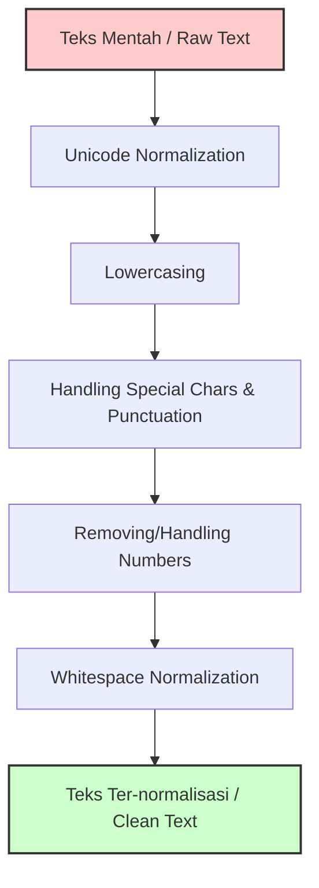

# Text Preprocessing Part 1: Text Normalization & Basic Cleaning

> **PRINSIP UTAMA:** Preprocessing teks dalam NLP adalah **KEPUTUSAN DESAIN (Design Decision)**, bukan daftar checklist wajib yang harus dieksekusi buta. Setiap tindakan pembersihan berpotensi menghapus informasi atau menambah noise baru.

---

## 1. Gambaran Besar

Dalam Natural Language Processing (NLP), komputer tidak memahami huruf atau kata; komputer hanya mengerti angka. Teks mentah dari dunia nyata (scraping web, media sosial, dokumen) sangat tidak teratur. Kata yang sama bisa muncul dalam puluhan variasi bentuk penulisan.

Jika kita langsung memasukkan teks mentah ke model machine learning, ukuran kosakata (*vocabulary size*) akan membengkak drastis secara tidak efisien, dan model gagal mengenali bahwa variasi-variasi tersebut memiliki makna yang identik.



### Alur "Masalah -> Solusi"
- **Masalah:** Komputer menganggap `"Bagus"`, `"bagus"`, dan `"BAGUS"` sebagai tiga kata yang sepenuhnya berbeda.
- **Solusi:** Lakukan *Lowercasing* untuk menyatukan representasi kata.
- **Masalah:** Teks hasil scraping memiliki spasi acak, karakter Unicode tak kasat mata, dan simbol aneh.
- **Solusi:** Aplikasikan *Unicode Normalization* dan *Whitespace Cleaning*.
- **Masalah (Efek Samping):** Menghapus tanda baca dan angka secara asal dapat merusak makna kalimat bahasa Indonesia seperti kata ulang (`anak-anak`) atau rentang harga (`Rp 50.000`).
- **Solusi:** Tentukan aturan pembersihan berdasarkan tugas akhir (*downstream task*).

---

## 2. Tujuan Belajar Terukur

Setelah menyelesaikan materi ini, kamu akan bisa:
1. Menjelaskan alasan teknis di balik kebutuhan normalisasi teks dan dampaknya terhadap *vocabulary size*.
2. Memilih teknik normalisasi yang tepat sesuai konteks aplikasi (kapan harus pakai lowercasing/hapus angka/hapus tanda baca, dan kapan **dilarang** dipakai).
3. Mengimplementasikan fungsi pembersihan teks mentah menggunakan modul bawaan Python (`re` dan `unicodedata`) tanpa bantuan library eksternal.
4. Menganalisis *failure mode* dari teknik pembersihan pada kasus teks bahasa Indonesia.

---

## 3. Prasyarat Minimum

Sebelum lanjut, pastikan kamu sudah paham operasi dasar string dan regex di Python.

### Cek Cepat Prasyarat

Uji pemahamanmu secara mandiri.

1. Apa hasil dari `'  Lari Pagi  '.strip().lower()` di Python?
2. Dalam regex Python (`import re`), apa arti dari pola `r'\s+'`?
3. Mengapa ekspresi `re.sub(r'\d+', '', 'COVID-19')` menghasilkan string `'COVID-'`?

<details>
<summary>Jawaban Cek Cepat</summary>

1. `'lari pagi'` (menghapus spasi di awal/akhir lalu diubah ke huruf kecil).
2. Memilih satu atau lebih karakter *whitespace* berturut-turut (spasi, tab, newline).
3. Pola `\d+` mencocokkan satu atau lebih digit angka (`19`) dan menggantinya dengan string kosong `''`, sehingga karakter `-` tetap tersisa.
</details>

---

## 4. Isi Sub-Materi

---

### Sub-Materi 1: Text Normalization & Lowercasing

#### 1. Masalah yang Diselesaikan
Tanpa lowercasing, model NLP menganggap kata di awal kalimat (berawalan kapital) berbeda dari kata di tengah kalimat. Ini menyebabkan *sparsity* (keterjarangan data) pada matriks fitur dan membengkaknya memori.

#### 2. Intuisi
Analogi: Menyamakan warna seragam siswa di sekolah. Semua siswa memakai warna baju yang sama agar tidak dikelompokkan berdasarkan warna baju.
*Batas Analogi:* Seragam menghilangkan identitas unik individu. Sama halnya, lowercasing menghilangkan informasi nama diri (*Named Entity*) atau emosi (TULISAN KAPITAL UNTUK TERIAK).

#### 3. Contoh Konkret Kecil
- **Input:** `"Bagus beli HP di Tokopedia. Kualitasnya sangat bagus."`
- **Proses:** `text.lower()`
- **Output:** `"bagus beli hp di tokopedia. kualitasnya sangat bagus."`

#### 4. Mekanisme
Komputer menyimpan karakter sebagai angka (*ASCII/Unicode code point*).
- Huruf `'A'` memiliki kode Unicode `65` (`U+0041`).
- Huruf `'a'` memiliki kode Unicode `97` (`U+0061`).

Fungsi `.lower()` memeriksa setiap karakter. Jika nilai kode berada dalam rentang huruf besar Unicode, nilainya digeser ke kode huruf kecil yang bersesuaian.

#### 5. Kode Minimal
```python
raw_text = "Bagus pergi ke pasar, tapi mas bagus tidak ada."

# Lowercasing standar
lowered_text = raw_text.lower()

print("Mentah  :", raw_text)
print("Lowered :", lowered_text)

# Menghitung keunikan kata (Vocabulary)
vocab_raw = set(raw_text.split())
vocab_lowered = set(lowered_text.split())

print("Jumlah vocab sebelum lowercasing:", len(vocab_raw))
print("Jumlah vocab sesudah lowercasing:", len(vocab_lowered))
```

#### 6. Jebakan & Failure Modes
- 💡 **Loss of Information (NER):** Kata `"Bagus"` (nama orang) dan `"bagus"` (kata sifat) menjadi identik secara representasi. Model *Named Entity Recognition* (NER) akan kesulitan mendeteksi nama orang jika huruf kapital dihilangkan.
- 💡 **Sentiment Analysis:** String `"BAGUS BANGET!"` memiliki intensitas emosi lebih tinggi daripada `"bagus banget"`. Lowercasing menghilangkan sinyal penekanan emosi ini.
- **Bahasa Non-Latin / Kasus Khusus:** Pada bahasa Turki, huruf `'I'` kecil adalah `'ı'` (tanpa titik), sedangkan `'İ'` besar menjadi `'i'` kecil. Fungsi `.lower()` standar di Python mengikuti konvensi baku Latin.

#### 7. Mini-Eksperimen
Ubah kode di bawah, prediksi jumlah kata unik sebelum dan sesudah `lower()`, lalu jalankan:

```python
teks = "SAYA SANGAT SANGAT SUKA Makan Nasi goreng dan makan Nasi uduk"
# Prediksi dulu: berapa len(set(teks.split())) vs len(set(teks.lower().split()))?
# Jalankan sendiri, lalu bandingkan dengan prediksimu
```

#### 8. Cek Pemahaman
1. Kapan kamu **TIDAK** boleh menggunakan lowercasing pada tahap preprocessing?
2. Diberikan list `words = ["Budi", "budi", "BUDI"]`. Tuliskan satu baris Python comprehension untuk menghasilkan list berisi elemen unik yang sudah di-lowercased!

<details>
<summary>Jawaban</summary>

1. Saat mengerjakan tugas yang membutuhkan informasi huruf kapital, seperti *Named Entity Recognition* (NER), ekstraksi nama/merek, atau *Sentiment Analysis* yang memanfaatkan intensitas huruf kapital.
2. `list(set(w.lower() for w in words))` -> menghasilkan `['budi']`.
</details>

---

### Sub-Materi 2: Unicode Normalization

#### 1. Masalah yang Diselesaikan
Karakter dengan tampilan visual yang sama bisa disimpan oleh sistem komputer menggunakan byte/code point yang berbeda. Kasus ini sering muncul pada teks hasil scraping dari PDF, web, atau input dari berbagai sistem operasi.

#### 2. Intuisi
Analogi: Menulis huruf `é` dengan cara langsung menempel stempel `é`, dibandingkan dengan cara mengetik huruf `e` lalu menggambar tanda aksen `´` di atasnya. Keduanya terlihat sama persis di layar, tetapi di kertas disimpan dengan metode berbeda.

#### 3. Contoh Konkret Kecil
- **String A:** `"café"` (menggunakan 1 karakter `é` -> `U+00E9`)
- **String B:** `"café"` (menggunakan `e` + combining accent `´` -> `U+0065` + `U+0301`)
- **Proses:** Visual identik, tetapi `String A == String B` bernilai `False`!

#### 4. Mekanisme
Unicode konsorsium mendefinisikan 4 standar normalisasi:
1. **NFC (Canonical Composition):** Menggabungkan karakter terpisah menjadi satu kode gabungan jika memungkinkan.
2. **NFD (Canonical Decomposition):** Memecah karakter gabungan menjadi karakter dasar + aksen terpisah.
3. **NFKC / NFKD (Compatibility):** Meratakan variasi gaya penulisan (misalnya mengubah karakter pecahan `½` menjadi `1/2` atau huruf tebal/italic ke bentuk standar).

```
         Decomposition (NFD)
      ------------------------>
 "é"                            "e" + "´"
 (U+00E9)                      (U+0065 U+0301)
      <------------------------
          Composition (NFC)
```

#### 5. Kode Minimal
```python
import unicodedata

# String dengan e-acute tunggal (NFC)
str1 = "café" 

# String dengan e + combining accent (NFD)
str2 = "cafe\u0301"

print("Tampilan Visual str1:", str1)
print("Tampilan Visual str2:", str2)
print("Panjang str1:", len(str1))  # 4
print("Panjang str2:", len(str2))  # 5
print("Apakah str1 == str2?", str1 == str2) # False

# Solusi: Unicode Normalization ke NFC
str2_normalized = unicodedata.normalize('NFC', str2)
print("Panjang str2 setelah NFC:", len(str2_normalized)) # 4
print("Apakah str1 == str2_normalized?", str1 == str2_normalized) # True
```

#### 6. Jebakan & Failure Modes
- Jika kamu melewatkan langkah ini, pencarian kata (*lookup dictionary*) atau ekstraksi kata kunci bisa gagal total hanya karena perbedaan encoding antar pengguna.
- Mode `NFKC`/`NFKD` bisa mengubah arti pada domain spesifik, misalnya mengubah simbol matematika atau format superscript/subscript secara ireversibel.

#### 7. Mini-Eksperimen
Jalankan kode berikut dan amati bagaimana `NFKC` mengubah bentuk angka pecahan:

```python
import unicodedata

text_fraction = "Resep: ½ sendok teh garam"
normalized_nfkc = unicodedata.normalize('NFKC', text_fraction)

print("Sebelum:", text_fraction, "| Panjang:", len(text_fraction))
print("Sesudah NFKC:", normalized_nfkc, "| Panjang:", len(normalized_nfkc))
```

#### 8. Cek Pemahaman
1. Apa perbedaan mendasar antara bentuk normalisasi NFC dan NFD?
2. Jika sebuah dokumen mengandung string `"2²"` dan kamu menggunakan normalisasi `NFKC`, apa hasil string yang diperoleh?

<details>
<summary>Jawaban</summary>

1. NFC menggabungkan karakter terpisah menjadi satu karakter composite, sedangkan NFD memecah karakter composite menjadi karakter dasar beserta karakter kombinasinya (seperti aksen).
2. String akan berubah menjadi `"22"` karena NFKC mengubah karakter superscript `²` menjadi angka standar `2`.
</details>

---

### Sub-Materi 3: Cleaning Noise (Punctuation, Numbers, Special Chars, & Whitespace)

#### 1. Masalah yang Diselesaikan
Teks mentah sering kali dikotori oleh spasi berlebih, tanda baca bertumpuk, angka yang tidak relevan dengan preferensi analisis, serta karakter khusus/HTML entity.

#### 2. Intuisi
Menyaring kerikil dan pasir dari beras sebelum dimasak. Kerikil adalah tanda baca/spasi acak yang tidak memiliki nilai informasi untuk tugas klasifikasi topik.
*Batas Analogi:* Dalam kalimat tertentu, "kerikil" seperti tanda tanya `?` adalah penanda utama bahwa kalimat tersebut adalah pertanyaan (Intent Classification).

#### 3. Contoh Konkret Kecil
- **Input:** `"Diskon  50%!!  Untuk  anak-anak...   "`
- **Proses:** Hapus tanda baca acak + hapus angka + bersihkan spasi ganda.
- **Output (Standard Naive):** `"Diskon Untuk anakanak"`

#### 4. Mekanisme
Menggunakan Regular Expressions (Regex) untuk mencari pola karakter berdasarkan kelasnya:
- `\d+` : Mencocokkan satu atau lebih karakter digit (`0-9`).
- `[^\w\s]` : Mencocokkan semua karakter yang **BUKAN** huruf/angka (`\w`) dan **BUKAN** spasi (`\s`).
- `\s+` : Mencocokkan satu atau lebih spasi/tab/newline berurutan.

#### 5. Kode Minimal
```python
import re

raw_doc = "  Diskon  50%!!  Hubungi: test@email.com untuk promo anak-anak. \n"

# 1. Normalisasi Whitespace (Ganti spasi berlebih/newline dengan 1 spasi)
clean_space = re.sub(r'\s+', ' ', raw_doc).strip()
print("1. Space Normalized :", repr(clean_space))

# 2. Menghapus Angka
no_numbers = re.sub(r'\d+', '', clean_space)
print("2. No Numbers       :", no_numbers)

# 3. Menghapus Tanda Baca (Pendekatan Naif)
no_punc_naive = re.sub(r'[^\w\s]', '', clean_space)
print("3. Naive No Punct   :", no_punc_naive)
```

#### 6. Jebakan & Failure Modes (PENTING untuk Bahasa Indonesia)
- 💡 **Kata Ulang Bahasa Indonesia:** Menghapus tanda baca menggunakan regex `[^\w\s]` pada kata `"anak-anak"` atau `"batu-batan"` akan mengubahnya menjadi `"anakanak"` atau `"batubatan"`. Kata ini menjadi *Out-Of-Vocabulary* (OOV) atau kehilangan arti baku!
- 💡 **Aturan Penggantian Tanda Baca:** Lebih aman mengganti tanda strip `-` dengan spasi (`"anak anak"`) atau mempertahankan tanda baca tertentu daripada menghapusnya langsung tanpa pengganti.
- 💡 **Data Keuangan / Angka:** Pada tugas klasifikasi sentimen pasar atau deteksi penipuan, angka seperti `"Rp 500.000"` sangat krusial. Menghapus angka membuat data kehilangan konteks nominal.

#### 7. Mini-Eksperimen
Prediksi hasil dari dua pendekatan pembersihan tanda baca pada kalimat bahasa Indonesia berikut:

```python
import re

text = "Ibu membeli baju-baju baru seharga Rp 150.000!"

# Pendekatan A: Langsung hapus tanda baca dengan string kosong
res_a = re.sub(r'[^\w\s]', '', text)

# Pendekatan B: Ganti tanda baca dengan satu spasi dulu, baru rapikan spasi
res_b = re.sub(r'\s+', ' ', re.sub(r'[^\w\s]', ' ', text)).strip()

print("Pendekatan A:", res_a)
print("Pendekatan B:", res_b)
# Mana yang mempertahankan token "baju" dan "baju" secara terpisah?
```

#### 8. Cek Pemahaman
1. Mengapa ekspresi `re.sub(r'[^\w\s]', '', 'tidak/bisa')` dapat menimbulkan masalah baru dalam pemrosesan teks?
2. Tulis pola regex untuk menghapus semua karakter khusus/tanda baca **KECUALI** tanda hubung `-`!

<details>
<summary>Jawaban</summary>

1. Karena kata `"tidak"` dan `"bisa"` akan tergabung menjadi satu kata tidak baku `"tidakbisa"`, sehingga tokenizer tidak dapat memisahkan kedua kata tersebut.
2. Pola regex: `r'[^\w\s-]'` (memasukkan tanda `-` ke dalam negasi kelas karakter).
</details>

---

## 5. Mini-Proyek Penutup

**Kasus:** Pembersihan Dataset Ulasan Produk E-commerce (Bahasa Indonesia).

### 1. Definisi Masalah
Kita menerima data ulasan mentah yang dipenuhi spasi tidak teratur, kapitalisasi acak, angka nominal, dan kata ulang bersambung tanda baca. Tujuan kita adalah membuat pipeline preprocessing awal (*baseline*).

### 2. Dataset Mentah (Baseline)
```python
raw_reviews = [
    "  Barang BANYAK RUSAK!!! Sangat kecewa...  ",
    "Pengiriman cepat, produk-produk original 100% Bagus!",
    "Harga Rp 50.000,- tapi kualitas seperti Rp 500.000 BINTANG 5 "
]
```

### 3. Metric Evaluasi
*Vocabulary Size* (Jumlah kata unik) dan Tingkat Keutuhan Token (*Token Integrity* — tidak ada kata ganjil akibat penghapusan tanda baca yang salah).

### 4. Implementasi Pipeline Preprocessing
```python
import re
import unicodedata

def preprocess_text_v1(text: str) -> str:
    # Step 1: Unicode Normalization (NFC)
    text = unicodedata.normalize('NFC', text)
    
    # Step 2: Lowercasing
    text = text.lower()
    
    # Step 3: Handling Kata Ulang (Ganti '-' dengan spasi agar token tidak menyatu)
    text = re.sub(r'-', ' ', text)
    
    # Step 4: Menghapus Tanda Baca Lainnya (Kecuali Alfanumerik dan Spasi)
    text = re.sub(r'[^\w\s]', '', text)
    
    # Step 5: Menghapus Angka (Asumsi: topik ulasan tidak fokus pada angka)
    text = re.sub(r'\d+', '', text)
    
    # Step 6: Whitespace Normalization
    text = re.sub(r'\s+', ' ', text).strip()
    
    return text

# Eksekusi Pipeline
cleaned_reviews = [preprocess_text_v1(rev) for rev in raw_reviews]

for i, (before, after) in enumerate(zip(raw_reviews, cleaned_reviews)):
    print(f"[{i+1}] MENTAH : {before}")
    print(f"    BERSIH : {after}\n")
```

### 5. Error Analysis & Perbaikan Satu Faktor
- **Temuan Error:** Kata `"produk-produk"` berubah menjadi `"produk produk"`. Ini jauh lebih baik daripada `"produkproduk"`, tetapi menghasilkan dua token identik.
- **Rencana Perbaikan:** Tambahkan aturan khusus jika ingin mempertahankan struktur kata ulang atau menangani karakter mata uang sebelum angka dihilangkan.

---

## 6. Kesalahan Umum & Cara Debugging

| Symptom (Gejala Error) | Root Cause (Penyebab Utama) | Cara Debugging / Solusi |
| :--- | :--- | :--- |
| Kata gabung aneh seperti `anakanak` atau `tidakbisa`. | Menghapus tanda baca tanpa memberikan spasi pengganti (`re.sub(r'[^\w\s]', '', text)`). | Ganti tanda baca dengan spasi terlebih dahulu: `re.sub(r'[^\w\s]', ' ', text)`, lalu lakukan *whitespace normalization*. |
| String terlihat sama tapi `dict_key` tidak ditemukan / `==` bernilai `False`. | Perbedaan encoding Unicode (NFC vs NFD). | Aplikasikan `unicodedata.normalize('NFC', text)` di awal seluruh pipeline. |
| Performa model NER / Analisis Sentimen anjlok setelah preprocessing. | Lowercasing membabi buta pada task yang butuh informasi kapital. | Matikan langkah lowercasing atau gunakan pendekatan *case-sensitive feature representation*. |

---

## 7. Cheat Sheet 1 Halaman

```python
import re
import unicodedata

# 1. Unicode Normalization
text = unicodedata.normalize('NFC', text)

# 2. Lowercasing
text = text.lower()

# 3. Menghapus Angka
text = re.sub(r'\d+', '', text)

# 4. Menghapus Tanda Baca (Aman untuk Spasi)
text = re.sub(r'[^\w\s]', ' ', text)

# 5. Whitespace Normalization (Hapus newline, tab, spasi ganda)
text = re.sub(r'\s+', ' ', text).strip()
```

### Aturan Keputusan Preprocessing (Rule of Thumb) 💡
- **Klasifikasi Topik Umum:** Lowercasing = **YA**, Hapus Tanda Baca = **YA**, Hapus Angka = **YA**.
- **Named Entity Recognition (NER):** Lowercasing = **TIDAK**, Hapus Tanda Baca = **SELEKTIF**, Hapus Angka = **TIDAK**.
- **Sentiment Analysis (Media Sosial):** Lowercasing = **SELEKTIF**, Hapus Tanda Baca (Punctuation/Emoji) = **TIDAK** (Simbol `!` dan `?` adalah sinyal emosi).

---

## 8. Jembatan ke Materi Berikutnya

Di bagian ini, kita baru membersihkan teks di tingkat **karakter dan string tunggal**. Namun, teks bersih kita masih berupa satu kalimat utuh. 

Komputer belum bisa mengolah statistik kata jika teks belum dipotong-potong menjadi satuan token terpisah (*Tokenization*), dibersihkan dari kata-kata yang tidak bermakna (*Stopwords*), dan disederhanakan ke bentuk kata dasarnya (*Stemming/Lemmatization*).

Di **Part 2**, kita akan membahas teknik pemotongan kata (Tokenization), penanganan Stopwords, Contractions, Stemming, serta Lemmatization pada teks Bahasa Indonesia dan Inggris.

---

## 9. Referensi Kanonik

1. **Speech and Language Processing** — Daniel Jurafsky & James H. Martin (Seksi: *Text Normalization, Words, Corpora*).
2. **Python Standard Library Documentation** — Modul `re` (Regular expression operations) & `unicodedata` (Unicode Database).
3. **NLTK Documentation** — Bagian *Accessing Text Corpora and Lexical Resources*.

### Cara Memverifikasi Sendiri
Gunakan fungsi bawaan Python `ord()` untuk memeriksa nilai Unicode code point dari karakter yang mencurigakan:
```python
char = 'é'
print(f"Character: {char} | Code Point: U+{ord(char):04X}")
```

---

## 10. Glosarium Istilah

- **Code Point:** Nilai numerik unik yang diberikan oleh standar Unicode untuk mewakili suatu karakter tertentu.
- **Downstream Task:** Tugas/aplikasi utama NLP yang berada di akhir pipeline (misalnya: Klasifikasi Sentimen, Penerjemahan Bahasa, NER).
- **Lowercasing:** Proses mengonversi seluruh huruf kapital dalam teks menjadi huruf kecil.
- **Named Entity Recognition (NER):** Sub-tugas NLP untuk mendeteksi dan mengategorikan entitas bernama (nama orang, lokasi, organisasi) dalam teks.
- **Out-Of-Vocabulary (OOV):** Kata yang muncul pada data uji/input tetapi tidak ada di dalam daftar kata yang dipelajari model saat pelatihan.
- **Sparsity:** Kondisi ketika sebagian besar nilai dalam matriks data bernilai nol, membuat representasi data tidak efisien.
- **Unicode Normalization:** Proses mengonversi teks dengan variasi encoding Unicode ke bentuk standar yang konsisten.

---

## 11. Log Verifikasi

Daftar klaim/heuristik yang diberi label penanda dalam materi ini:

1. `💡 Loss of Information (NER)` — Heuristik: Lowercasing menghilangkan sinyal kapitalisasi yang krusial untuk ekstraksi entitas bernama.
2. `💡 Sentiment Analysis` — Heuristik: Kapitalisasi penuh sering menandakan intensitas emosi/teriakan pada teks media sosial.
3. `💡 Kata Ulang Bahasa Indonesia` — Konvensi khusus bahasa: Menghapus tanda hubung `-` secara Naive pada bahasa Indonesia merusak kata ulang.
4. `💡 Aturan Penggantian Tanda Baca` — Heuristik: Mengganti tanda baca dengan spasi jauh lebih aman daripada langsung menghapusnya dengan string kosong.
5. `💡 Data Keuangan / Angka` — Konteks domain: Hapus angka merusak informasi pada domain finansial atau teknis.
6. `💡 Aturan Keputusan Preprocessing (Rule of Thumb)` — Heuristik umum berdasarkan pengalaman praktis dalam rekayasa sistem NLP.