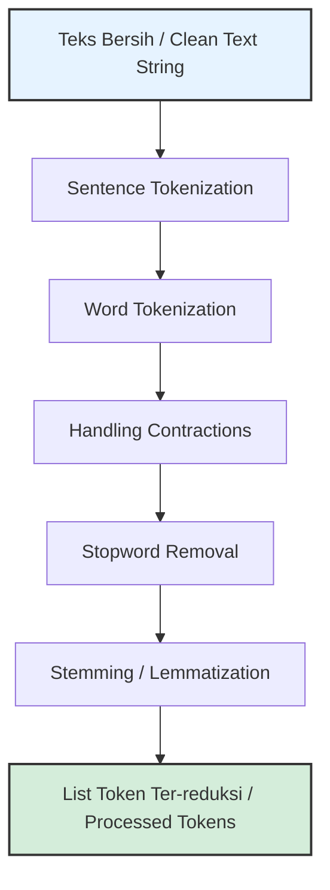

# Text Preprocessing Part 2: Structural & Morphological Processing

> **PRINSIP UTAMA:** Memotong string menjadi token dan mereduksi kata ke bentuk dasarnya mengubah tingkat abstraksi teks. Keputusan pada tahap ini menentukan apakah model mengolah kata utuh, makna tata bahasa, atau sekadar akar kata.

---

## 1. Gambaran Besar

Setelah teks dibersihkan dari spasi acak dan noise tingkat karakter (Part 1), teks masih berbentuk satu alur string utuh. Komputer membutuhkan unit-unit terkecil bermakna (*tokens*) untuk melakukan komputasi numerik. 

Pemrosesan tingkat struktur dan morfologi ini membagi kalimat menjadi kata/kalimat, menyaring kata-kata tanpa nilai relevansi tinggi, serta menyederhanakan variasi kata berimbuhan.



### Alur "Masalah -> Solusi"
- **Masalah:** Komputer melihat `"Saya belajar NLP"` sebagai satu string sepanjang 16 karakter, bukan 3 unit kata.
- **Solusi:** Aplikasikan *Word Tokenization* untuk memecah string menjadi list kata.
- **Masalah:** Kata-kata seperti `"yang"`, `"di"`, `"dan"` muncul sangat dominan dan mengaburkan topik utama dokumen.
- **Solusi:** Aplikasikan *Stopword Removal* selektif.
- **Masalah:** Kata `"makanan"`, `"memakan"`, dan `"dimakan"` dihitung sebagai tiga kata unik yang terpisah, padahal akar maknanya sama.
- **Solusi:** Aplikasikan *Stemming* atau *Lemmatization* untuk memetakan variasi kata ke satu bentuk dasar.

---

## 2. Tujuan Belajar Terukur

Setelah menyelesaikan materi ini, kamu akan bisa:
1. Membedakan pemotongan kata tingkat *Word Tokenization* dan *Sentence Tokenization* beserta penanganan *edge cases*-nya.
2. Mengubah bentuk singkatan (*contractions*) menjadi bentuk panjang sebelum pemotongan token.
3. Menyusun strategi *Stopword Removal* yang aman tanpa merusak konteks negasi pada analisis sentimen.
4. Menganalisis perbedaan teknis, kelebihan, dan kerugian antara *Stemming* (rule-based heuristic) dan *Lemmatization* (lexicon & POS-based).
5. Mengimplementasikan pipeline tokenisasi dan reduksi morfologi dalam Python.

---

## 3. Prasyarat Minimum

Sebelum lanjut, pastikan kamu sudah menguasai materi Part 1 (Lowercasing, Regex dasar, dan String cleaning).

### Cek Cepat Prasyarat

1. Apa output dari `re.findall(r'\w+', 'Budi pergi!')`?
2. Apa bedanya tipe data `list` dan `set` di Python ketika digunakan untuk memfilter stopwords?
3. Mengapa ekspresi `text.split(' ')` bisa menghasilkan string kosong `''` jika ada spasi ganda?

<details>
<summary>Jawaban Cek Cepat</summary>

1. `['Budi', 'pergi']` (tanda seru `!` diabaikan karena bukan karakter alfanumerik `\w`).
2. Pencarian elemen (`x in container`) pada `set` memiliki kompleksitas waktu $O(1)$ (sangat cepat), sedangkan pada `list` memiliki kompleksitas $O(N)$ (lambat untuk dataset besar).
3. Karena `split(' ')` memotong tepat di setiap karakter spasi tunggal. Dua spasi berurutan menghasilkan elemen kosong di antara kedua spasi tersebut.
</details>

---

## 4. Isi Sub-Materi

---

### Sub-Materi 1: Tokenization (Sentence & Word Tokenization)

#### 1. Masalah yang Diselesaikan
Model machine learning memproses unit kata atau kalimat terpisah. Tanpa tokenisasi yang benar, tanda baca yang melekat pada kata (misal `"Jakarta."` atau `"makan?"`) dihitung sebagai kata baru yang berbeda dari `"Jakarta"` atau `"makan"`.

#### 2. Intuisi
Analogi: Menggunting rantai kata menjadi cincin-cincin kata terpisah.
*Batas Analogi:* Jika kamu menggunting secara asal di setiap spasi, frasa majemuk seperti `"rumah sakit"` atau singkatan `"Dr. Soetomo"` akan terpotong dan kehilangan keutuhan artinya.

#### 3. Contoh Konkret Kecil
- **Input:** `"Dr. H. Budi pergi ke S.T.P. Harganya Rp 2.000."`
- **Sentence Tokenization:** `["Dr. H. Budi pergi ke S.T.P.", "Harganya Rp 2.000."]`
- **Word Tokenization:** `["Dr.", "H.", "Budi", "pergi", "ke", "S.T.P.", "Harganya", "Rp", "2.000", "."]`

#### 4. Mekanisme
1. **Naive Split (`text.split()`):** Memotong string hanya berdasarkan *whitespace*. Sederhana tetapi gagal memisahkan tanda baca dari kata.
2. **Regex-based Tokenizer:** Menggunakan pola regex `r'\w+|[^\w\s]'` untuk memisahkan kata alfanumerik dan simbol tanda baca sebagai token mandiri.
3. **Deterministic State Machine / Rule-based Tokenizer (NLTK Punkt):** Menggunakan model kaidah bahasa yang mengenali pola singkatan (seperti `"Dr."`, `"Prof."`, `"N.B."`) agar titik di akhir singkatan tidak dianggap sebagai akhir kalimat.

#### 5. Kode Minimal
```python
import re

text = "Dr. Andi membeli HP di toko. Harganya Rp 2.500.000, sangat murah!"

# 1. Naive Split (Gagal memisahkan tanda baca)
naive_tokens = text.split()
print("Naive Split     :", naive_tokens[:5])

# 2. Regex Tokenizer (Memisahkan kata dan tanda baca)
# Pola: tangkap kata alfanumerik (\w+) ATAU simbol non-spasi ([^\w\s])
regex_tokens = re.findall(r'\w+|[^\w\s]', text)
print("Regex Tokenizer :", regex_tokens)

# 3. Simple Sentence Tokenizer menggunakan Lookbehind Regex
# Memotong spasi yang didahului titik, tanda tanya, atau tanda seru
sentences = re.split(r'(?<=[.!?])\s+', text)
print("Sentence Tokens :", sentences)
```

#### 6. Jebakan & Failure Modes
- 💡 **Ambiguitas Tanda Titik:** Tanda titik `.` digunakan untuk akhir kalimat, singkatan nama/gelar (`"M.Sc."`), dan pemisah ribuan pada format angka Indonesia (`"Rp 10.000"`). Tokenizer sederhana sering kali salah memotong kalimat di tengah angka nominal atau singkatan.
- 💡 **Domain-Specific Tokenization:** Pada teks pemrograman (source code), simbol seperti `->` atau `==` harus dianggap 1 token, bukan 2 token terpisah.

#### 7. Mini-Eksperimen
Prediksi jumlah token hasil `re.findall(r'\w+|[^\w\s]', text)` pada string di bawah ini:

```python
import re

teks = "Email saya: Budi-123@email.com!"
tokens = re.findall(r'\w+|[^\w\s]', teks)

print("Tokens:", tokens)
print("Jumlah token:", len(tokens))
# Amati bagaimana karakter '-' dan '@' dipisah menjadi token tersendiri!
```

#### 8. Cek Pemahaman
1. Apa kelemahan utama fungsi `text.split()` jika digunakan langsung sebagai word tokenizer?
2. Mengapa regex `r'\w+'` kurang ideal jika kita ingin mempertahankan tanda baca sebagai token terpisah dalam tugas *Parsing Syntax*?

<details>
<summary>Jawaban</summary>

1. `text.split()` tidak memisahkan tanda baca dari kata (misalnya `"akhir."` tetap menyatukan kata `"akhir"` dengan titik `.` sebagai satu token).
2. Regex `r'\w+'` hanya mengambil karakter alfanumerik dan secara otomatis membuang/menghapus seluruh tanda baca.
</details>

---

### Sub-Materi 2: Stopword Removal & Handling Contractions

#### 1. Masalah yang Diselesaikan
1. **Contractions (Singkatan/Keratan):** Frasa seperti `"don't"` atau `"it's"` (bahasa Inggris) membingungkan tokenizer jika dipecah menjadi `["don", "'", "t"]`.
2. **Stopwords (Kata Fungsional):** Kata-kata seperti `"yang"`, `"di"`, `"dan"`, `"ke"` muncul dengan frekuensi sangat tinggi tetapi memiliki nilai pembeda (*discriminative power*) yang rendah untuk klasifikasi topik dokumen.

#### 2. Intuisi
Analogi: Menyaring air keruh dengan saringan halus. Stopwords adalah air penjelas tata bahasa, sedangkan kata-kata bermakna (*content words*) adalah ampas kopi yang ingin kita analisis.
*Batas Analogi:* Dalam analisis sentimen, kata-kata penegas seperti `"sangat"` atau negasi `"tidak"` dianggap "air" oleh saringan standar, padahal itulah penentu utama sentimen.

#### 3. Contoh Konkret Kecil
- **Input:** `"Saya tidak suka produk ini karena sangat buruk"`
- **Handling Contractions (Inggris):** `"don't like"` -> `"do not like"`
- **Stopword Removal Naif:** `["suka", "produk", "buruk"]` (Kata `"tidak"` terhapus -> **Makna terbalik!**)
- **Stopword Removal Aman:** `["tidak", "suka", "produk", "buruk"]`

#### 4. Mekanisme
- **Contraction Expansion:** Menggunakan pencarian kamus pemetaan (*dictionary lookup*) dengan Regex untuk mengganti singkatan sebelum tokenisasi.
- **Stopword Filtering:** Memeriksa setiap token dalam list. Jika token ada di dalam daftar *stopword set*, token tersebut dibuang.

$$\text{Filtered Tokens} = \{ t \in \text{Tokens} \mid t \notin \text{Stopword Set} \}$$

#### 5. Kode Minimal
```python
import re

# 1. Handling Contractions (Bahasa Inggris)
contractions_db = {
    "don't": "do not",
    "can't": "cannot",
    "it's": "it is",
    "i'm": "i am"
}

def expand_contractions(text: str, c_dict: dict) -> str:
    # Buat regex pattern dari kunci-kunci dictionary
    pattern = re.compile(r'\b(' + '|'.join(re.escape(k) for k in c_dict.keys()) + r')\b')
    return pattern.sub(lambda m: c_dict[m.group(0)], text.lower())

raw_en = "It's good, but I can't buy it."
expanded_en = expand_contractions(raw_en, contractions_db)
print("Expanded English:", expanded_en)

# 2. Stopword Removal Bahasa Indonesia (Custom Set + Aman Negasi)
# Kumpulan stopword standar
default_stopwords = {"saya", "ini", "karena", "yang", "dan", "di", "ke", "sangat"}

# Kata negasi yang WAJIB dikecualikan dari pembuangan
negation_words = {"tidak", "bukan", "belum", "tanpa"}

# Stopword set akhir
safe_stopwords = default_stopwords - negation_words

tokens = ["saya", "tidak", "suka", "karena", "sangat", "buruk"]
filtered_tokens = [t for t in tokens if t not in safe_stopwords]

print("Tokens Asli     :", tokens)
print("Filtered Tokens :", filtered_tokens)
```

#### 6. Jebakan & Failure Modes
- 💡 **Negasi Hilang (Sentiment Analysis):** Menghapus kata `"tidak"` atau `"bukan"` mengubah sentimen negatif menjadi positif secara tidak sengaja.
- 💡 **Loss of Context pada Transformer/Deep Learning:** Model modern seperti BERT, RoBERTa, atau LLM **DILARANG** menggunakan stopword removal. Transformer membutuhkan urutan tata bahasa lengkap dan posisi kata untuk membangun representasi konteks (*Attention Mechanism*).
- 💡 **Domain-Specific Stopwords:** Kata `"pasien"` atau `"obat"` adalah stopword pada dataset medis (karena muncul di semua dokumen), tetapi merupakan kata kunci penting pada dataset berita umum.

#### 7. Mini-Eksperimen
Jalankan kode pemutakhiran daftar stopword berikut dan amati beda hasilnya:

```python
stopwords_standard = {"yang", "di", "dan", "tidak", "sangat"}
tokens = ["makanan", "ini", "tidak", "enak"]

# Kasus A: Pakai stopword standar
clean_a = [t for t in tokens if t not in stopwords_standard]

# Kasus B: Kecualikan 'tidak' dari stopword
stopwords_custom = stopwords_standard - {"tidak"}
clean_b = [t for t in tokens if t not in stopwords_custom]

print("Kasus A (Hilang negasi):", clean_a)
print("Kasus B (Negasi aman)  :", clean_b)
```

#### 8. Cek Pemahaman
1. Kapan kamu harus mengeksekusi *Handling Contractions* dalam pipeline preprocessing?
2. Mengapa model arsitektur Transformer (seperti BERT) tidak memerlukan tahap Stopword Removal?

<details>
<summary>Jawaban</summary>

1. *Handling Contractions* harus dieksekusi di awal sebelum tokenisasi atau lowercasing, agar bentuk frasa lengkap dapat dipecah menjadi token baku secara konsisten.
2. Karena Transformer menggunakan *self-attention mechanism* yang memanfaatkan urutan seluruh kata (termasuk kata sambung/stopwords) untuk memahami hubungan konteks dan struktur tata bahasa secara utuh.
</details>

---

### Sub-Materi 3: Stemming & Lemmatization

#### 1. Masalah yang Diselesaikan
Kata-kata berimbuhan seperti `"memakan"`, `"makanan"`, `"dimakan"`, `"kecewa"`, `"mewajibkan"` membengkakkan ukuran *vocabulary*. Model memperlakukan kata-kata tersebut sebagai entitas yang tidak saling berhubungan, padahal semuanya berbagi akar kata dasar yang sama.

#### 2. Intuisi
- **Stemming:** Memotong awalan dan akhiran secara kasar berpatokan pada aturan statistik/heuristik (seperti memakai pisau pemotong). Hasil pemotongan belum tentu merupakan kata valid dalam kamus.
- **Lemmatization:** Mencari bentuk kata dasar resmi (lemma) dengan melihat kamus tata bahasa dan konteks kelas kata (*Part-of-Speech / POS*).

*Batas Analogi:* Stemming sangat cepat tetapi sering menghasilkan kata "cacat" (misal `"memperbaiki"` -> `"baik"` vs `"universitas"` -> `"univers"`). Lemmatization akurat tetapi membutuhkan sumber daya komputasi dan kamus bahasa yang lengkap.

#### 3. Contoh Konkret Kecil
- **Kata:** `"berlari-lari"`, `"memperbaiki"` | `"running"`, `"better"`
- **Hasil Stemming:** `"lari"`, `"baik"` | `"run"`, `"better"` (Porter Stemmer gagal memetakan 'better')
- **Hasil Lemmatization:** `"lari"`, `"baik"` | `"run"`, `"good"` (Dengan POS Tag: Adjective)

#### 4. Mekanisme
1. **Stemming (Algoritma Nazief & Adriani / Porter):**
   Menerapkan urutan aturan pemotongan (*rule-based sequence*):
   $$\text{Teks Berimbuhan} \xrightarrow{\text{Hapus Infleksi}} \xrightarrow{\text{Hapus Awalan}} \xrightarrow{\text{Hapus Akhiran}} \text{Stem}$$
2. **Lemmatization (Lexicon & POS Lookup):**
   Memeriksa tabel pustaka kata (*Morphological Analysis*) berdasarkan pasangan `(Token, POS_Tag)`:
   $$\text{Lemma} = \text{LookupTable}(\text{Token}=\text{"better"}, \text{POS}=\text{ADJ}) \rightarrow \text{"good"}$$

#### 5. Kode Minimal
```python
# Demonstrasi Stemming vs Lemmatization (Bahasa Inggris bawaan NLTK)
import nltk
from nltk.stem import PorterStemmer, WordNetLemmatizer

# Inisialisasi
stemmer = PorterStemmer()
lemmatizer = WordNetLemmatizer()

words = ["running", "runs", "ran", "better", "studies"]

print(f"{'Kata Asli':<12} | {'Stemming':<12} | {'Lemmatization':<12}")
print("-" * 42)

for w in words:
    stem_val = stemmer.stem(w)
    # Lemmatization butuh acuan POS tag ('v' untuk verb, 'a' untuk adjective)
    pos_type = 'a' if w == 'better' else 'v'
    lemma_val = lemmatizer.lemmatize(w, pos=pos_type)
    
    print(f"{w:<12} | {stem_val:<12} | {lemma_val:<12}")
```

> **Catatan Bahasa Indonesia:** Untuk stemming Bahasa Indonesia, library kanonik yang biasa digunakan adalah `Sastrawi` (berdasarkan Algoritma Nazief-Adriani / CS Stemmer).

#### 6. Jebakan & Failure Modes
- 💡 **Overstemming:** Dua kata dengan akar berbeda dipotong menjadi stem yang sama secara keliru. Contoh: `"universitas"` dan `"universe"` sama-sama dipotong menjadi `"univers"`.
- 💡 **Understemming:** Dua kata dari akar yang sama gagal dipotong ke bentuk dasar yang seragam.
- 💡 **Bottleneck Performa (Bahasa Indonesia):** Library stemming Bahasa Indonesia seperti Sastrawi menguji setiap pemotongan imbuhan terhadap pencarian kamus (*dictionary lookup*). Ini membuat proses stemming sangat **lambat** jika dijalankan pada jutaan baris data tanpa paralelisasi.

#### 7. Mini-Eksperimen
Amati perbedaan logika pemotongan kata berikut:

```python
from nltk.stem import PorterStemmer

stemmer = PorterStemmer()
sample_words = ["organization", "organize", "organizing"]

stems = [stemmer.stem(w) for w in sample_words]
print("Kata Asli :", sample_words)
print("Hasil Stem:", stems)
# Apakah hasilnya kata valid dalam bahasa Inggris? (organ)
```

#### 8. Cek Pemahaman
1. Apa perbedaan utama input yang dibutuhkan oleh *Lemmatizer* dibandingkan *Stemmer*?
2. Sebutkan risiko utama penggunaan *Stemming* pada sistem mesin pencari (*Search Engine*)!

<details>
<summary>Jawaban</summary>

1. *Lemmatizer* membutuhkan informasi kelas kata (*Part-of-Speech Tag*) dan tabel kamus (*lexicon*), sedangkan *Stemmer* hanya membutuhkan string token dan aturan pemotongan pola imbuhan.
2. Risiko *Overstemming*: Kata pencarian yang berbeda (misalnya `"organik"` dan `"organisasi"`) bisa terpotong ke akar kata yang sama, sehingga mesin pencari menampilkan hasil pencarian yang tidak relevan.
</details>

---

## 5. Mini-Proyek Penutup

**Kasus:** Preprocessing Teks Berita & Ulasan untuk Baseline Model Klasifikasi.

### 1. Definisi Masalah
Kita ingin memproses sekumpulan teks mentah ulasan produk bahasa Indonesia menjadi daftar token bersih ter-stemming yang siap dimasukkan ke tahap *Text Representation* (Bag-of-Words / TF-IDF).

### 2. Dataset Mentah
```python
raw_documents = [
    "Pembeli TIDAK menyukai pelayanan toko yang sangat lambat ini!",
    "Produk-produknya original, pengirimannya super cepat dan memuaskan."
]
```

### 3. Metric Evaluasi
- **Ukuran Vocabulary ($\vert{}V\vert{}$):** Penurunan jumlah kata unik sebelum dan sesudah reduksi morfologi.
- **Integritas Makna Negasi:** Memastikan kata negasi tidak terbuang.

### 4. Implementasi Pipeline Preprocessing Part 2
```python
import re
import unicodedata

# Pustaka stopword khusus yang memelihara kata negasi
STOPWORDS_ID = {
    "yang", "di", "ke", "dari", "ini", "itu", "dan", "atau", "yang",
    "dengan", "untuk", "pada", "adalah", "sebagai", "sangat"
}
NEGATIONS = {"tidak", "bukan", "belum", "tanpa"}
FINAL_STOPWORDS = STOPWORDS_ID - NEGATIONS

def pipeline_preprocessing_part2(text: str) -> list[str]:
    # 1. Normalisasi & Lowercasing
    text = unicodedata.normalize('NFC', text).lower()
    
    # 2. Tangani Kata Ulang (Ganti '-' dengan spasi)
    text = re.sub(r'-', ' ', text)
    
    # 3. Word Tokenization via Regex (Memisahkan kata & mengabaikan tanda baca)
    tokens = re.findall(r'\b\w+\b', text)
    
    # 4. Stopword Removal (Dengan proteksi kata negasi)
    filtered_tokens = [t for t in tokens if t not in FINAL_STOPWORDS]
    
    # 5. Menghapus token angka murni
    clean_tokens = [t for t in filtered_tokens if not t.isdigit()]
    
    return clean_tokens

# Eksekusi
processed_docs = [pipeline_preprocessing_part2(doc) for doc in raw_documents]

for i, (original, clean) in enumerate(zip(raw_documents, processed_docs)):
    print(f"Doc {i+1} Mentah  : {original}")
    print(f"Doc {i+1} Processed: {clean}\n")
```

### 5. Error Analysis & Perbaikan Satu Faktor
- **Temuan:** Kata `"menyukai"` dan `"pengirimannya"` masih memiliki kata dasar `"suka"` dan `"kirim"`.
- **Rencana Perbaikan (Satu Faktor):** Integrasikan library stemming khusus Bahasa Indonesia (`Sastrawi`) pada tahap paling akhir dari pipeline jika reduksi ukuran *vocabulary* lebih diprioritaskan daripada kecepatan eksekusi.

---

## 6. Kesalahan Umum & Cara Debugging

| Symptom (Gejala Error) | Root Cause (Penyebab Utama) | Cara Debugging / Solusi |
| :--- | :--- | :--- |
| Model Klasifikasi Sentimen memprediksi teks negatif sebagai positif. | Kata negasi (`tidak`, `bukan`) terhapus saat pembersihan stopword. | Kecualikan kata negasi dari daftar stopword set: `stopwords = default_stopwords - negations`. |
| Pemotongan kalimat terpisah di tengah nominal harga (`"Rp 5.000"` menjadi 2 kalimat). | Simple Split regex memotong tanda titik tanpa mengecek pola digit di depannya. | Gunakan regex berbasis *lookbehind* atau library sentence tokenizer berbasis kaidah (seperti `nltk.sent_tokenize`). |
| Eksekusi preprocessing memakan waktu jam-jaman pada dataset 100.000 baris. | Menggunakan Stemmer berbasis kamus (seperti Sastrawi) di dalam loop tunggal tanpa paralelisasi. | Matikan stemming jika tidak terbukti meningkatkan performa model, atau gunakan pustaka *multiprocessing* untuk memproses data secara paralel. |

---

## 7. Cheat Sheet 1 Halaman

```python
import re

# 1. Regex Word Tokenization (Kata + Tanda Baca Terpisah)
tokens = re.findall(r'\w+|[^\w\s]', text)

# 2. Sentence Tokenization (Lookbehind Titik/Tanda Tanya/Seru)
sentences = re.split(r'(?<=[.!?])\s+', text)

# 3. Contraction Expansion Lookup
def expand_contractions(text, c_dict):
    pattern = re.compile(r'\b(' + '|'.join(map(re.escape, c_dict.keys())) + r')\b')
    return pattern.sub(lambda m: c_dict[m.group(0)], text)

# 4. Safe Stopword Removal (Set Difference)
safe_stopwords = default_stopwords - {"tidak", "bukan", "belum"}
clean_tokens = [t for t in tokens if t.lower() not in safe_stopwords]
```

### Aturan Keputusan Preprocessing (Rule of Thumb) 💡
- **Tokenization:** Gunakan Regex Tokenizer untuk baseline cepat, gunakan NLTK/spaCy jika butuh penanganan singkatan tingkat lanjut.
- **Stopwords:** **WAJIB** filter kata negasi jika mengerjakan tugas Analisis Sentimen. **HAPUS** tahap stopword removal jika menggunakan arsitektur Deep Learning / Transformer (BERT, GPT).
- **Stemming vs Lemmatization:** Gunakan *Stemming* jika butuh kecepatan komputasi tinggi; gunakan *Lemmatization* jika butuh keutuhan bentuk kata baku dalam kamus.

---

## 8. Jembatan ke Materi Berikutnya

Di bagian ini, kita telah mempelajari cara memotong teks menjadi token serta mereduksi bentuk kata dasar dan kata fungsional. 

Namun, teks di dunia nyata (terutama media sosial) juga dipenuhi oleh **Emoji/Emoticon**, **URL web**, **Mention/Hashtag**, **Variasi Ejaan (Typo/Slang)**, serta **Perbedaan Bahasa**.

Di **Part 3**, kita akan mempelajari penanganan noise tingkat lanjut ini: *Handling emojis & emoticons*, *URLs/emails/mentions*, *Spelling variations/Slang normalization*, dan *Basic language detection*.

---

## 9. Referensi Kanonik

1. **Speech and Language Processing** — Daniel Jurafsky & James H. Martin (Seksi: *Word Tokenization, Lemmatization, Stemming, and Sentence Segmentation*).
2. **NLTK Documentation** — Tokenizer Package (`nltk.tokenize`) & Stemmer Package (`nltk.stem`).
3. **Sastrawi Documentation** — Python Stemmer Library for Indonesian Language (Algoritma Nazief-Adriani).

### Cara Memverifikasi Sendiri
Uji efisiensi pencarian stopword menggunakan modul `timeit` bawaan Python:
```python
import timeit

# Bandingkan pencarian di list vs set
list_words = ["yang", "di", "dan", "ke", "dari"]
set_words = set(list_words)

print("List Lookup:", timeit.timeit("'dan' in list_words", globals=globals(), number=1000000))
print("Set Lookup :", timeit.timeit("'dan' in set_words", globals=globals(), number=1000000))
```

---

## 10. Glosarium Istilah

- **Contraction:** Keratan atau singkatan dari dua kata menjadi satu kata ber-apostrof (misal: `"don't"` dari `"do not"`).
- **Lemmatization:** Proses pemetaan variasi kata berimbuhan ke bentuk kata dasar baku (lemma) berdasarkan kamus dan konteks kelas kata.
- **Overstemming:** Kesalahan algoritma stemming yang memotong dua kata berakar beda ke bentuk akar kata yang sama.
- **Part-of-Speech (POS) Tagging:** Proses pemberian label kelas kata (kata kerja, kata benda, kata sifat) pada tiap token dalam kalimat.
- **Stemming:** Proses pencopotan imbuhan kata (awalan/akhiran) menggunakan aturan heuristik tanpa memeriksa validitas kata di kamus.
- **Tokenization:** Pemotongan alur string teks menjadi satuan-satuan token mandiri (kata, angka, atau tanda baca).
- **Understemming:** Kesalahan algoritma stemming yang gagal memotong dua kata berakar sama ke bentuk akar kata yang seragam.

---

## 11. Log Verifikasi

Daftar klaim/heuristik yang diberi label penanda dalam materi ini:

1. `💡 Ambiguitas Tanda Titik` — Pertimbangan desain: Tanda titik memiliki fungsi ganda dalam penulisan kalimat, nominal angka, dan singkatan.
2. `💡 Domain-Specific Tokenization` — Konteks domain: Struktur token bervariasi tergantung pada domain data (misal: source code vs teks bahasa alami).
3. `💡 Negasi Hilang (Sentiment Analysis)` — Heuristik: Pembuangan kata negasi merusak sinyal polaritas pada analisis sentimen.
4. `💡 Loss of Context pada Transformer/Deep Learning` — Fakta arsitektur: Model berbasis Attention memerlukan urutan kata lengkap.
5. `💡 Domain-Specific Stopwords` — Heuristik: Definisi stopword bergantung pada distribusi kata dalam korpus spesifik.
6. `💡 Overstemming & Understemming` — Failure mode: Keterbatasan heuristik pemotongan kata tanpa analisis sintaksis utuh.
7. `💡 Bottleneck Performa (Bahasa Indonesia)` — Keterbatasan teknis: Algoritma Nazief-Adriani melakukan iterasi pencarian kamus yang intensif komputasi.
8. `💡 Aturan Keputusan Preprocessing (Rule of Thumb)` — Heuristik praktis dalam rekayasa sistem NLP.