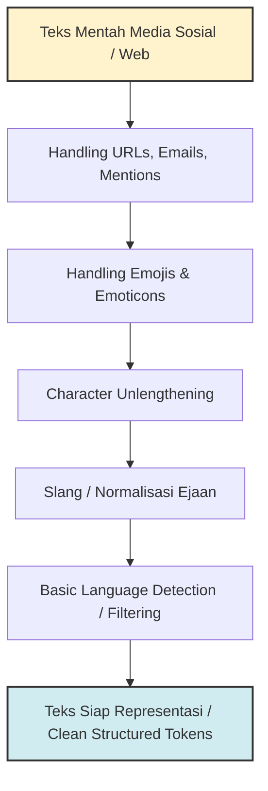

# Text Preprocessing Part 3: Advanced Noise Cleaning & Language Handling

> **PRINSIP UTAMA:** Teks dari media sosial dan internet dipenuhi oleh elemen non-standar (emoji, URL, slang, *code-switching*). Pembersihan tingkat lanjut bukan sekadar membuang noise, melainkan mengonversi elemen tak terstruktur menjadi token yang bermakna bagi model.

---

## 1. Gambaran Besar

Setelah melalui normalisasi standar (Part 1) dan pemrosesan morfologi (Part 2), kita masih sering menemukan teks dunia nyata yang sangat "kotor". Teks ulasan, cuitan, atau obrolan *chatting* membawa tantangan spesifik: ekspresi emosi lewat emoji, tautan web, singkatan gaul (*slang*), huruf berulang (*character lengthening*), hingga campuran dua bahasa (*code-switching*).

Jika elemen-elemen ini diabaikan, tokenizer akan memecahnya menjadi puluhan token acak tanpa arti, atau bahkan membuang sinyal sentimen yang sangat berharga.



### Alur "Masalah -> Solusi"
- **Masalah:** URL `https://tokopedia.com/item/123` terpecah menjadi `['https', 'tokopedia', 'com', 'item', '123']` yang merusak statistik kata.
- **Solusi:** Lakukan *URL/Email Canonicalization* (ganti URL dengan token khusus `[URL]`).
- **Masalah:** Ekspresi emosi `:)` atau `🔥` terhapus oleh pembersihan tanda baca standar.
- **Solusi:** Terjemahkan emoji/emoticon menjadi teks deskriptif (`[EMOTICON_HAPPY]`, `[EMOJI_FIRE]`).
- **Masalah:** Kata `"baaaagussss bgt"` dihitung sebagai kata berbeda dari `"bagus banget"`.
- **Solusi:** Reduksi huruf berulang (*character unlengthening*) diikuti pemetaan kamus *slang*.
- **Masalah:** Teks berbahasa asing masuk ke dalam korpus pelatihan model spesifik Bahasa Indonesia.
- **Solusi:** Filter dokumen menggunakan *Basic Language Detection*.

---

## 2. Tujuan Belajar Terukur

Setelah menyelesaikan materi ini, kamu akan bisa:
1. Menyusun pola Regular Expression untuk mendeteksi dan menganonimkan URL, Email, Mention, dan Hashtag.
2. Memproses emoji dan emoticon agar sinyal emosinya tetap bertahan untuk analisis sentimen.
3. Mengimplementasikan fungsi normalisasi kata gaul (*slang*) dan reduksi huruf berulang (*character lengthening*) untuk teks Bahasa Indonesia.
4. Membuat detektor bahasa sederhana berbasis overlap *vocabulary/stopword* tanpa pustaka eksternal berat.
5. Menggabungkan seluruh tahapan Preprocessing (Part 1, 2, dan 3) menjadi satu *end-to-end preprocessing pipeline*.

---

## 3. Prasyarat Minimum

Pastikan kamu sudah memahami materi Part 1 & Part 2 (Regex dasar, Tokenisasi, dan Penggunaan Python Dictionary).

### Cek Cepat Prasyarat

1. Apa fungsi dari modul `re.sub(pattern, replacement, string)` di Python?
2. Bagaimana cara mengakses representasi Unicode dari sebuah karakter di Python?
3. Apa perbedaan utama antara token `[URL]` (placeholder) dan menghapus URL secara langsung?

<details>
<summary>Jawaban Cek Cepat</summary>

1. Mengganti semua kemunculan pola regex (`pattern`) dalam `string` dengan string pengganti (`replacement`).
2. Menggunakan fungsi bawaan `ord(char)` untuk mendapatkan nilai integer code point, atau `char.encode('unicode-escape')`.
3. Menggunakan placeholder `[URL]` mempertahankan informasi struktural bahwa kalimat tersebut memuat tautan (penting untuk deteksi spam/phishing), sedangkan menghapus URL membuang struktur tersebut sepenuhnya.
</details>

---

## 4. Isi Sub-Materi

---

### Sub-Materi 1: Handling Emojis & Emoticons

#### 1. Masalah yang Diselesaikan
Dalam teks media sosial, ekspresi sentimen terbanyak disampaikan melalui emoticon ASCII (seperti `:)`, `:-D`, `;(`) dan Emoji Unicode (`😊`, `😭`, `🔥`). Pembersihan tanda baca naif (`[^\w\s]`) akan menghapus karakter ini, sehingga kalimat `"Kecewa banget :("` menjadi `"Kecewa banget"` (kehilangan penegas emosi).

#### 2. Intuisi
Analogi: Menjelmakan ekspresi wajah dan intonasi pembicara menjadi deskripsi teks dalam naskah drama (misal: `:)` -> `[SENYUM]`).
*Batas Analogi:* Satu emoji bisa memiliki arti kontekstual yang berlainan tergantung budaya atau sarkasme (misal emoji folded hands `🙏` bisa berarti berdoa, terima kasih, atau tos).

#### 3. Contoh Konkret Kecil
- **Input:** `"Beli baju disini memuaskan bgt :) 🔥"`
- **Proses:** 
  1. Map Emoticon `:)` -> `[EMOT_HAPPY]`
  2. Map Emoji `🔥` -> `[EMOJI_FIRE]` atau `"api"`
- **Output:** `"Beli baju disini memuaskan bgt [EMOT_HAPPY] [EMOJI_FIRE]"`

#### 4. Mekanisme
1. **Emoticon Matching:** Menggunakan pola Regex berbasis kelompok karakter ASCII khas mata, hidung, dan mulut (`[:;=][----]?[()DPdO]`).
2. **Emoji Parsing:** Emoji disimpan dalam rentang blok Unicode spesifik (misalnya rentang Smileys `\U0001F600-\U0001F64F`). Kita bisa mendeteksi rentang ini menggunakan regex Unicode atau memetakan tiap code point ke label teks.

#### 5. Kode Minimal
```python
import re

# Database pemetaan emoticon ASCII sederhana
EMOTICON_MAP = {
    ":)": "[EMOT_HAPPY]",
    ":-)" : "[EMOT_HAPPY]",
    ":(": "[EMOT_SAD]",
    ":-(": "[EMOT_SAD]",
    ":D": "[EMOT_LAUGH]"
}

# Regex untuk mendeteksi rentang Emoji Unicode utama
EMOJI_PATTERN = re.compile(
    r'[\U0001F600-\U0001F64F'  # Emoticons
    r'\U0001F300-\U0001F5FF'  # Symbols & Pictographs
    r'\U0001F680-\U0001F6FF'  # Transport & Map
    r'\U0001F1E0-\U0001F1FF]' # Flags
    r'+', flags=re.UNICODE
)

def replace_emoticons(text: str) -> str:
    for emot, tag in EMOTICON_MAP.items():
        text = text.replace(emot, f" {tag} ")
    return text

def convert_emojis_to_tag(text: str) -> str:
    # Mengganti semua emoji dengan tag generik [EMOJI]
    return EMOJI_PATTERN.sub(r' [EMOJI] ', text)

sample_text = "Pelayanan mantap! :) Bintang lima 🔥👍"
text_no_emot = replace_emoticons(sample_text)
clean_text = convert_emojis_to_tag(text_no_emot)

print("Teks Asli   :", sample_text)
print("Hasil Demoji:", clean_text)
```

#### 6. Jebakan & Failure Modes
- 💡 **ZWJ Sequences (Zero Width Joiner):** Beberapa emoji kompleks merupakan gabungan beberapa code point yang diikat oleh karakter `U+200D` (misalnya emoji keluarga atau variasi warna kulit). Regex sederhana bisa memecah 1 emoji gabungan menjadi 2-3 tag emoji terpisah.
- 💡 **Overwriting Text:** Emoticon seperti `:P` jika di-replace tanpa memperhatikan batas spasi bisa secara tidak sengaja memakan bagian dari string lain.

#### 7. Mini-Eksperimen
Jalankan kode di bawah ini untuk melihat bagaimana regex Unicode mendeteksi emoji:

```python
import re

text_emoji = "Bagus sekali ❤️!"
# Coba ganti emoji dengan token khusus
result = re.sub(r'[\U0001F300-\U0001F5FF]|\u2764\ufe0f', '[LOVE]', text_emoji)

print("Hasil:", result)
# Jalankan sendiri, lalu bandingkan dengan prediksimu
```

#### 8. Cek Pemahaman
1. Mengapa teknik penghapusan tanda baca standar `re.sub(r'[^\w\s]', '', text)` berbahaya untuk data analisis sentimen ulasan toko online?
2. Bagaimana strategi penanganan emoji jika kita melatih model *Word Embedding* (seperti Word2Vec) yang tidak memiliki pembacaan karakter Unicode?

<details>
<summary>Jawaban</summary>

1. Karena penghapusan tanda baca akan membuang emoticon ASCII seperti `:)` dan `:(` yang merupakan indikator sentimen paling jelas.
2. Emoji diubah terlebih dahulu menjadi teks deskriptif baku (misalnya `[EMOJI_FIRE]` atau kata `"api"`) agar dapat terpetakan ke dalam vektor kata *vocabulary*.
</details>

---

### Sub-Materi 2: Handling URLs, Emails, and Mentions/Hashtags

#### 1. Masalah yang Diselesaikan
Data dari web atau Twitter/X dipenuhi oleh URL (`https://...`), alamat Email (`user@mail.com`), Mention Username (`@user`), dan Hashtag (`#promo`). Elemen-elemen ini memiliki frekuensi unik yang sangat tinggi (*high sparsity*) dan merusak statistik frekuensi kata jika tidak dinormalisasi.

#### 2. Intuisi
Analogi: Mengganti nomor rekening bank atau nomor seri barang pada formulir publik dengan kata label generik `[NOMOR_REKENING]` demi kerapian dan privasi.
*Batas Analogi:* Mengubah semua hashtag menjadi token `[HASHTAG]` membuang kata kunci topik yang tersimpan di dalam hashtag tersebut (misal `#PromoDiskon` sebenarnya memuat dua kata kunci penting).

#### 3. Contoh Konkret Kecil
- **Input:** `"Beli di https://toko.com/p1 atau email cs@toko.com, cc @admin #PromoHebat"`
- **Proses:** 
  - URL -> `[URL]`
  - Email -> `[EMAIL]`
  - Mention -> `[MENTION]`
  - Hashtag -> ekstrak kata `"PromoHebat"`
- **Output:** `"Beli di [URL] atau email [EMAIL] cc [MENTION] PromoHebat"`

#### 4. Mekanisme
Menerapkan Regular Expression spesifik berbasis pola standar internet:
- **URL Pattern:** `r'https?://\S+|www\.\S+'`
- **Email Pattern:** `r'[\w\.-]+@[\w\.-]+\.\w+'`
- **Mention Pattern:** `r'@\w+'`
- **Hashtag Pattern:** `r'#(\w+)'` (Menggunakan *capture group* untuk mempertahankan teks hashtag tanpa simbol `#`).

#### 5. Kode Minimal
```python
import re

doc = "Kontak cs@shopex.id / [https://shopex.id/help](https://shopex.id/help). Follow @shopex_id #DiskonSpesial!"

def clean_web_elements(text: str) -> str:
    # 1. Replace Email
    text = re.sub(r'[\w\.-]+@[\w\.-]+\.\w+', '[EMAIL]', text)
    
    # 2. Replace URL
    text = re.sub(r'https?://\S+|www\.\S+', '[URL]', text)
    
    # 3. Replace Mention
    text = re.sub(r'@\w+', '[MENTION]', text)
    
    # 4. Clean Hashtag (Ambil kata di dalam hashtag)
    text = re.sub(r'#(\w+)', r'\1', text)
    
    # 5. Normalisasi Spasi
    text = re.sub(r'\s+', ' ', text).strip()
    return text

cleaned_doc = clean_web_elements(doc)
print("Dokumen Mentah :", doc)
print("Dokumen Bersih :", cleaned_doc)
```

#### 6. Jebakan & Failure Modes
- 💡 **URL Trailing Punctuation:** URL di akhir kalimat yang diikuti titik (`"Cek https://toko.com."`) sering kali membuat tanda titik ikut terhubung ke dalam URL jika regex terlalu serakah (*greedy*).
- 💡 **Hashtag CamelCase:** Hashtag seperti `#DiskonBesarHariIni` jika hanya dibuang simbol `#`-nya akan menjadi satu token tunggal `"DiskonBesarHariIni"` yang mungkin tidak ada di kamus dasar (*Out-Of-Vocabulary*).

#### 7. Mini-Eksperimen
Gunakan regex di bawah ini dan amati apakah titik di akhir kalimat ikut terhapus atau tidak:

```python
import re

text_url = "Kunjungi website kami di [https://website.com](https://website.com)."

# Regex URL standar
clean_1 = re.sub(r'https?://\S+', '[URL]', text_url)

print("Hasil Regex:", repr(clean_1))
# Perhatikan apakah titik di akhir kalimat hilang tersedot ke [URL]!
```

#### 8. Cek Pemahaman
1. Kapan kita sebaiknya mengganti URL dengan tag `[URL]`, dan kapan kita sebaiknya **menghapus** URL sepenuhnya dari teks?
2. Bagaimana cara memisahkan frasa CamelCase pada hashtag `#PelayananBagus` menjadi dua kata terpisah `"Pelayanan"` dan `"Bagus"` menggunakan regex?

<details>
<summary>Jawaban</summary>

1. Gunakan tag `[URL]` jika tugas NLP membutuhkan sinyal keberadaan tautan (misalnya deteksi Spam, Phishing, atau Klasifikasi Tipe Cuitan). Hapus URL sepenuhnya jika tugas fokus murni pada analisis topik utama teks.
2. Gunakan pola regex berbasis batas huruf besar/kecil: `re.sub(r'([a-z])([A-Z])', r'\1 \2', hashtag_text)`.
</details>

---

### Sub-Materi 3: Handling Spelling Variations & Slang Normalization

#### 1. Masalah yang Diselesaikan
Bahasa tidak baku / *slang* Bahasa Indonesia memunculkan dua masalah utama:
1. **Character Lengthening (Huruf Berulang):** `"baaaagusssss"`, `"iyaaa"`.
2. **Singkatan Gaul & Typo:** `"bgt"` (banget), `"yg"` (yang), `"tdk"` (tidak), `"mkn"` (makan).

Ini menyebabkan pembengkakan *vocabulary* karena satu kata baku memiliki puluhan variasi bentuk tidak baku.

#### 2. Intuisi
Analogi: Penerjemah yang menyelaraskan bahasa gaul anak muda daerah ke dalam Bahasa Indonesia Ragam Resmi sebelum dicatat di dokumen pengadilan.
*Batas Analogi:* Normalisasi slang yang terlalu agresif dapat menghilangkan nuansa gaya bahasa (*gaya penulisan/persona*) dari penulis teks.

#### 3. Contoh Konkret Kecil
- **Input:** `"Barangnnyaa baaagusss bgt, sy sukaaa!"`
- **Proses 1 (Character Unlengthening):** `"Barangmya bagus bgt, sy suka!"`
- **Proses 2 (Slang Replacement):** `"Barang nya bagus banget, saya suka!"`

#### 4. Mekanisme
1. **Character Unlengthening via Regex:** Mencari pola karakter yang berulang 3 kali atau lebih (`(\w)\1{2,}`) dan memotongnya menjadi 1 atau 2 karakter saja.
   $$\text{Pola Regex: } \text{r'(\w)\1\{2,\}'} \rightarrow \text{r'\1'}$$
2. **Dictionary Lookup (Kamus Slang):** Menggunakan pemetaan tabel (*hash table/dict*) kata tidak baku ke kata baku. Setiap token dalam teks dicocokkan terhadap kunci dictionary.

#### 5. Kode Minimal
```python
import re

# 1. Kamus Slang Bahasa Indonesia (Sampel Sederhana)
SLANG_DICTIONARY = {
    "bgt": "banget",
    "bgtu": "begitu",
    "sy": "saya",
    "yg": "yang",
    "tdk": "tidak",
    "gk": "tidak",
    "gak": "tidak",
    "brg": "barang",
    "dgn": "dengan"
}

def reduce_lengthening(text: str) -> str:
    # Mengubah huruf yang berulang >= 3 kali menjadi 1 huruf saja
    # Contoh: "baaaagusss" -> "bagus"
    pattern = re.compile(r'(\w)\1{2,}')
    return pattern.sub(r'\1', text)

def normalize_slang(tokens: list[str], slang_dict: dict) -> list[str]:
    # Ganti kata jika ada di dalam kamus slang
    return [slang_dict.get(token, token) for token in tokens]

# Eksekusi
raw_input = "brg nya baaaagussss bgt, sy sukaaa!!!"

# Step A: Reduksi huruf berulang
text_unlengthened = reduce_lengthening(raw_input)

# Step B: Tokenisasi sederhana
tokens = re.findall(r'\w+|[^\w\s]', text_unlengthened)

# Step C: Normalisasi Slang
normalized_tokens = normalize_slang(tokens, SLANG_DICTIONARY)

print("Mentah              :", raw_input)
print("Unlengthened        :", text_unlengthened)
print("Hasil Normalisasi   :", " ".join(normalized_tokens))
```

#### 6. Jebakan & Failure Modes
- 💡 **Over-reduction pada Kata Baku:** Kata baku Bahasa Indonesia yang memiliki dua huruf berdampingan seperti `"saat"`, `"miffed"`, atau `"keadaan"` bisa rusak jika aturan unlengthening memotong huruf berulang 2 kali. Gunakan batas ambang minimal 3 kali pengulangan (`{2,}` pada regex group).
- 💡 **Kamus Slang Tidak Pernah Lengkap:** Bahasa gaul berubah sangat cepat. Pendekatan berbasis kamus static pasti memiliki *coverage limitation*.

#### 7. Mini-Eksperimen
Coba amati apa yang terjadi pada kata `"saat"` jika kamu menggunakan batas pengulangan 2 kali (`\1{1,}`) versus 3 kali (`\1{2,}`):

```python
import re

word = "saat baaaagus"

# Opsi A: Potong jika berulang >= 2 kali (Agresif)
res_a = re.sub(r'(\w)\1{1,}', r'\1', word)

# Opsi B: Potong jika berulang >= 3 kali (Aman)
res_b = re.sub(r'(\w)\1{2,}', r'\1', word)

print("Opsi A (Agresif) :", res_a) # 'sat bagus' -> Kata 'saat' rusak!
print("Opsi B (Aman)     :", res_b) # 'saat bagus' -> Kata 'saat' aman!
```

#### 8. Cek Pemahaman
1. Mengapa urutan eksekusi *Character Unlengthening* harus dilakukan **SEBELUM** pencarian kamus *Slang*?
2. Diberikan kata `"tidakkkk"`. Tuliskan alur transformasi kata tersebut hingga menjadi kata baku `"tidak"`!

<details>
<summary>Jawaban</summary>

1. Jika tidak dilakukan di awal, kata `"bgtuuu"` tidak akan cocok dengan kunci kamus `"bgtu"` karena adanya huruf `'u'` berlebih di ujung kata.
2. Transformasi: `"tidakkkk"` -> (*Character Unlengthening*) -> `"tidak"` -> (*Slang Lookup / Sudah Baku*) -> `"tidak"`.
</details>

---

### Sub-Materi 4: Basic Language Detection

#### 1. Masalah yang Diselesaikan
Dataset internet sering kali berisi teks multibahasa atau fenomena *code-switching* (campuran Bahasa Indonesia dan Inggris dalam satu kalimat, misal `"Produk ini highly recommended bgt!"`). Jika kita ingin melatih model spesifik bahasa tertentu, dokumen berbahasa asing perlu difilter.

#### 2. Intuisi
Analogi: Menghitung jumlah kata khas (seperti kata sambung) untuk menebak bahasa sebuah surat tanpa perlu membaca seluruh isi buku.
*Batas Analogi:* Metode heuristik kata sambung ini gagal pada kalimat yang sangat pendek (1-2 kata) atau kalimat dengan persentase campuran 50:50.

#### 3. Contoh Konkret Kecil
- **Teks A:** `"This item is very good and fast delivery"`
- **Teks B:** `"Barang ini sangat bagus dan pengiriman cepat"`
- **Proses:** Hitung persentase kata yang cocok dengan kata kunci khas Bahasa Indonesia (`{"yang", "dan", "ini", "sangat"}`) vs Bahasa Inggris (`{"the", "is", "and", "this"}`).
- **Output:** Teks A -> `EN`, Teks B -> `ID`.

#### 4. Mekanisme (Overlapping Stopword Heuristic)
Kita menghitung skor cakupan (*coverage score*) kata dalam teks terhadap himpunan kata kunci unik tiap bahasa ($L$):

$$\text{Score}(L) = \frac{\sum_{w \in \text{Tokens}} \mathbb{I}(w \in \text{Vocabulary}_L)}{\vert{}\text{Tokens}\vert{}}$$

Bahasa dengan skor $Score(L)$ tertinggi dipilih sebagai bahasa dominan dokumen tersebut.

#### 5. Kode Minimal
```python
# Kumpulan kata kunci fungsional (Stopwords) unik per bahasa
ID_KEYWORDS = {"yang", "di", "dan", "ini", "itu", "dengan", "untuk", "sangat", "tidak"}
EN_KEYWORDS = {"the", "is", "and", "this", "that", "with", "for", "very", "not"}

def detect_language_simple(text: str) -> str:
    tokens = set(re.findall(r'\b\w+\b', text.lower()))
    if not tokens:
        return "UNKNOWN"
        
    # Hitung berapa banyak kata kunci yang cocok
    id_score = len(tokens.intersection(ID_KEYWORDS))
    en_score = len(tokens.intersection(EN_KEYWORDS))
    
    if id_score == 0 and en_score == 0:
        return "UNKNOWN / MIXED"
    
    return "ID" if id_score >= en_score else "EN"

text_1 = "Produk ini sangat bagus dan pengirimannya cepat."
text_2 = "This product is very good and fast shipping."
text_3 = "OK thanks."

print("Teks 1 Bahasa:", detect_language_simple(text_1))
print("Teks 2 Bahasa:", detect_language_simple(text_2))
print("Teks 3 Bahasa:", detect_language_simple(text_3))
```

#### 6. Jebakan & Failure Modes
- 💡 **Ambiguitas Kalimat Pendek:** Kalimat seperti `"No"` bisa berarti kata negasi (Bahasa Inggris) atau singkatan dari kata `"Nomor"` (Bahasa Indonesia).
- 💡 **Code-Switching (Bahasa Gado-Gado):** Pada kalimat `"I think barang ini worth it banget"`, detektor sederhana akan memilah salah satu bahasa saja padahal dokumen memuat konteks ganda.

#### 7. Mini-Eksperimen
Uji fungsi `detect_language_simple` pada kalimat *code-switching* berikut:

```python
mixed_text = "Jujurly ini worth it banget sih untuk dibeli"
# Prediksi: Apakah terdeteksi ID atau UNKNOWN/MIXED?
# Jalankan sendiri, lalu bandingkan dengan prediksimu
```

#### 8. Cek Pemahaman
1. Mengapa pendekatan *Stopword Overlap* lebih disukai untuk deteksi bahasa yang ringan dibanding menggunakan model *Deep Learning* kompleks?
2. Kapan teknik deteksi bahasa wajib dipasang di awal pipeline sebelum tahap preprocessing lainnya?

<details>
<summary>Jawaban</summary>

1. Karena sangat cepat ($O(N)$ waktu eksekusi), tidak membutuhkan footprint memori besar, dan tidak memerlukan dependensi library pihak ketiga.
2. Saat kita memiliki korpus mentah hasil *crawling* web skala besar yang belum diketahui distribusi bahasanya, sehingga kita bisa membuang dokumen non-target sebelum pemrosesan berat dilakukan.
</details>

---

## 5. Mini-Proyek Penutup

**Kasus:** Complete End-to-End Preprocessing Pipeline untuk Data Media Sosial Bahasa Indonesia.

### 1. Definisi Masalah
Membuat satu fungsi pipeline utuh yang menerima teks ulasan mentah dari internet (berisi URL, mention, emoji, slang, dan kata berulang) lalu mengembalikannya dalam bentuk list token bersih yang ter-normalisasi.

### 2. Dataset Mentah
```python
raw_social_data = [
    "Cek promo di [https://toko.com/123](https://toko.com/123) !! Barangbaaaagusss bgt :) sukaaa @admin",
    "Pengiriman lambat bgt!! tdk recommended 😭 cc: @cs_toko"
]
```

### 3. Metric Evaluasi
*Cleanliness & Token Consistency:* Semua URL/mention ter-anonimkan, emoji terkonversi/terisolasi, slang terterjemahkan, dan tidak ada karakter terpisah ganjil.

### 4. Implementasi Complete Pipeline
```python
import re
import unicodedata

SLANG_DICT = {
    "bgt": "banget", "tdk": "tidak", "gk": "tidak",
    "gak": "tidak", "sy": "saya", "yg": "yang"
}

EMOT_MAP = {":)": "[EMOT_HAPPY]", ":(": "[EMOT_SAD]"}

def full_preprocessing_pipeline(text: str) -> list[str]:
    # 1. Unicode Normalization
    text = unicodedata.normalize('NFC', text)
    
    # 2. Handling Emoticons (ASCII)
    for emot, tag in EMOT_MAP.items():
        text = text.replace(emot, f" {tag} ")
        
    # 3. Handling Web Noise (URL, Mention, Email)
    text = re.sub(r'https?://\S+|www\.\S+', '[URL]', text)
    text = re.sub(r'@\w+', '[MENTION]', text)
    text = re.sub(r'[\w\.-]+@[\w\.-]+\.\w+', '[EMAIL]', text)
    
    # 4. Lowercasing
    text = text.lower()
    
    # 5. Character Unlengthening (Huruf berulang >= 3 potong jadi 1)
    text = re.sub(r'(\w)\1{2,}', r'\1', text)
    
    # 6. Word Tokenization (Ekstrak kata & token khusus)
    tokens = re.findall(r'\[\w+\]|\w+|[^\w\s]', text)
    
    # 7. Slang Normalization
    normalized_tokens = [SLANG_DICT.get(t, t) for t in tokens]
    
    # 8. Filter Tanda Baca Tunggal & Whitespace Clean
    clean_tokens = [t for t in normalized_tokens if t.isalnum() or t.startswith('[')]
    
    return clean_tokens

# Eksekusi Pipeline
for i, raw in enumerate(raw_social_data):
    result = full_preprocessing_pipeline(raw)
    print(f"Sample {i+1} Mentah : {raw}")
    print(f"Sample {i+1} Bersih : {result}\n")
```

### 5. Error Analysis & Perbaikan Satu Faktor
- **Temuan:** Token `[URL]` atau `[EMOT_HAPPY]` berhasil dipertahankan secara utuh tanpa terpotong oleh regex tokenisasi karena kita menambahkan pola `\[\w+\]` di urutan pertama regex tokenization.

---

## 6. Kesalahan Umum & Cara Debugging

| Symptom (Gejala Error) | Root Cause (Penyebab Utama) | Cara Debugging / Solusi |
| :--- | :--- | :--- |
| Token placeholder `[URL]` pecah menjadi `['', 'url', '']`. | Regex tokenization menghapus tanda kurung siku `[` dan `]`. | Perbarui regex tokenization agar mengenali pola tag ber-bracket: `r'\[\w+\]|\w+'`. |
| Kata baku `"saat"` berubah menjadi `"sat"`. | Regex character unlengthening menggunakan batas `\1{1,}` (2 pengulangan). | Ubah batas minimal pengulangan regex menjadi 3 kali: `\1{2,}`. |
| Penggantian Slang merusak kata lain (misal `"saya"` jadi `"sa-saya"`). | Melakukan string replacement pada kalimat utuh (`text.replace()`) tanpa batas kata. | Selalu lakukan *Slang Replacement* pada tingkat **Token / List** menggunakan dictionary lookup. |

---

## 7. Cheat Sheet 1 Halaman

```python
import re

# 1. URL & Mention Masking
text = re.sub(r'https?://\S+|www\.\S+', '[URL]', text)
text = re.sub(r'@\w+', '[MENTION]', text)

# 2. Character Unlengthening (Potong pengulangan >= 3 kali)
text = re.sub(r'(\w)\1{2,}', r'\1', text)

# 3. Dictionary Slang Lookup (Tingkat Token)
clean_tokens = [SLANG_DICT.get(w, w) for w in tokens]

# 4. Regex Tokenizer dengan Dukungan Tag Placeholder
tokens = re.findall(r'\[\w+\]|\w+', text)
```

### Aturan Keputusan Preprocessing (Rule of Thumb) 💡
- **Data Teks Media Sosial:** **WAJIB** lakukan Masking URL/Mention, Unlengthening, dan Slang Normalization. Jangan langsung hapus tanda baca jika ada emoticon.
- **Data Teks Formal (Jurnal/Berita):** Skip tahap Slang Normalization dan Unlengthening untuk menghemat waktu eksekusi.
- **Urutan Pipeline:** Selalu jalankan *Character Unlengthening* **sebelum** *Slang Dictionary Lookup*.

---

## 8. Jembatan ke Materi Berikutnya

Selamat! Kamu telah menyelesaikan seluruh rangkaian **Text Preprocessing** (Part 1, 2, dan 3). Sekarang teks mentahmu telah berubah menjadi sekumpulan list token bersih yang konsisten.

Namun, komputer tetap belum bisa melakukan operasi matematika pada string huruf. Teks bersih ini harus diubah menjadi **representasi numerik (vektor)**.

Pada modul berikutnya — **Text Representation** — kita akan mempelajari cara mengonversi token menjadi angka menggunakan metode:
1. **Bag-of-Words (BoW)**
2. **N-Grams**
3. **TF-IDF (Term Frequency - Inverse Document Frequency)**

---

## 9. Referensi Kanonik

1. **Speech and Language Processing** — Daniel Jurafsky & James H. Martin (Seksi: *Text Normalization and Social Media Preprocessing*).
2. **Python Standard Library Documentation** — Modul `re` (Regular expression operations).
3. **NLTK / spaCy Documentation** — Bagian *Rule-based Sentiment & Social Media Tokenization*.

### Cara Memverifikasi Sendiri
Uji Regex URL dan Unlengthening pada pustaka ekspresi reguler Python menggunakan *interactive shell*:
```python
import re
print(re.sub(r'(\w)\1{2,}', r'\1', "baaaagusss")) # Output: bagus
```

---

## 10. Glosarium Istilah

- **Canonicalization:** Proses mengonversi data yang memiliki beberapa representasi berbeda ke dalam satu bentuk standar baku (seperti mengganti semua URL dengan `[URL]`).
- **Character Lengthening:** Fenomena penulisan huruf berulang untuk memberikan penekanan emosi pada media sosial (misalnya `"bagusss"`).
- **Code-Switching:** Fenomena penggunaan dua atau lebih bahasa secara bergantian dalam satu percakapan atau kalimat.
- **Emoticon:** Representasi ekspresi wajah menggunakan kombinasi karakter ASCII keyboard (misalnya `:)` atau `:P`).
- **Slang Normalization:** Proses penerjemahan kata-kata tidak baku / gaul menjadi kata baku sesuai kamus resmi.
- **Zero Width Joiner (ZWJ):** Karakter khusus Unicode yang digunakan untuk menggabungkan dua atau lebih karakter emoji menjadi satu tampilan emoji gabungan.

---

## 11. Log Verifikasi

Daftar klaim/heuristik yang diberi label penanda dalam materi ini:

1. `💡 ZWJ Sequences (Zero Width Joiner)` — Pertimbangan teknis Unicode: Emoji gabungan terdiri dari beberapa code point yang terikat ZWJ.
2. `💡 Overwriting Text` — Failure mode: Replacement string tanpa acuan batas kata merusak substring kata lain.
3. `💡 URL Trailing Punctuation` — Failure mode: Regex URL greedy menyerap tanda titik akhir kalimat.
4. `💡 Hashtag CamelCase` — Pertimbangan tokenisasi: Hashtag majemuk membutuhkan pemisahan huruf kapital.
5. `💡 Over-reduction pada Kata Baku` — Failure mode: Regex unlengthening yang terlalu agresif memotong kata baku berdampingan (`"saat"` -> `"sat"`).
6. `💡 Kamus Slang Tidak Pernah Lengkap` — Keterbatasan heuristik: Bahasa gaul berkembang secara dinamis.
7. `💡 Ambiguitas Kalimat Pendek` — Keterbatasan deteksi bahasa: Kalimat 1-2 kata memiliki overlap tinggi antar bahasa.
8. `💡 Code-Switching` — Keterbatasan deteksi bahasa: Kalimat campur sulit dikategorikan secara biner.
9. `💡 Aturan Keputusan Preprocessing (Rule of Thumb)` — Heuristik praktis dalam rekayasa sistem NLP.