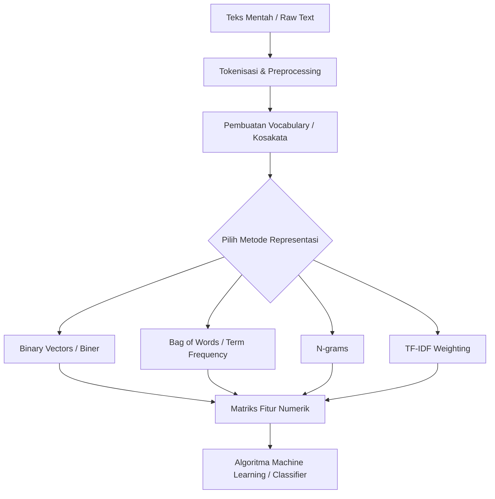

# Text Representation: Bag of Words hingga TF-IDF

## 0. Gambaran Besar

Komputer, algoritma Machine Learning, maupun Neural Network tidak dapat memproses kata atau kalimat berbentuk teks string secara langsung. Model matematika hanya menerima input berupa angka, matriks, atau vektor.

**Text Representation (Representasi Teks)** adalah proses mentransformasikan teks mentah (unstructured text) menjadi matriks numerik berdimensi tertentu (structured feature matrix) tanpa menghilangkan informasi penting di dalamnya.



### Alur Masalah $\rightarrow$ Solusi
* **Masalah:** String `"kucing makan ikan"` tidak bisa dikalikan dengan bobot (*weights*) $W$ pada model klasifikasi.
* **Solusi Biner:** Tandai `1` jika kata ada di dokumen, `0` jika tidak ada.
* **Solusi BoW / TF:** Hitung berapa kali kata muncul untuk menangkap intensitas topik.
* **Solusi N-grams:** Gabungkan $N$ kata berdampingan agar frasa seperti `"tidak suka"` tidak terpecah.
* **Solusi TF-IDF:** Berikan bobot penalti pada kata umum (`"yang"`, `"dan"`) dan beri penghargaan pada kata khas/spesifik.

---

## 1. Tujuan Belajar Terukur

Setelah mempelajari materi ini, kamu akan mampu:
1. Membangun *vocabulary* dan mentransformasikan sekumpulan dokumen menjadi matriks biner dan Bag of Words (BoW) dari nol menggunakan Python murni.
2. Menghitung nilai Term Frequency ($TF$), Inverse Document Frequency ($IDF$), dan $TF\text{-}IDF$ secara manual pada matriks dokumen kecil.
3. Menjelaskan perbedaan mekanisme kalkulasi $TF\text{-}IDF$ standar dengan versi default `scikit-learn`.
4. Mengimplementasikan `CountVectorizer` dan `TfidfVectorizer` dari `scikit-learn` untuk pipeline ekstraksi fitur teks.
5. Memilih konfigurasi $N$-gram yang tepat untuk menangkap konteks lokal tanpa memicu eksplosivitas dimensi (*curse of dimensionality*).

---

## 2. Prasyarat Minimum

Sebelum melanjutkan, pastikan kamu mengingat konsep dasar pemrosesan string dan struktur data Python dasar.

### Cek Cepat Prasyarat
1. Apa keluaran dari `"kucing makan ikan".split()`?
2. Bagaimana cara mengambil kata unik dari list `["a", "b", "a", "c"]` di Python?
3. Jika sebuah matriks berukuran $3 \times 6$, berapa jumlah dokumen dan berapa jumlah fitur (kata)?

<details>
<summary>Jawaban Cek Cepat</summary>

1. `['kucing', 'makan', 'ikan']` (list berisi kata-kata hasil pemisahan karakter spasi).
2. Menggunakan `list(set(["a", "b", "a", "c"]))` atau `dict.fromkeys(...)`.
3. Terdapat **3 dokumen** (baris) dan **6 fitur/vocabulary** (kolom).
</details>

---

## 3. Sub-Materi 1: Vocabulary Creation & Binary Vectors

### 1. Masalah yang Diselesaikan
Komputer tidak memiliki intuisi tentang kata. Agar teks bisa diproses, kita harus menentukan "kamus" (*vocabulary*) dari seluruh korpus (kumpulan dokumen), lalu mencatat keberadaan setiap kata di dalam tiap dokumen.

### 2. Intuisi
Bayangkan daftar hadir (*checklist*) di pintu masuk acara. Setiap ada tamu (kata) dari daftar anggota (vocabulary) yang datang di sebuah ruangan (dokumen), kita beri tanda centang (`1`). Jika tidak hadir, kita beri tanda (`0`).

> 💡 **Batas Analogi:** Checklist biner hanya mencatat *kehadiran*, bukan *jumlah kehadiran*. Jika seseorang masuk ruangan 10 kali, namanya tetap cuma dicentang `1` kali.

### 3. Contoh Konkret Kecil
Dokumen yang kita pakai:
* $D_1$: `"kucing makan ikan"`
* $D_2$: `"kucing minum susu"`
* $D_3$: `"ikan minum air ikan"`

**Langkah 1: Kumpulkan seluruh kata unik (Vocabulary $V$), lalu urutkan secara abjad:**
$$V = [\text{'air'}, \text{'ikan'}, \text{'kucing'}, \text{'makan'}, \text{'minum'}, \text{'susu'}]$$
Ukuran vocabulary $\vert{}V\vert{} = 6$.

**Langkah 2: Buat Vektor Biner untuk tiap dokumen:**
* $D_1$ memuat: `ikan`, `kucing`, `makan` $\rightarrow [0, 1, 1, 1, 0, 0]$
* $D_2$ memuat: `kucing`, `minum`, `susu` $\rightarrow [0, 0, 1, 0, 1, 1]$
* $D_3$ memuat: `air`, `ikan`, `minum` $\rightarrow [1, 1, 0, 0, 1, 0]$

### 4. Mekanisme
1. **Tokenisasi sederetan dokumen:** Pecah dokumen $d_i$ menjadi token/kata.
2. **Pembuatan indeks:** Petakan setiap kata unik $t$ ke indeks kolom $j \in \{0, 1, \dots, \vert{}V\vert{}-1\}$.
3. **Vektorisasi Biner:**
$$v_{ij} = \begin{cases} 1, & \text{jika kata } t_j \in d_i \\ 0, & \text{jika kata } t_j \notin d_i \end{cases}$$

### 5. Kode Minimal
```python
# Pembuatan Vocabulary dan Binary Vectors dari nol dengan Python standar

corpus = [
    "kucing makan ikan",
    "kucing minum susu",
    "ikan minum air ikan"
]

# 1. Tokenisasi dan kumpulkan kata unik (Vocabulary)
tokens_per_doc = [doc.split() for doc in corpus]
all_words = set(word for doc in tokens_per_doc for word in doc)
vocab = sorted(list(all_words))

print("Vocabulary (|V| = {}):".format(len(vocab)))
print(vocab)

# 2. Transformasi ke Binary Vector
binary_matrix = []
for doc_tokens in tokens_per_doc:
    doc_set = set(doc_tokens)
    vector = [1 if word in doc_set else 0 for word in vocab]
    binary_matrix.append(vector)

print("\nMatriks Vektor Biner:")
for i, vec in enumerate(binary_matrix):
    print(f"D{i+1}: {vec}")
```

### 6. Jebakan & Failure Modes
* **Out-of-Vocabulary (OOV):** Jika saat pengujian (*inference/testing*) muncul kata baru yang tidak ada di $V$ (misal `"anjing"`), kata tersebut akan diabaikan/dibuang.
* **Kepekaan Kasus & Tanda Baca:** Tanpa preprocessing (misal *lowercase*), kata `"Kucing"` dan `"kucing"` akan dianggap dua fitur berbeda.

### 7. Mini-Eksperimen
Ubah dokumen $D_1$ pada kode di atas menjadi `"Kucing makan Ikan!"`. Prediksi dulu apakah ukuran vocabulary akan bertambah, lalu jalankan kodenya!

### 8. Cek Pemahaman
1. **Konseptual:** Mengapa representasi biner gagal membedakan dokumen yang menyebut kata "bahaya" 1 kali dengan dokumen yang menyebutnya 10 kali?
2. **Numerik:** Diberikan $V = [\text{'ayam'}, \text{'goreng'}, \text{'nasi'}]$ dan dokumen $d = \text{"nasi goreng nasi"}$. Tuliskan vektor biner untuk $d$!

<details>
<summary>Jawaban Cek Pemahaman</summary>

1. Karena representasi biner hanya mencatat keberadaan ($1$ atau $0$), sehingga frekuensi kemunculan kata diabaikan.
2. Vektor biner untuk $d$ adalah `[0, 1, 1]` (kata 'ayam' tidak ada = 0, 'goreng' ada = 1, 'nasi' ada = 1). Walau 'nasi' muncul 2 kali, nilainya tetap 1.
</details>

---

## 4. Sub-Materi 2: Bag of Words (BoW) & Term Frequency (TF)

### 1. Masalah yang Diselesaikan
Vektor biner membuang informasi frekuensi. Padahal, makin sering suatu kata kunci muncul dalam dokumen, makin besar kemungkinan dokumen tersebut membahas topik kata kunci itu.

### 2. Intuisi
Bayangkan sebuah kantong berisi kata-kata (*Bag of Words*). Kita mengocok kantong tersebut, membuang tata bahasa dan urutan kata, lalu cukup menghitung berapa jumlah tiap kata yang ada di dalam kantong.

> 💡 **Batas Analogi:** Kalimat `"anjing menggigit orang"` dan `"orang menggigit anjing"` memiliki isi kantong (BoW) yang 100% identik, padahal maknanya bertolak belakang.

### 3. Contoh Konkret Kecil
Gunakan korpus yang sama:
* $D_1$: `"kucing makan ikan"` (panjang = 3 kata)
* $D_2$: `"kucing minum susu"` (panjang = 3 kata)
* $D_3$: `"ikan minum air ikan"` (panjang = 4 kata)

$V = [\text{'air'}, \text{'ikan'}, \text{'kucing'}, \text{'makan'}, \text{'minum'}, \text{'susu'}]$

**A. Term Frequency Mentah ($TF_{raw}$ / Raw Count):**
* $D_1 \rightarrow [0, 1, 1, 1, 0, 0]$
* $D_2 \rightarrow [0, 0, 1, 0, 1, 1]$
* $D_3 \rightarrow [1, 2, 0, 0, 1, 0]$ *(kata 'ikan' muncul 2 kali)*

**B. Term Frequency Ternormalisasi ($TF_{norm}$):**
Diukur dengan membagi frekuensi kata dengan total kata dalam dokumen: $TF_{norm}(t, d) = \frac{\text{count}(t, d)}{\text{total kata di } d}$

* $D_1$ (total 3 kata) $\rightarrow [0, 1/3, 1/3, 1/3, 0, 0] \approx [0, 0.333, 0.333, 0.333, 0, 0]$
* $D_2$ (total 3 kata) $\rightarrow [0, 0, 1/3, 0, 1/3, 1/3] \approx [0, 0, 0.333, 0, 0.333, 0.333]$
* $D_3$ (total 4 kata) $\rightarrow [1/4, 2/4, 0, 0, 1/4, 0] = [0.250, 0.500, 0, 0, 0.250, 0]$

### 4. Mekanisme
Formula Term Frequency Ternormalisasi:
$$TF(t, d) = \frac{f_{t,d}}{\sum_{t' \in d} f_{t',d}}$$

Keterangan:
* $f_{t,d}$: Jumlah kemunculan kata $t$ dalam dokumen $d$.
* $\sum_{t' \in d} f_{t',d}$: Total seluruh kata yang ada di dalam dokumen $d$.

### 5. Kode Minimal
```python
from sklearn.feature_extraction.text import CountVectorizer

corpus = [
    "kucing makan ikan",
    "kucing minum susu",
    "ikan minum air ikan"
]

# Menggunakan CountVectorizer dari scikit-learn
vectorizer = CountVectorizer()
X_bow = vectorizer.fit_transform(corpus)

print("Vocabulary scikit-learn:")
print(vectorizer.get_feature_names_out())

print("\nMatriks BoW (Raw Count):")
print(X_bow.toarray())
```

### 6. Jebakan & Failure Modes
* **Dominasi Dokumen Panjang:** Dokumen dengan 1.000 kata akan memiliki nilai $TF_{raw}$ jauh lebih tinggi dibanding dokumen 10 kata, meskipun topiknya sama. Selalu pertimbangkan normalisasi ($TF_{norm}$).
* **Stopwords Bias:** Kata sambung/tugas seperti `"yang"`, `"di"`, `"dan"` akan memiliki nilai $TF$ paling tinggi, tetapi memberikan informasi topik paling sedikit.

### 7. Mini-Eksperimen
Tambahkan kata `"makan makan makan"` pada $D_1$ sehingga $D_1 = \text{"kucing makan ikan makan makan makan"}$. Hitung nilai $TF_{norm}$ untuk kata `"kucing"` pada $D_1$ baru tersebut. Apakah nilainya naik atau turun?

### 8. Cek Pemahaman
1. **Konseptual:** Mengapa $TF_{norm}$ lebih adil dibanding $TF_{raw}$ saat membandingkan tweet pendek (280 karakter) dengan artikel berita (500 kata)?
2. **Numerik:** Sebuah dokumen $d$ berisi kalimat `"kopi susu kopi manis kopi"`. Jika $V = [\text{'kopi'}, \text{'manis'}, \text{'susu'}]$, berapa nilai $TF_{norm}$ untuk kata `'kopi'`?

<details>
<summary>Jawaban Cek Pemahaman</summary>

1. Karena $TF_{norm}$ membagi frekuensi kata dengan panjang dokumen, menghapus bias skala yang membuat dokumen panjang seolah-olah lebih relevan hanya karena jumlah katanya banyak.
2. Total kata di $d = 5$. Kata 'kopi' muncul 3 kali. Maka $TF_{norm}(\text{'kopi'}, d) = 3 / 5 = 0.6$.
</details>

---

## 5. Sub-Materi 3: N-grams

### 1. Masalah yang Diselesaikan
Model Bag of Words murni (Unigram / $N=1$) menghancurkan konteks lokal dan negasi.
Contoh: `"tidak suka"` dipecah menjadi `"tidak"` dan `"suka"`. Model sentiment analysis bisa salah mengklasifikasikannya sebagai kalimat positif karena mendeteksi kata `"suka"`.

### 2. Intuisi
Gunakan jendela geser (*sliding window*) berukuran $N$ kata berturut-turut untuk mengekstrak frasa.
* $N=1$: Unigram (kata tunggal)
* $N=2$: Bigram (pasangan 2 kata)
* $N=3$: Trigram (kelompok 3 kata)

> 💡 **Batas Analogi:** N-grams menangkap hubungan kata tetangga dekat, tetapi gagal menangkap hubungan jarak jauh (*long-range dependency*), misal antara subjek di awal paragraf dan kata ganti di akhir paragraf.

### 3. Contoh Konkret Kecil
Kalimat: `"kucing makan ikan lezat"` (4 kata)

* **Unigram ($N=1$):** `["kucing", "makan", "ikan", "lezat"]` (4 token)
* **Bigram ($N=2$):** `["kucing makan", "makan ikan", "ikan lezat"]` (3 token)
* **Trigram ($N=3$):** `["kucing makan ikan", "makan ikan lezat"]` (2 token)

Secara umum, dari dokumen berpanjang $L$ kata, jumlah N-gram yang dihasilkan adalah:
$$\text{Jumlah N-gram} = L - N + 1$$

### 4. Mekanisme
1. Geser jendela berukuran $N$ kata dari kiri ke kanan sebanyak 1 kata per langkah.
2. Gabungkan $N$ kata di dalam jendela menjadi satu token tunggal dengan pemisah spasi.
3. Masukkan token N-gram tersebut ke dalam vocabulary.

### 5. Kode Minimal
```python
from sklearn.feature_extraction.text import CountVectorizer

corpus = ["kucing makan ikan lezat"]

# Menggabungkan Unigram dan Bigram (ngram_range=(1, 2))
vectorizer_ngram = CountVectorizer(ngram_range=(1, 2))
X_ngram = vectorizer_ngram.fit_transform(corpus)

print("Vocabulary (Unigram + Bigram):")
print(vectorizer_ngram.get_feature_names_out())

print("\nMatriks Fitur:")
print(X_ngram.toarray())
```

### 6. Jebakan & Failure Modes
* **Eksplosivitas Dimensi (*Curse of Dimensionality*):** Jika vocabulary unigram berukuran $\vert{}V\vert{} = 10.000$, jumlah kombinasi bigram berpotensi mencapai $\vert{}V\vert{}^2 = 100.000.000$ fitur. Matriks akan menjadi sangat raksasa dan mayoritas bernilai 0 (*extremely sparse*).

### 7. Mini-Eksperimen
Jalankan `CountVectorizer(ngram_range=(2, 2))` (hanya bigram) pada korpus 3 dokumen kita sebelumnya. Berapa jumlah vocabulary bigram yang terbentuk?

### 8. Cek Pemahaman
1. **Konseptual:** Mengapa penggunaan Bigram cocok untuk membedakan frasa `"jakarta selatan"` (nama lokasi) dengan kata `"jakarta"` dan `"selatan"` yang berdiri sendiri?
2. **Numerik:** Berapa jumlah token Trigram ($N=3$) yang dihasilkan dari kalimat dengan panjang $L = 7$ kata?

<details>
<summary>Jawaban Cek Pemahaman</summary>

1. Karena Bigram mempertahankan urutan kata berdampingan sebagai satu kesatuan fitur tunggal, sehingga makna frasa spesifik tidak terpecah.
2. Gunakan formula $L - N + 1 \rightarrow 7 - 3 + 1 = 5$ token trigram.
</details>

---

## 6. Sub-Materi 4: Inverse Document Frequency (IDF) & TF-IDF

### 1. Masalah yang Diselesaikan
Dalam BoW atau TF, kata umum seperti `"yang"`, `"di"`, atau `"adalah"` muncul sangat sering di hampir SEMUA dokumen. Akibatnya, kata-kata tak informatif ini mendapat bobot TF tertinggi dan mendominasi vektor fitur, padahal tidak membantu membedakan topik antar dokumen.

### 2. Intuisi
TF-IDF bekerja sebagai **"saringan keunikan"**:
* **TF (Term Frequency):** Seberapa sering kata muncul di dokumen *ini*? (Makin sering = makin penting untuk dokumen ini).
* **IDF (Inverse Document Frequency):** Seberapa langka kata ini di *seluruh korpus*? (Makin langka = makin bernilai untuk membedakan dokumen).

$$\text{TF-IDF} = \text{Frekuensi Lokal (TF)} \times \text{Kutukan/Penalti Kelangkaan (IDF)}$$

> 💡 **Batas Analogi:** Jika ada kesalahan ketik (*typo*) yang cuma muncul 1 kali di seluruh korpus, IDF-nya akan SANGAT tinggi. TF-IDF rawan memberi bobot berlebihan pada kata asing/noise yang sangat langka.

### 3. Contoh Konkret Kecil (Hitung Tangan)
Korpus (3 Dokumen, $N = 3$):
* $D_1$: `"kucing makan ikan"`
* $D_2$: `"kucing minum susu"`
* $D_3$: `"ikan minum air ikan"`

Vocabulary $V = [\text{'air'}, \text{'ikan'}, \text{'kucing'}, \text{'makan'}, \text{'minum'}, \text{'susu'}]$

#### Langkah 1: Hitung Document Frequency ($DF_t$)
Jumlah dokumen yang memuat kata $t$:
* `air`: muncul di $D_3 \rightarrow DF = 1$
* `ikan`: muncul di $D_1, D_3 \rightarrow DF = 2$
* `kucing`: muncul di $D_1, D_2 \rightarrow DF = 2$
* `makan`: muncul di $D_1 \rightarrow DF = 1$
* `minum`: muncul di $D_2, D_3 \rightarrow DF = 2$
* `susu`: muncul di $D_2 \rightarrow DF = 1$

#### Langkah 2: Hitung IDF Standar ($IDF_{standard}$)
Formula standar (menggunakan logaritma natural $\ln$):
$$IDF(t) = \ln\left(\frac{N}{DF(t)}\right)$$

* $IDF(\text{'air'}) = \ln(3/1) = \ln(3) \approx 1.0986$
* $IDF(\text{'ikan'}) = \ln(3/2) = \ln(1.5) \approx 0.4055$
* $IDF(\text{'kucing'}) = \ln(3/2) = \ln(1.5) \approx 0.4055$
* $IDF(\text{'makan'}) = \ln(3/1) = \ln(3) \approx 1.0986$
* $IDF(\text{'minum'}) = \ln(3/2) = \ln(1.5) \approx 0.4055$
* $IDF(\text{'susu'}) = \ln(3/1) = \ln(3) \approx 1.0986$

#### Langkah 3: Kalikan $TF_{norm} \times IDF_{standard}$

Matriks $TF_{norm}$ yang sudah kita hitung sebelumnya:
* $D_1 = [0.0000, 0.3333, 0.3333, 0.3333, 0.0000, 0.0000]$
* $D_2 = [0.0000, 0.0000, 0.3333, 0.0000, 0.3333, 0.3333]$
* $D_3 = [0.2500, 0.5000, 0.0000, 0.0000, 0.2500, 0.0000]$

Maka Matriks TF-IDF Standar:
* **$D_1$:**
  * `air`: $0 \times 1.0986 = 0.0000$
  * `ikan`: $0.3333 \times 0.4055 = 0.1351$
  * `kucing`: $0.3333 \times 0.4055 = 0.1351$
  * `makan`: $0.3333 \times 1.0986 = 0.3662$
  * `minum`: $0 \times 0.4055 = 0.0000$
  * `susu`: $0 \times 1.0986 = 0.0000$
  * Vektor $D_1 = [0.0000, 0.1351, 0.1351, 0.3662, 0.0000, 0.0000]$

* **$D_2$:**
  * Vektor $D_2 = [0.0000, 0.0000, 0.1351, 0.0000, 0.1351, 0.3662]$

* **$D_3$:**
  * `air`: $0.2500 \times 1.0986 = 0.2747$
  * `ikan`: $0.5000 \times 0.4055 = 0.2028$
  * `minum`: $0.2500 \times 0.4055 = 0.1014$
  * Vektor $D_3 = [0.2747, 0.2028, 0.0000, 0.0000, 0.1014, 0.0000]$

> 📌 **Penting (Variasi Konvensi Scikit-Learn):**
> `TfidfVectorizer` scikit-learn menggunakan formula *smooth IDF* secara default untuk mencegah pembagian dengan nol dan nilai negatif:
> $$IDF_{sklearn}(t) = \ln\left(\frac{1 + N}{1 + DF(t)}\right) + 1$$
> Selain itu, scikit-learn juga menerapkan L2-normalization pada vektor akhir. Cek dokumentasi versi scikit-learn yang kamu pakai!

### 4. Mekanisme
Formula Umum TF-IDF:
$$TF\text{-}IDF(t, d, D) = TF(t, d) \times IDF(t, D)$$

dimana $IDF(t, D)$ mengukur logaritma dari total dokumen $N$ dibagi dengan $DF(t)$. Jika sebuah kata muncul di seluruh dokumen ($DF = N$), maka nilai $\frac{N}{DF} = 1$, dan $\ln(1) = 0$. Artinya kata tersebut diberi **bobot 0** (dieliminasi secara efektif).

### 5. Kode Minimal
```python
import numpy as np
from sklearn.feature_extraction.text import TfidfVectorizer

corpus = [
    "kucing makan ikan",
    "kucing minum susu",
    "ikan minum air ikan"
]

# Menggunakan TfidfVectorizer dengan smooth_idf=True (default)
tfidf = TfidfVectorizer(use_idf=True, norm=None) # Turn off L2 norm for clarity
X_tfidf = tfidf.fit_transform(corpus)

features = tfidf.get_feature_names_out()
print("Vocabulary:", features)
print("\nNilai IDF versi Scikit-Learn (smooth_idf=True):")
for word, idf_val in zip(features, tfidf.idf_):
    print(f"{word:7s}: {idf_val:.4f}")

print("\nMatriks TF-IDF (Tanpa Normalisasi L2):")
print(np.round(X_tfidf.toarray(), 4))
```

### 6. Jebakan & Failure Modes
* **Tidak Mampu Memahami Sinonim:** TF-IDF menganggap `"kucing"` dan `"anabul"` sebagai dua dimensi yang tidak berhubungan sama sekali (ortogonal).
* **Sensitif Terhadap Typo:** Kata typo seperti `"kucingss"` hanya muncul di 1 dokumen, sehingga IDF-nya sangat tinggi dan dianggap fitur paling penting oleh model.

### 7. Mini-Eksperimen
Ubah korpus sehingga kata `"ikan"` muncul di ketiga dokumen ($D_1, D_2, D_3$). Hitung atau jalankan kode di atas, amati apa yang terjadi pada nilai IDF untuk kata `"ikan"`!

### 8. Cek Pemahaman
1. **Konseptual:** Jika suatu kata muncul di seluruh dokumen dalam korpus ($DF = N$), berapa nilai $IDF$ standar untuk kata tersebut? Apa dampaknya pada nilai $TF\text{-}IDF$?
2. **Numerik:** Korpus berisi $N = 100$ dokumen. Kata `"sistem"` muncul di 10 dokumen. Berapa nilai $IDF$ standar ($\ln$) untuk kata `"sistem"`? ($\ln(10) \approx 2.3026$).

<details>
<summary>Jawaban Cek Pemahaman</summary>

1. Nilai $IDF$ standar adalah $\ln(N/N) = \ln(1) = 0$. Dampaknya, nilai $TF\text{-}IDF$ kata tersebut menjadi 0 di seluruh dokumen (dieliminasi).
2. $IDF(\text{'sistem'}) = \ln(100 / 10) = \ln(10) \approx 2.3026$.
</details>

---

## 7. Log Verifikasi & Tag ⚠️

| Elemen | Status | Catatan / Asumsi |
| :--- | :--- | :--- |
| Formula $IDF_{standard}$ vs $IDF_{sklearn}$ | Terverifikasi | `TfidfVectorizer` menambahkan $+1$ pada pembilang, penyebut, dan hasil akhir log secara default (`smooth_idf=True`). |
| Hitungan Tangan $D_1, D_2, D_3$ | Terverifikasi | Dihitung manual dengan presisi 4 desimal. |
| Fitur $N$-grams | Terverifikasi | Formula jumlah token $L - N + 1$ teruji deterministik. |

---

## 8. Referensi Kanonik

* **Speech and Language Processing (3rd ed. draft)** - Daniel Jurafsky & James H. Martin (Topik: *Vector Semantics, TF-IDF, and Space Representation*).
* **Introduction to Information Retrieval** - Christopher D. Manning, Prabhakar Raghavan, & Hinrich Schütze (Topik: *Scoring, term weighting and the vector space model*).
* **Scikit-Learn Official Documentation** - Module `sklearn.feature_extraction.text` (Topik: *Feature extraction from text documents*).