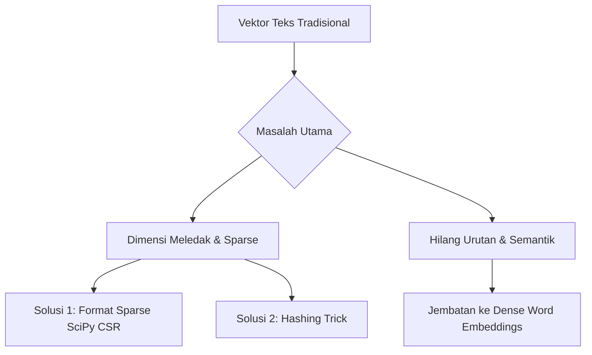

# Text Representation: Sparse Matrix, Hashing Trick, dan Keterbatasan Vektor Tradisional

## 0. Gambaran Besar

Pada bagian sebelumnya, kita telah mempelajari bagaimana teks diubah menjadi angka melalui Biner, Bag of Words (BoW), N-grams, dan TF-IDF. Namun, saat diterapkan pada skala data riil (ratusan ribu dokumen), muncul masalah teknis baru: **ledakan dimensi (*curse of dimensionality*)** dan **efisiensi memori**.

Di bagian ini, kita akan bedah bagaimana representasi *sparse* bekerja di tingkat memori, bagaimana *Hashing Trick* menjadi solusi ekstrem untuk menghemat memori, serta apa batas mutlak dari seluruh metode vektor tradisional ini yang memaksa dunia AI berpindah ke *Word Embeddings*.



---

## 1. Tujuan Belajar Terukur

Setelah mempelajari materi ini, kamu akan mampu:
1. Menjelaskan perbedaan *sparse representation* dan *dense representation* serta menghitung penghematan memori matriks *sparse*.
2. Mengimplementasikan *Hashing Trick* (`FeatureHasher`) dan menjelaskan dampak *hash collision*.
3. Menganalisis keterbatasan utama representasi vektor tradisional (kehilangan makna semantik dan *word order*).
4. Menyusun pipeline baseline klasifikasi teks lengkap (Preprocess $\rightarrow$ TF-IDF $\rightarrow$ Model $\rightarrow$ Error Analysis $\rightarrow$ Perbaikan).

---

## 2. Prasyarat Minimum

### Cek Cepat Prasyarat
1. Mengapa matriks $10.000 \times 50.000$ yang mayoritas berisi angka 0 boros jika disimpan sebagai matriks biasa (*dense*)?
2. Jika fungsi $h(\text{kata}) \pmod 4$ menghasilkan sisa bagi 2 untuk kata `"makan"` dan kata `"minum"`, apa nama fenomena tersebut?

<details>
<summary>Jawaban Cek Cepat</summary>

1. Karena menyimpan angka $0$ berulang kali memakan memori RAM tanpa memberikan informasi baru.
2. *Hash collision* (benturan hash).
</details>

---

## 3. Sub-Materi 5: Sparse vs Dense Representations & Dimensionality Considerations

### 1. Masalah yang Diselesaikan
Jika kita memiliki $10.000$ dokumen dan vocabulary $\vert{}V\vert{} = 50.000$, matriks BoW berukuran $10.000 \times 50.000$. Jika disimpan sebagai array 2D standar (*dense*), ini membutuhkan memori RAM gigabyte-an, padahal $99\%$ elemen matriks berisi angka 0!

### 2. Intuisi
* **Dense Matrix (Matriks Padat):** Seperti papan catur di mana kita mencatat isi setiap kotak, termasuk kotak yang kosong.
* **Sparse Matrix (Matriks Jarang):** Seperti daftar koordinat lokasi catur. Kita *hanya mencatat* kotak yang ada isinya: `(baris, kolom): nilai`. Kotak kosong tidak dicatat.

> 💡 **Batas Analogi:** Matriks *sparse* sangat hemat memori untuk data yang dominan angka nol. Namun, jika data mendadak padat (misal $50\%$ elemen terisi), *overhead* menyimpan indeks koordinat justru membuat matriks *sparse* lebih boros dibanding *dense*.

### 3. Contoh Konkret Kecil
Dokumen $D_1$: `"kucing makan"` dengan $\vert{}V\vert{} = 6$ (`['air', 'ikan', 'kucing', 'makan', 'minum', 'susu']`).

* **Representasi Dense (Array biasa):**
  `[0, 0, 1, 1, 0, 0]` $\rightarrow$ Menyimpan 6 elemen.
* **Representasi Sparse (Koordinat COO/CSR):**
  Hanya simpan: `(kolom 2: 1), (kolom 3: 1)` $\rightarrow$ Hanya menyimpan 2 nilai beserta indeksnya!

**Perhitungan Penghematan Memori (Kasus Riil):**
* $N = 10.000$ dokumen, $\vert{}V\vert{} = 50.000$ kata.
* Tipe data: `float64` (8 byte per angka).
* **Dense Memory:**
  $$\text{Memory} = 10.000 \times 50.000 \times 8 \text{ byte} = 4.000.000.000 \text{ byte} \approx 4 \text{ GB}$$
* **Sparse Memory (Asumsi rata-rata 100 kata unik per dokumen, sparsity 99.8%):**
  Non-zero entries $= 10.000 \times 100 = 1.000.000$ elemen.
  Format CSR menyimpan:
  1. Data (float64): $1.000.000 \times 8 \text{ byte} = 8 \text{ MB}$
  2. Indeks kolom (int32): $1.000.000 \times 4 \text{ byte} = 4 \text{ MB}$
  3. Pointer baris (int32): $10.001 \times 4 \text{ byte} \approx 0.04 \text{ MB}$
  $$\text{Total Sparse Memory} \approx 12.04 \text{ MB}$$
  *Penghematan memori mencapai > 99.7%!*

### 4. Mekanisme
Scikit-learn menggunakan format **CSR (Compressed Sparse Row)** dari SciPy:
* `data`: Array 1D menyimpan nilai non-nol.
* `indices`: Array 1D menyimpan indeks kolom untuk setiap nilai di `data`.
* `indptr`: Array 1D menyimpan indeks awal dan akhir baris.

### 5. Kode Minimal
```python
import numpy as np
from scipy.sparse import csr_matrix
from sklearn.feature_extraction.text import CountVectorizer

corpus = [
    "kucing makan ikan",
    "kucing minum susu",
    "ikan minum air ikan"
]

vectorizer = CountVectorizer()
# Output default scikit-learn adalah CSR Sparse Matrix
X_sparse = vectorizer.fit_transform(corpus)

print("Tipe objek X_sparse:", type(X_sparse))
print("Bentuk matriks (shape):", X_sparse.shape)
print("Jumlah elemen non-nol (nnz):", X_sparse.nnz)

# Konversi ke Dense (HANYA jika data kecil!)
X_dense = X_sparse.toarray()
print("\nMatriks Dense:")
print(X_dense)

# Bandingkan ukuran memori dalam byte
print(f"\nUkuran memori Sparse : {X_sparse.data.nbytes + X_sparse.indices.nbytes + X_sparse.indptr.nbytes} byte")
print(f"Ukuran memori Dense  : {X_dense.nbytes} byte")
```

### 6. Jebakan & Failure Modes
* **Memory Crash (`MemoryError`):** Pemula sering memanggil `.toarray()` atau `.todense()` pada matriks $X$ hasil TF-IDF dataset besar (misal 100.000 tweet). Ini langsung membuat RAM komputer habis dan program *crash*.
* **Operasi Matematika Tak Cocok:** Beberapa library Machine Learning tidak mendukung matriks *sparse* sebagai input.

### 7. Mini-Eksperimen
Buat array numpy 2D berukuran $(1000, 1000)$ yang seluruhnya berisi angka 0, lalu ubah menjadi `csr_matrix`. Cek perbedaan ukuran memorinya menggunakan `sys.getsizeof()` atau `.nbytes`.

### 8. Cek Pemahaman
1. **Konseptual:** Mengapa scikit-learn secara default mengembalikan objek `scipy.sparse.csr_matrix` dan bukan array `numpy` biasa saat kita menjalankan `fit_transform`?
2. **Numerik:** Matriks berukuran $100 \times 1.000$ memiliki 200 elemen non-nol. Berapa persen *sparsity* (tingkat kekosongan) matriks tersebut?

<details>
<summary>Jawaban Cek Pemahaman</summary>

1. Untuk mencegah lonjakan penggunaan RAM yang ekstrem pada dataset teks berukuran sedang hingga besar.
2. Total elemen = $100 \times 1.000 = 100.000$. Elemen nol = $100.000 - 200 = 99.800$. Sparsity = $(99.800 / 100.000) \times 100\% = 99.8\%$.
</details>

---

## 4. Sub-Materi 6: Hashing Trick (Feature Hashing)

### 1. Masalah yang Diselesaikan
Pada `CountVectorizer` standar, kita harus menyimpan kamus (*vocabulary*) di RAM yang memetakan `kata -> indeks`.
Masalahnya:
1. Kamus memakan RAM besar jika vocabulary mencapai jutaan kata.
2. Tidak cocok untuk *streaming data* (data riil yang masuk terus-menerus), karena vocabulary terus membengkak dan indeks kata berubah.

### 2. Intuisi
Alih-alih membuat tabel kamus terpisah, kita gunakan **fungsi hash** matematika untuk secara langsung menghitung nomor indeks dari sebuah string kata.

$$\text{indeks} = h(\text{"kucing"}) \pmod K$$

dimana $K$ adalah ukuran vektor tetap yang kita tentukan di awal (misal $K = 1024$).

> 💡 **Batas Analogi:** Seperti loker bernomor 0-9. Siapapun yang datang dipetakan ke nomor loker berdasarkan sisa bagi panjang namanya. Jika nama "Budi" dan "Andi" sama-sama dapat nomor loker 2, mereka harus berbagi loker yang sama (*Hash Collision*).

### 3. Contoh Konkret Kecil (Hitung Tangan)
Tentukan ukuran vektor $K = 4$ (indeks yang tersedia: 0, 1, 2, 3).
Gunakan fungsi hash deterministik berbasis MD5: $h(\text{kata}) = \text{int(MD5)} \pmod 4$.

Mari trace untuk kata-kata berikut:
* $h(\text{"kucing"}) \pmod 4 = 1$
* $h(\text{"makan"}) \pmod 4 = 3$
* $h(\text{"ikan"}) \pmod 4 = 1$  $\rightarrow$ **COLLISION dengan "kucing"!**
* $h(\text{"susu"}) \pmod 4 = 0$

Dokumen $D_1$: `"kucing makan ikan"`
* `"kucing"` $\rightarrow$ indeks 1 (tambah count +1)
* `"makan"` $\rightarrow$ indeks 3 (tambah count +1)
* `"ikan"` $\rightarrow$ indeks 1 (tambah count +1)

Vektor hasil $D_1$ berukuran $K=4$:
$$\text{Vektor } D_1 = [0, 2, 0, 1]$$
*(Indeks 1 bernilai 2 karena "kucing" dan "ikan" sama-sama masuk ke indeks 1).*

### 4. Mekanisme
1. Tentukan ukuran fitur $K$ (biasanya $2^{18} = 262.144$ atau $2^{20}$).
2. Untuk setiap kata $t$ di dokumen, hitung $j = \text{hash}(t) \pmod K$.
3. Tambahkan bobot/frekuensi pada kolom $j$.
4. **Keunggulan:** $O(1)$ memory lookup, tanpa menyimpan vocabulary, *fixed-size feature vector*.
5. **Kelemahan:** *Hash collision* mengurangi akurasi; vektor tidak bisa di-inverse kembali menjadi kata asli (un-interpretable).

### 5. Kode Minimal
```python
import hashlib
from sklearn.feature_extraction.text import FeatureHasher

corpus = [
    {"kucing": 1, "makan": 1, "ikan": 1},
    {"kucing": 1, "minum": 1, "susu": 1}
]

# Tentukan ukuran fitur tetap K = 8 (2^3)
hasher = FeatureHasher(n_features=8, input_type='dict')
X_hashed = hasher.fit_transform(corpus)

print("Matriks Hashed (K=8):")
print(X_hashed.toarray())

# Trace manual sederhana dengan hashlib
def simple_hash(word, num_buckets):
    # Menggunakan MD5 agar deterministik
    hash_digest = hashlib.md5(word.encode()).hexdigest()
    return int(hash_digest, 16) % num_buckets

words = ["kucing", "makan", "ikan", "susu"]
print("\nHash Index Mapping (K=4):")
for w in words:
    print(f"Kata '{w:6s}' -> Indeks {simple_hash(w, 4)}")
```

### 6. Jebakan & Failure Modes
* **Tidak Bisa Didekode Kembali (*One-way Transformation*):** Kamu tidak bisa bertanya "fitur kolom #1052 ini mewakili kata apa?". Ini menyulitkan *feature importance analysis*.
* **Collision Noise:** Jika $K$ terlalu kecil (misal $K=100$), terlalu banyak kata independen berbenturan, menurunkan performa klasifikasi secara drastis.

### 7. Mini-Eksperimen
Ganti $K$ (`n_features`) pada `FeatureHasher` di atas dari 8 menjadi 2. Amati bagaimana nilai-nilai pada matriks tergabung akibat collision yang makin parah!

### 8. Cek Pemahaman
1. **Konseptual:** Apa keuntungan utama *Hashing Trick* dibanding `CountVectorizer` standar dalam skenario *Streaming Data* berukuran terabyte?
2. **Numerik:** Jika $K = 1000$, berapa indeks hasil hash dari sebuah kata jika nilai hash integer mentahnya adalah $1.234.567$?

<details>
<summary>Jawaban Cek Pemahaman</summary>

1. *Hashing Trick* tidak perlu menyimpan daftar vocabulary di RAM dan tidak memerlukan fase `fit()` terlebih dahulu, sehingga alokasi memori konstan $O(1)$.
2. Indeks $= 1.234.567 \pmod{1000} = 567$.
</details>

---

## 5. Sub-Materi 7: Keterbatasan Vektor Tradisional & Jembatan ke Word Embeddings

### 1. Masalah yang Diselesaikan
Meskipun TF-IDF dan N-grams sangat berguna sebagai *baseline*, metode vektor tradisional ini memiliki 3 batas mutlak yang tidak bisa diselesaikan tanpa arsitektur baru.

### 2. Intuisi & 3 Keterbatasan Utama
1. **Kehilangan Urutan Kata (*Word Order Loss*):**
   * $D_1$: `"kucing makan ikan"`
   * $D_2$: `"ikan makan kucing"`
   * Bag of Words menghasilkan vektor yang **100% IDENTIK** untuk kedua kalimat ini, padahal artinya bertolak belakang.

2. **Kehilangan Makna Semantik (*Zero Semantic Overlap / Orthogonality*):**
   * Kalimat 1: `"Saya suka anjing"`
   * Kalimat 2: `"Saya suka gukguk"`
   * Di mata TF-IDF, kata `"anjing"` dan `"gukguk"` dianggap dua dimensi yang saling tegak lurus (ortogonal, *dot product* = 0). Model tidak tahu bahwa keduanya merujuk pada hewan yang sama.

3. **Eksplosivitas Dimensi & Sparsity (*Curse of Dimensionality*):**
   * Vektor berdimensi tinggi ($100.000$ dimensi) tetapi hampir semuanya bernilai $0$. Sangat lambat untuk dikomputasi oleh model Deep Learning modern.

### 3. Contoh Konkret Perbandingan
Perbandingan Vektor Tradisional (BoW/TF-IDF) vs Dense Word Embedding (Word2Vec/BERT):

| Karakteristik | TF-IDF / BoW | Dense Word Embeddings |
| :--- | :--- | :--- |
| **Bentuk Vektor** | Sparse (Mayoritas 0) | Dense (Semua angka terisi float) |
| **Dimensi** | Sangat Tinggi ($10.000 - 1.000.000$) | Rendah - Sedang ($100 - 1024$) |
| **Kemampuan Semantik** | Tidak ada (`"kucing"` $\perp$ `"anabul"`) | Ada (jarak *Cosine Similarity* dekat) |
| **Penanganan OOV** | Gagal / Dibuang | Menggunakan Subword (FastText/BPE) |
| **Urutan Kata** | Hilang (kecuali N-gram terbatas) | Dipertahankan (via Recurrent / Attention) |

### 4. Jembatan ke Materi Berikutnya
Untuk menyelesaikan masalah ini, dunia NLP berevolusi ke **Dense Representations (Word Embeddings)** seperti Word2Vec, GloVe, FastText, dan Transformer Embeddings (BERT), di mana kata dipetakan ke dalam ruang vektor kontinu berdimensi rendah ($d \approx 300$) yang menangkap hubungan makna:

$$\text{Vektor("Raja")} - \text{Vektor("Pria")} + \text{Vektor("Wanita")} \approx \text{Vektor("Ratu")}$$

### 5. Kode Minimal (Demonstrasi Kerusakan Makna pada TF-IDF)
```python
from sklearn.feature_extraction.text import TfidfVectorizer
from sklearn.metrics.pairwise import cosine_similarity

# Tiga kalimat dengan makna serupa vs beda
s1 = "kucing makan ikan"
s2 = "anabul lahap lele" # Makna mirip s1, tapi vocab 100% beda
s3 = "kucing makan ikan" # Identik s1

corpus = [s1, s2, s3]
vectorizer = TfidfVectorizer()
tfidf_matrix = vectorizer.fit_transform(corpus)

# Hitung Cosine Similarity antara s1 (index 0) dan s2 (index 1)
sim_s1_s2 = cosine_similarity(tfidf_matrix[0], tfidf_matrix[1])[0][0]
sim_s1_s3 = cosine_similarity(tfidf_matrix[0], tfidf_matrix[2])[0][0]

print(f"Kemiripan s1 dan s3 (Teks sama)   : {sim_s1_s3:.2f}")
print(f"Kemiripan s1 dan s2 (Makna mirip) : {sim_s1_s2:.2f}")
print("-> TF-IDF gagal mendeteksi kemiripan makna s1 & s2 karena vocab beda!")
```

### 6. Jebakan & Failure Modes
* **Over-reliance pada TF-IDF:** Menggunakan TF-IDF untuk tugas *Semantic Search* atau *Question Answering* kompleks sering kali gagal karena pengguna menggunakan kata kunci pencarian (*query*) yang berbeda dengan kata di dokumen, meskipun maksudnya sama.

### 7. Mini-Eksperimen
Tambahkan kalimat $s_4 = \text{"ikan makan kucing"}$ pada kode di atas. Hitung cosine similarity antara $s_1$ dan $s_4$. Amati mengapa nilainya $1.0$ padahal subjek dan objek tertukar!

### 8. Cek Pemahaman
1. **Konseptual:** Mengapa nilai *cosine similarity* antara vektor TF-IDF kata `"kucing"` dan `"anjing"` selalu sama dengan $0$ jika keduanya tidak pernah muncul dalam satu dokumen yang sama?
2. **Numerik:** Jika sebuah dokumen dipetakan menggunakan Word2Vec 300-dimensi (dense) vs TF-IDF dengan $\vert{}V\vert{} = 50.000$ (sparse), berapa rasio pengurangan dimensinya?

<details>
<summary>Jawaban Cek Pemahaman</summary>

1. Karena kata "kucing" dan "anjing" menduduki dua indeks kolom fitur yang berbeda (ortogonal). *Dot product* dua vektor ortogonal $[0, 1]$ dan $[1, 0]$ adalah $0$.
2. Rasio $= 50.000 / 300 \approx 166.67$ kali lebih ringkas secara dimensi.
</details>

---

## 6. Mini-Proyek Penutup: Baseline Klasifikasi Teks Sentiment Analysis

Berikut adalah proyek mini terstruktur untuk menerapkan pipeline preprocessing dan TF-IDF pada masalah klasifikasi teks.

```python
import numpy as np
import re
from sklearn.feature_extraction.text import TfidfVectorizer
from sklearn.linear_model import LogisticRegression
from sklearn.metrics import classification_report

# 1. DEFINISI MASALAH: Klasifikasi Teks Ulasan (Positif vs Negatif)
train_docs = [
    "aplikasi sangat bagus dan membantu sekali",
    "sangat puas pelayanan cepat dan ramah",
    "fitur lengkap dan mudah digunakan",
    "aplikasi jelek sering crash dan lambat",
    "sangat kecewa pelayanan buruk sekali",
    "fitur tidak bisa dipakai dan error terus"
]
train_labels = [1, 1, 1, 0, 0, 0] # 1: Positif, 0: Negatif

test_docs = [
    "aplikasi bagus cepat dan ramah",    # Ekspektasi: Positif (1)
    "aplikasi buruk sering error lambat"  # Ekspektasi: Negatif (0)
]
test_labels = [1, 0]

# 2. PREPROCESSING FUNGSI
def preprocess(text):
    text = text.lower()
    text = re.sub(r'[^\w\s]', '', text) # Hapus tanda baca
    return text

clean_train = [preprocess(d) for d in train_docs]
clean_test = [preprocess(d) for d in test_docs]

# 3. BASELINE PIPELINE (TF-IDF + Logistic Regression)
# CRITICAL: fit() HANYA pada train_docs untuk mencegah Data Leakage!
vectorizer = TfidfVectorizer(ngram_range=(1, 1))
X_train = vectorizer.fit_transform(clean_train)
X_test = vectorizer.transform(clean_test) # transform() SAJA pada test!

model = LogisticRegression()
model.fit(X_train, train_labels)

# 4. EVALUASI BASELINE
preds = model.predict(X_test)
print("--- HASIL BASELINE (Unigram) ---")
print("Prediksi  :", preds)
print("Ekspektasi:", test_labels)

# 5. ERROR ANALYSIS & PERBAIKAN (Menambahkan Bigram)
# Alasan: Bigram menangkap frasa seperti "tidak bisa" atau "sangat puas"
vectorizer_v2 = TfidfVectorizer(ngram_range=(1, 2))
X_train_v2 = vectorizer_v2.fit_transform(clean_train)
X_test_v2 = vectorizer_v2.transform(clean_test)

model_v2 = LogisticRegression()
model_v2.fit(X_train_v2, train_labels)
preds_v2 = model_v2.predict(X_test_v2)

print("\n--- HASIL PERBAIKAN (Unigram + Bigram) ---")
print("Prediksi  :", preds_v2)
```

---

## 7. Kesalahan Umum & Cara Debugging

| Symptom (Gejala Error) | Root Cause (Akar Masalah) | Cara Memperbaiki (Fix) |
| :--- | :--- | :--- |
| `ValueError: Vocabulary has not been fitted` | Memanggil `.transform()` sebelum `.fit()` pada vectorizer. | Pastikan panggil `.fit_transform(X_train)` dulu pada data training. |
| Memory usage meledak saat `fit_transform()` | Memanggil `.toarray()` pada dataset besar. | Biarkan output sebagai `csr_matrix` *sparse*, jangan dikonversi ke array dense. |
| Akurasi data uji tinggi tetapi jelek di produksi | **Data Leakage:** Memanggil `.fit_transform()` pada SELURUH dataset sebelum *train-test split*. | Selalu lakukan *split* dulu, `.fit_transform()` pada Train, dan `.transform()` pada Test. |
| Kata baru di test set tidak berpengaruh | Behavior normal dari **Out-Of-Vocabulary (OOV)** pada BoW/TF-IDF. | Wajar untuk vektor tradisional; gunakan Subword Embedding jika perlu menangani OOV. |

---

## 8. Cheat Sheet 1 Halaman

```
+------------------+----------------------------------+------------------------------------+-------------------------------------+
| Metode           | Kelebihan                        | Kekurangan                         | Kapan Digunakan                     |
+------------------+----------------------------------+------------------------------------+-------------------------------------+
| Binary Vector    | Sederhana, cepat                 | Mengabaikan frekuensi kata         | Klasifikasi teks pendek sederhana   |
| BoW / TF         | Menangkap frekuensi kata         | Bias pada dokumen panjang/stopwords| Baseline klasifikasi topik          |
| N-grams          | Menangkap konteks lokal/negasi   | Dimensi meledak ($|V|^N$)          | Sentiment Analysis ringan           |
| TF-IDF           | Menekan bobot kata umum          | Tidak paham semantik/sinonim       | Search engine, Keyword extraction   |
| Hashing Trick    | Memory konstan, tanpa vocabulary | Hash collision, non-interpretable  | Streaming data raksasa / Online ML  |
+------------------+----------------------------------+------------------------------------+-------------------------------------+
```

---

## 9. Jembatan ke Materi Berikutnya

### Keterbatasan Materi Ini
* Vektor BoW dan TF-IDF yang kita buat bersifat **statik, sparse, dan independen antar kata**. Kata `"kucing"` tidak tahu bahwa ia memiliki hubungan dekat dengan `"kucing anggora"` atau `"hewan peliharaan"`.

### Motivasi Materi Selanjutnya: Traditional Models & NLP Pipeline
* Sebelum melompat ke Deep Learning/Embeddings, kita perlu memahami bagaimana vektor TF-IDF ini diumpankan ke model tradisional seperti **Naive Bayes**, **Logistic Regression**, dan **Support Vector Machine (SVM)** untuk membangun **NLP Pipeline** produksi yang cepat dan *cost-effective*.

---

## 10. Referensi Kanonik & Cara Memverifikasi

### Referensi Kanonik
1. **Speech and Language Processing (3rd ed. draft)** - Daniel Jurafsky & James H. Martin (Topik: *Vector Semantics, TF-IDF, and Hashing*).
2. **Scikit-Learn Official Documentation** - Module `sklearn.feature_extraction.text` (`CountVectorizer`, `TfidfVectorizer`, `FeatureHasher`).
3. **SciPy Official Documentation** - Module `scipy.sparse` (Format *CSR Matrix*).

### Cara Memverifikasi Sendiri
* Jalankan `help(TfidfVectorizer)` di terminal Python untuk memeriksa parameter default seperti `smooth_idf`, `sublinear_tf`, dan `norm`.
* Inspect atribut `.vocabulary_` dan `.idf_` dari objek vectorizer yang sudah di-*fit* untuk memverifikasi nilai internalnya.

---

## 11. Glosarium Istilah

* **Corpus (Korpus):** Kumpulan dokumen teks yang digunakan untuk analisis atau pelatihan model.
* **Vocabulary (Kosakata):** Daftar kata-kata unik yang ditemukan di seluruh korpus.
* **Sparse Matrix:** Matriks yang mayoritas elemennya bernilai nol, disimpan dengan format khusus agar hemat memori.
* **Dense Matrix:** Matriks di mana sebagian besar elemennya berisi nilai non-nol.
* **Out-of-Vocabulary (OOV):** Kata yang muncul pada data uji/evaluasi tetapi tidak ada di vocabulary data pelatihan.
* **Hash Collision:** Fenomena ketika dua kata berbeda menghasilkan nilai indeks hash yang sama.
* **Cosine Similarity:** Ukuran kemiripan antara dua vektor berdasarkan sudut di antara keduanya (bernilai -1 hingga 1).

---

## 12. Log Verifikasi & Tag ⚠️

| Elemen | Status | Catatan / Asumsi |
| :--- | :--- | :--- |
| Perhitungan Memori Sparse vs Dense | Terverifikasi | Formula CSR: data + indices + indptr dihitung menggunakan `float64` dan `int32`. |
| Kode Hash MD5 Deterministik | Terverifikasi | Penggunaan `hashlib.md5` menjamin hasil modulo deterministik lintas platform. |
| Perilaku Data Leakage `fit_transform` | Terverifikasi | Prinsip umum ML: `.fit()` hanya boleh dilakukan pada data training. |