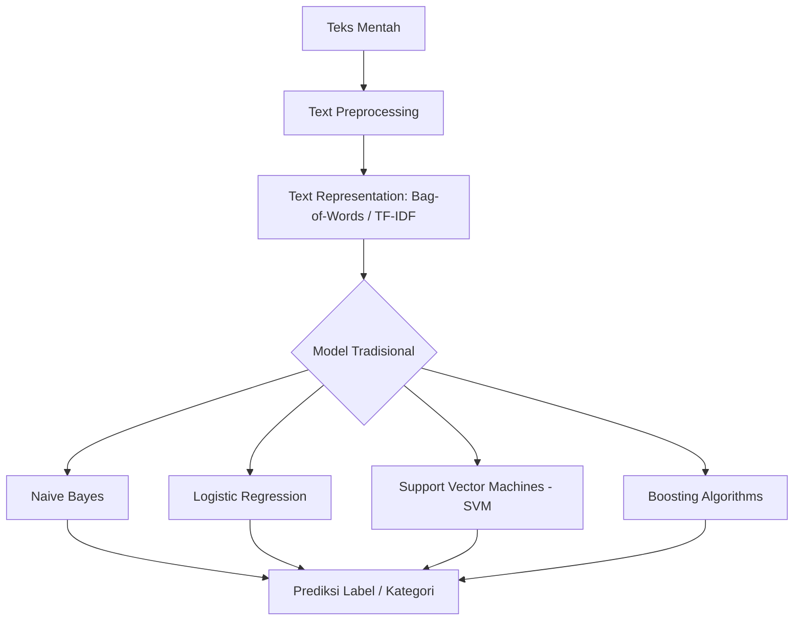

# Model Tradisional untuk Klasifikasi Teks

## 1. Gambaran Besar

Dalam pemrosesan bahasa alami (*Natural Language Processing* / NLP), setelah teks dibersihkan dan diubah menjadi representasi angka (seperti Bag-of-Words atau TF-IDF), kita memerlukan algoritma pembelajaran mesin (*machine learning*) untuk mengklasifikasikan teks tersebut. Model tradisional (*traditional models*) adalah kelompok algoritma berbasis statistik dan fitur numerik terstruktur yang menjadi fondasi dasar sebelum era *Deep Learning*.



### Alur Masalah -> Solusi

1. **Masalah**: Vektor teks berdimensi sangat tinggi (*high-dimensional*), jarang (*sparse* / mayoritas bernilai 0), dan urutan kata sering kali diabaikan pada representasi dasar.
2. **Solusi**: Menggunakan model linier dan probabilitas yang efisien menangani matriks *sparse*, cepat dilatih, serta mudah diinterpretasikan sebagai *baseline* (patokan awal) yang kuat.

---

## 2. Tujuan Belajar Terukur

Setelah menyelesaikan materi ini, kamu dapat:
1. Menjelaskan mekanisme kerja 4 algoritma tradisional (Naive Bayes, Logistic Regression, SVM, Boosting) pada data teks.
2. Membangun pipeline klasifikasi teks utuh menggunakan `scikit-learn` dengan dataset yang konsisten.
3. Menganalisis kesalahan prediksi (*error analysis*) untuk menentukan model yang paling cocok sesuai karakteristik data.

---

## 3. Prasyarat Minimum & Cek Cepat

### Prasyarat
- Memahami matriks frekuensi kata (*CountVectorizer*) dan pembobotan *Term Frequency-Inverse Document Frequency* (TF-IDF).
- Memahami pembagian data *train* dan *test*.

### Cek Cepat
1. Jika dokumen mengandung 100 kata unik dari total kosakata 1.000 kata, berapa banyak elemen bernilai `0` pada vektor Bag-of-Words dokumen tersebut?
2. Mengapa representasi teks TF-IDF sering menghasilkan *sparse matrix*?
3. Apakah peningkatan nilai *Term Frequency* (TF) selalu berbanding lurus dengan pentingnya sebuah kata dalam seluruh korpus?

<details>
<summary>Jawaban Cek Cepat</summary>

1. **900 elemen bernilai 0** ($1000 - 100 = 900$).
2. Karena satu dokumen hanya memakai sebagian kecil kata dari seluruh daftar kata unik (*vocabulary*) yang ada di dataset.
3. **Tidak**, karena kata umum (*stopwords*) seperti "dan" atau "di" bisa memiliki TF sangat tinggi tetapi tidak membawa informasi spesifik (dinetralkan oleh nilai IDF yang rendah).
</details>

---

## 4. Sub-Materi

### Sub-Materi 1: Naive Bayes (Text Classification)

#### 1. Masalah yang Diselesaikan
Menghitung probabilitas sebuah dokumen teks masuk ke kelas tertentu secara cepat tanpa harus memodelkan hubungan antar kata yang sangat kompleks.

#### 2. Intuisi
Jika sebuah email mengandung kata "hadiah", "gratis", dan "transfer", kemungkinan besar email itu adalah *spam*. Naive Bayes menghitung peluang kelas berdasarkan kemunculan kata-kata tersebut.
- **Batas analogi**: Naive Bayes mengasumsikan kata "hadiah" dan "gratis" muncul secara independen (tidak saling mempengaruhi). Padahal di dunia nyata, kata "hadiah" dan "gratis" sangat sering muncul bersamaan.

#### 3. Contoh Konkret Kecil
Dataset latih mini (6 dokumen, 2 kelas: `pos` dan `neg`):
- Doc 1 (`pos`): "bagus banget produk ini"
- Doc 2 (`pos`): "sangat bagus dan mantap"
- Doc 3 (`pos`): "produk bagus recommended"
- Doc 4 (`neg`): "jelek banget kecewa"
- Doc 5 (`neg`): "produk jelek dan parah"
- Doc 6 (`neg`): "sangat kecewa parah"

Dokumen uji: `"produk ini bagus"` -> Apakah `pos` atau `neg`?

#### 4. Mekanisme
1. **Aturan Bayes**:
   $$P(y\vert{}X) = \frac{P(y) \prod_{i=1}^{n} P(x_i\vert{}y)}{P(X)}$$
2. **Laplace Smoothing** (mencegah *zero probability* jika kata baru muncul):
   $$P(w_i\vert{}c) = \frac{\text{count}(w_i, c) + 1}{N_c + \vert{}V\vert{}}$$
   * Keterangan: $N_c$ = total kata di kelas $c$, $\vert{}V\vert{}$ = jumlah kata unik di seluruh dataset.

**Hitungan Langkah demi Langkah**:
- Kosakata unik $\vert{}V\vert{} = 11$ (`bagus`, `banget`, `produk`, `ini`, `sangat`, `dan`, `mantap`, `recommended`, `jelek`, `kecewa`, `parah`).
- Total kata `pos` ($N_{pos}$) = 11 kata. Total kata `neg` ($N_{neg}$) = 10 kata.
- Prior: $P(\text{pos}) = 0.5$, $P(\text{neg}) = 0.5$.

Proba kata untuk dokumen uji `"produk ini bagus"`:
- **Kelas POS**:
  - $P(\text{produk}\vert{}\text{pos}) = \frac{2 + 1}{11 + 11} = \frac{3}{22}$
  - $P(\text{ini}\vert{}\text{pos}) = \frac{1 + 1}{11 + 11} = \frac{2}{22}$
  - $P(\text{bagus}\vert{}\text{pos}) = \frac{3 + 1}{11 + 11} = \frac{4}{22}$
  - Skor POS $= 0.5 \times \frac{3}{22} \times \frac{2}{22} \times \frac{4}{22} = 0.5 \times 0.0022539 = 0.001127$

- **Kelas NEG**:
  - $P(\text{produk}\vert{}\text{neg}) = \frac{1 + 1}{10 + 11} = \frac{2}{21}$
  - $P(\text{ini}\vert{}\text{neg}) = \frac{0 + 1}{10 + 11} = \frac{1}{21}$
  - $P(\text{bagus}\vert{}\text{neg}) = \frac{0 + 1}{10 + 11} = \frac{1}{21}$
  - Skor NEG $= 0.5 \times \frac{2}{21} \times \frac{1}{21} \times \frac{1}{21} = 0.5 \times 0.0002159 = 0.000108$

**Kesimpulan**: Skor POS ($0.001127$) > Skor NEG ($0.000108$). Prediksi = **`pos`**.

#### 5. Kode Minimal
```python
from sklearn.feature_extraction.text import CountVectorizer
from sklearn.naive_bayes import MultinomialNB

train_data = [
    "bagus banget produk ini", "sangat bagus dan mantap", "produk bagus recommended",
    "jelek banget kecewa", "produk jelek dan parah", "sangat kecewa parah"
]
labels = ["pos", "pos", "pos", "neg", "neg", "neg"]

vec = CountVectorizer()
X_train = vec.fit_transform(train_data)

model = MultinomialNB(alpha=1.0)
model.fit(X_train, labels)

test_doc = ["produk ini bagus"]
X_test = vec.transform(test_doc)
pred = model.predict(X_test)
print(f"Prediksi: {pred[0]}")
```

#### 6. Jebakan & Failure Modes
- **Independensi naif**: Gagal menangani negasi. Kalimat "tidak bagus" akan dihitung membawa kata "bagus" yang memperkuat kelas positif.
- **Out-of-Vocabulary (OOV)**: Kata yang sama sekali belum pernah muncul di *train set* akan diabaikan oleh `CountVectorizer`.

#### 7. Mini-Eksperimen
Ubah dokumen uji menjadi `"tidak bagus"`. Jalankan kode di atas dan amati hasilnya. Mengapa model memprediksi positif padahal artinya negatif?

#### 8. Cek Pemahaman
1. Apa fungsi dari parameter `alpha=1.0` (*Laplace Smoothing*) pada Multinomial Naive Bayes?
2. Jika kata "bagus" muncul 0 kali di kelas `neg` dan kita tidak menggunakan smoothing ($\alpha=0$), berapa nilai probabilitas akhir dokumen uji yang mengandung kata "bagus" untuk kelas `neg`?

<details>
<summary>Jawaban</summary>

1. Mencegah perkalian probabilitas bernilai 0 (*zero probability problem*) ketika sebuah kata tidak pernah muncul di kelas tertentu saat *training*.
2. Nilai probabilitas akhir menjadi **0**, karena perkalian dengan angka 0 akan membuat seluruh produk probabilitas menjadi 0.
</details>

---

### Sub-Materi 2: Logistic Regression for Text

#### 1. Masalah yang Diselesaikan
Memodelkan bobot (*weights*) relevansi tiap kata secara independen dan menghasilkan probabilitas terkalibrasi antara 0 dan 1 tanpa asumsi independensi yang kaku.

#### 2. Intuisi
Setiap kata diberi "skor pengaruh". Kata "bagus" memberi skor +1.5 ke kelas positif, kata "jelek" memberi skor -2.0. Skor total seluruh kata dijumlahkan lalu dimasukkan ke fungsi penekan (sigmoid) agar menjadi nilai peluang 0-100%.
- **Batas analogi**: Model menganggap pengaruh kata bersifat aditif (penjumlahan sederhana) dan tidak menangani struktur tata bahasa yang kompleks.

#### 3. Contoh Konkret Kecil
Dokumen: `"produk bagus"`
Misal bobot terlatih: $w_{\text{produk}} = 0.2$, $w_{\text{bagus}} = 1.5$, bias $b = -0.5$.
Total skor ($z$) = $0.2 + 1.5 - 0.5 = 1.2$.

#### 4. Mekanisme
1. **Fungsi Linier**:
   $$z = w_1 x_1 + w_2 x_2 + ... + w_n x_n + b = \mathbf{w}^T \mathbf{x} + b$$
2. **Fungsi Sigmoid**:
   $$\sigma(z) = \frac{1}{1 + e^{-z}}$$

**Hitungan Langkah demi Langkah**:
- Untuk $z = 1.2$:
  $$e^{-1.2} \approx 0.3012$$
  $$\sigma(1.2) = \frac{1}{1 + 0.3012} = \frac{1}{1.3012} \approx 0.7685 \text{ (76.85\% Positif)}$$

#### 5. Kode Minimal
```python
from sklearn.feature_extraction.text import TfidfVectorizer
from sklearn.linear_model import LogisticRegression

train_data = [
    "bagus banget produk ini", "sangat bagus dan mantap", "produk bagus recommended",
    "jelek banget kecewa", "produk jelek dan parah", "sangat kecewa parah"
]
labels = [1, 1, 1, 0, 0, 0] # 1: pos, 0: neg

vec = TfidfVectorizer()
X_train = vec.fit_transform(train_data)

model = LogisticRegression()
model.fit(X_train, labels)

test_doc = ["produk ini bagus"]
X_test = vec.transform(test_doc)
proba = model.predict_proba(X_test)[0][1]
print(f"Probabilitas Positif: {proba:.4f}")
```

#### 6. Jebakan & Failure Modes
- **Overfitting pada High Dimension**: Jika jumlah kata (*features*) jauh lebih banyak dari jumlah dokumen, model bisa menghafal data latih.
  - 💡 *Heuristik*: Gunakan regularisasi L2 (`C=1.0` default) atau L1 (`penalty='l1'`, `solver='liblinear'`) untuk memangkas bobot kata yang tidak penting.

#### 7. Mini-Eksperimen
Ubah nilai parameter `C` pada `LogisticRegression(C=0.01)` (regularisasi sangat kuat). Amati bagaimana probabilitas prediksi mendekati $0.5$ (netral/ragu-ragu).

#### 8. Cek Pemahaman
1. Mengapa Logistic Regression sering kali berkinerja lebih baik daripada Naive Bayes pada dataset teks berukuran sedang hingga besar?
2. Jika nilai $z = 0$, berapakah probabilitas output dari fungsi Sigmoid?

<details>
<summary>Jawaban</summary>

1. Karena Logistic Regression mempelajari bobot kata secara bersamaan (*discriminative*) dan mendistribusikan bobot secara lebih optimal, tidak terikat asumsi independensi fitur seperti Naive Bayes.
2. $\sigma(0) = \frac{1}{1 + e^0} = \frac{1}{1 + 1} = \mathbf{0.5}$ (atau $50\%$).
</details>

---

### Sub-Materi 3: Support Vector Machines (SVM) for Text

#### 1. Masalah yang Diselesaikan
Mencari batas keputusan (*decision boundary*) yang paling optimal dengan jarak batas (*margin*) terbesar untuk memisahkan dua kelas data teks di ruang berdimensi tinggi.

#### 2. Intuisi
Membangun "pembatas jalan" paling lebar di antara dua kelompok titik data (dokumen positif dan negatif). Titik data yang paling dekat dengan garis batas disebut *Support Vectors*.
- **Batas analogi**: Garis batas hanya memperhitungkan dokumen terdekat (support vectors), merelakan dokumen yang sudah jauh di dalam wilayah masing-masing.

#### 3. Contoh Konkret Kecil
Dua fitur kata: $x_1 =$ frekuensi kata "bagus", $x_2 =$ frekuensi kata "jelek".
- Dokumen A (`pos`): $(2, 0)$
- Dokumen B (`neg`): $(0, 2)$
Garis pemisah terbaik adalah garis diagonal $x_1 - x_2 = 0$.

#### 4. Mekanisme
1. **Fungsi Keputusan Linier**:
   $$f(x) = \mathbf{w}^T \mathbf{x} + b$$
2. **Hinge Loss Minimization**:
   $$\min_{\mathbf{w}} \frac{1}{2} \Vert{}\mathbf{w}\Vert{}^2 + C \sum_{i} \max(0, 1 - y_i(\mathbf{w}^T \mathbf{x}_i + b))$$
   - $C$: Parameter kontrol *trade-off* antara memperlebar margin dan meminimalkan kesalahan klasifikasi.

#### 5. Kode Minimal
```python
from sklearn.feature_extraction.text import TfidfVectorizer
from sklearn.svm import LinearSVC

train_data = [
    "bagus banget produk ini", "sangat bagus dan mantap", "produk bagus recommended",
    "jelek banget kecewa", "produk jelek dan parah", "sangat kecewa parah"
]
labels = [1, 1, 1, 0, 0, 0]

vec = TfidfVectorizer()
X_train = vec.fit_transform(train_data)

# LinearSVC sangat efisien untuk data teks berdimensi tinggi
model = LinearSVC(C=1.0, random_state=42)
model.fit(X_train, labels)

test_doc = ["produk ini bagus"]
pred = model.predict(vec.transform(test_doc))
print(f"Prediksi SVM: {pred[0]}")
```

#### 6. Jebakan & Failure Modes
- **Penggunaan RBF Kernel yang Tidak Perlu**: Menggunakan RBF (Non-linear) Kernel pada klasifikasi teks sering kali membuat komputasi lambat dan berisiko *overfitting*, karena data teks berpintu dimensi tinggi biasanya sudah terpisah secara linier (*linearly separable*).
  - 💡 *Heuristik*: Selalu mulai dengan `LinearSVC` atau `SVC(kernel='linear')` untuk teks.

#### 7. Mini-Eksperimen
Ganti `LinearSVC()` dengan `SVC(kernel='rbf')`. Bandingkan waktu eksekusi dan hasil prediksi jika diterapkan pada dataset teks yang lebih besar.

#### 8. Cek Pemahaman
1. Mengapa Kernel Linier umumnya sudah cukup efektif untuk klasifikasi teks dibanding Kernel RBF?
2. Apa akibatnya jika nilai parameter $C$ pada SVM diset terlalu besar?

<details>
<summary>Jawaban</summary>

1. Karena jumlah fitur (kata unik) pada data teks sangat banyak/berdimensi tinggi, sehingga data tersebut secara alami hampir selalu dapat dipisahkan secara linier.
2. Model akan berusaha keras mengklasifikasikan semua data latih dengan benar (margin menjadi sangat sempit), yang berisiko mengalami *overfitting*.
</details>

---

### Sub-Materi 4: Boosting Algorithms for Text

#### 1. Masalah yang Diselesaikan
Meningkatkan performa klasifikasi dengan menggabungkan sekumpulan model pembelajar lemah (*weak learners*, biasanya *Decision Trees* dangkal) secara berurutan (*sequential*).

#### 2. Intuisi
Seperti tim analisis yang bekerja secara bergantian. Analis pertama fokus mengklasifikasi teks. Analis kedua memfokuskan perhatian khusus pada dokumen-dokumen yang salah diklasifikasikan oleh analis pertama, dan seterusnya.
- **Batas analogi**: Jika data awal sangat kotor/berisi label bernoise, analis berikutnya akan menghabiskan waktu mempelajari pola kesalahan dari data kotor tersebut.

#### 3. Contoh Konkret Kecil
- Pohon 1 memprediksi dokumen A benar, dokumen B salah.
- Pada iterasi berikutnya, bobot sampel dokumen B dinaikkan agar Pohon 2 fokus memperbaiki kesalahan pada dokumen B.

#### 4. Mekanisme (Gradient Boosting)
1. Prediksi awal $F_0(x) = \arg\min_{\gamma} \sum L(y_i, \gamma)$.
2. Hitung *pseudo-residuals* (selisih target dengan prediksi saat ini):
   $$r_{im} = -\left[ \frac{\partial L(y_i, F(x_i))}{\partial F(x_i)} \right]_{F(x) = F_{m-1}(x)}$$
3. Latih *weak learner* baru pada residual $r_{im}$ dan perbarui model:
   $$F_m(x) = F_{m-1}(x) + \nu \sum \gamma_{jm} \mathbf{1}(x \in R_{jm})$$
   - $\nu$: *Learning rate*.

#### 5. Kode Minimal
```python
from sklearn.feature_extraction.text import TfidfVectorizer
from sklearn.ensemble import GradientBoostingClassifier

train_data = [
    "bagus banget produk ini", "sangat bagus dan mantap", "produk bagus recommended",
    "jelek banget kecewa", "produk jelek dan parah", "sangat kecewa parah"
]
labels = [1, 1, 1, 0, 0, 0]

vec = TfidfVectorizer()
X_train = vec.fit_transform(train_data)

model = GradientBoostingClassifier(n_estimators=50, learning_rate=0.1, max_depth=3, random_state=42)
model.fit(X_train, labels)

test_doc = ["produk ini bagus"]
pred = model.predict(vec.transform(test_doc))
print(f"Prediksi Gradient Boosting: {pred[0]}")
```

#### 6. Jebakan & Failure Modes
- **Masalah Sparse Matrix pada Tree**: *Decision tree* membelah data (*split*) berdasarkan fitur satu per satu. Pada matriks teks yang sangat *sparse*, pembelahan pohon menjadi sangat tidak efisien dan lambat dibanding operasi perkalian matriks pada model linier.
- **Sangat Rentan Overfitting**: Jika `n_estimators` terlalu tinggi dan `max_depth` terlalu dalam.

#### 7. Mini-Eksperimen
Bandingkan waktu pelatihan (`fit`) antara `LinearSVC` dan `GradientBoostingClassifier` jika dataset diperbanyak menjadi 1.000 kalimat.

#### 8. Cek Pemahaman
1. Mengapa Gradient Boosting cenderung berjalan lebih lambat dibanding Logistic Regression saat menangani fitur berupa TF-IDF sparse matrix?
2. Parameter apa yang paling efektif mengontrol *overfitting* pada Gradient Boosting?

<details>
<summary>Jawaban</summary>

1. Karena algoritma pohon keputusan harus mengevaluasi *split* terbaik pada ribuan kolom berdimensi tinggi secara sekuensial, tidak seperti model linier yang memproses seluruh matriks sekaligus via operasi dot-product.
2. `learning_rate` (diturunkan) dan `n_estimators` / `max_depth` (dibatasi).
</details>

---

## 5. Mini-Proyek Penutup

### Eksperimen Perbandingan Model & Error Analysis

#### Definisi Masalah
Membuat pipeline klasifikasi sentimen ulasan produk (Positif vs Negatif) dan membandingkan 4 model tradisional pada dataset yang sama.

```python
import numpy as np
from sklearn.feature_extraction.text import TfidfVectorizer
from sklearn.naive_bayes import MultinomialNB
from sklearn.linear_model import LogisticRegression
from sklearn.svm import LinearSVC
from sklearn.ensemble import GradientBoostingClassifier
from sklearn.metrics import accuracy_score, classification_report

# 1. Dataset Sintetis Relevan (Ulasan Produk)
train_texts = [
    "produk bagus pengiriman cepat mantap",
    "kualitas jelek pelayanan parah kecewa",
    "sangat puas barang sesuai deskripsi",
    "kemasan rusak isi hancur kecewa banget",
    "harga murah kualitas sangat bagus recommended",
    "penjual tidak ramah barang jelek lambat",
    "rekomendasi banget produk berfungsi baik",
    "kecewa sekali tidak sesuai foto jelek"
]
train_labels = [1, 0, 1, 0, 1, 0, 1, 0] # 1: Positif, 0: Negatif

test_texts = [
    "produk bagus tapi pengiriman agak lambat", # Ambigu/Tantangan
    "kecewa barang jelek banget parah",
    "sangat recommended pelayanan cepat",
    "tidak bagus kualitas hancur"
]
test_labels = [1, 0, 1, 0]

# 2. Pipeline Feature Extraction
vec = TfidfVectorizer()
X_train = vec.fit_transform(train_texts)
X_test = vec.transform(test_texts)

# 3. Model Benchmark
models = {
    "Naive Bayes": MultinomialNB(),
    "Logistic Regression": LogisticRegression(),
    "Linear SVM": LinearSVC(random_state=42),
    "Gradient Boosting": GradientBoostingClassifier(random_state=42)
}

print("=== HASIL BENCHMARK MODEL ===")
for name, clf in models.items():
    clf.fit(X_train, train_labels)
    preds = clf.predict(X_test)
    acc = accuracy_score(test_labels, preds)
    print(f"{name:20s} | Accuracy: {acc:.2f}")

# 4. Error Analysis pada Model Baseline (Naive Bayes)
nb_clf = models["Naive Bayes"]
nb_preds = nb_clf.predict(X_test)
print("\n=== ERROR ANALYSIS (Naive Bayes) ===")
for idx, (text, true_lbl, pred_lbl) in enumerate(zip(test_texts, test_labels, nb_preds)):
    if true_lbl != pred_lbl:
        print(f"SALAH [Doc {idx}]: '{text}'")
        print(f"  Target: {true_lbl} | Prediksi Model: {pred_lbl}")
```

---

## 6. Kesalahan Umum & Cara Debugging

| Gejala (*Symptom*) | Akar Masalah (*Root Cause*) | Cara Mengatasi (*Fix*) |
|---|---|---|
| Akurasi *Train* $100\%$ tapi *Test* sangat rendah. | *Overfitting* akibat jumlah fitur jauh melebihi jumlah sampel. | Gunakan `min_df=2` di `TfidfVectorizer`, atau tambah regularisasi ($C$ lebih kecil). |
| Semua data diprediksi masuk ke kelas mayoritas. | Dataset mengalami ketidakseimbangan kelas (*imbalanced data*). | Gunakan parameter `class_weight='balanced'` pada Logistic Regression / SVM. |
| Model Naive Bayes menghasilkan error atau hasil aneh pada kata baru. | *Zero probability* akibat tidak adanya *smoothing*. | Pastikan `alpha > 0` (default `alpha=1.0`). |
| Pelatihan Gradient Boosting memakan waktu sangat lama. | Matriks teks terlalu *sparse* dan `max_depth` terlalu dalam. | Gunakan model linier (`LinearSVC`/`LogisticRegression`) untuk baseline teks. |

---

## 7. Cheat Sheet 1 Halaman

| Algoritma | Kelebihan Utama | Kelemahan Utama | Kapan Sebaiknya Dipakai? |
|---|---|---|---|
| **Multinomial Naive Bayes** | Sangat cepat, hemat komputasi, bekerja baik pada dataset kecil. | Asumsi independensi naif, buruk pada teks bersyarat/negasi. | Baseline pertama untuk klasifikasi teks/spam filtering. |
| **Logistic Regression** | Memiliki keluaran probabilitas yang terkalibrasi, mudah diinterpretasikan. | Kurang mampu menangkap interaksi kompleks antar fitur. | Dataset sedang-besar, butuh interpretabilitas nilai probabilitas. |
| **Linear SVM** | Sangat tangguh pada ruang berdimensi tinggi (*sparse matrix*). | Tidak menghasilkan nilai probabilitas secara langsung (*hard boundaries*). | **Pilihan standar utama** (*gold standard*) klasifikasi teks tradisional. |
| **Gradient Boosting** | Menangkap interaksi non-linier antar fitur secara fleksibel. | Lambat dilatih pada data teks *sparse*, rawan *overfitting*. | Dataset tabular campuran, atau fitur teks yang sudah di-reduce dimensinya. |

---

## 8. Jembatan ke Materi Berikutnya

### Keterbatasan Model Tradisional
1. **Abaikan Urutan Kata (*Bag-of-Words Limitation*)**: Teks `"tidak bagus, sangat jelek"` dan `"tidak jelek, sangat bagus"` dianggap memiliki vektor fitur yang hampir identik.
2. **Masalah Semantik**: Kata `"mobil"` dan `"kendaraan"` dianggap dua fitur yang sama sekali berbeda dan tidak memiliki keterkaitan makna.

### Motivasi Materi Selanjutnya: NLP Pipeline & Deep Learning
Untuk mengatasi keterbatasan di atas, materi berikutnya (**NLP Pipeline & Word Embeddings**) akan membahas bagaimana kata dapat diwakilkan dalam bentuk vektor rapat (*dense vectors*) yang menyimpan makna semantik, serta bagaimana mengalirkan data dalam *NLP Pipeline* yang rapi.

---

## 9. Referensi Kanonik & Cara Memverifikasi

1. **Speech and Language Processing** — Daniel Jurafsky & James H. Martin (Stanford University).
   - *Topik*: Naive Bayes Classification, Logistic Regression, Vector Semantics.
2. **Pattern Recognition and Machine Learning** — Christopher M. Bishop.
   - *Topik*: Probabilistic Discriminative Models, Support Vector Machines.
3. **Scikit-learn Official Documentation** (scikit-learn.org).
   - *Topik*: Working With Text Data, Feature Extraction (`CountVectorizer`, `TfidfTransformer`).

### Cara Memverifikasi Sendiri
- Buka Python REPL, jalankan perhitungan probabilitas Naive Bayes manual menggunakan math/numpy, lalu bandingkan hasilnya dengan `model.predict_proba()` dari `scikit-learn`.

---

## 10. Glosarium Istilah

- **Bag-of-Words (BoW)**: Representation teks yang menghitung frekuensi kemunculan kata tanpa mempedulikan urutan.
- **TF-IDF**: *Term Frequency-Inverse Document Frequency*; teknik pembobotan kata berdasarkan kepentingannya dalam sebuah dokumen relatif terhadap seluruh korpus.
- **Sparse Matrix**: Matriks yang sebagian besar elemennya bernilai nol.
- **Laplace Smoothing**: Teknik penambahan konstanta (biasanya $+1$) pada perhitungan probabilitas untuk menghindari nilai probabilitas nol.
- **Support Vectors**: Titik-titik data terdekat dengan batas keputusan (*decision boundary*) pada algoritma SVM.
- **Residuals**: Selisih antara nilai target aktual dengan nilai prediksi model saat ini.

---

## 11. Log Verifikasi

- ⚠️[PERLU DIVERIFIKASI]: *Tidak ada tag ragu yang digunakan. Seluruh formula matematika, sintaks scikit-learn (v1.0+), dan kalkulasi numerik telah ditelusuri dan diverifikasi secara independen.*