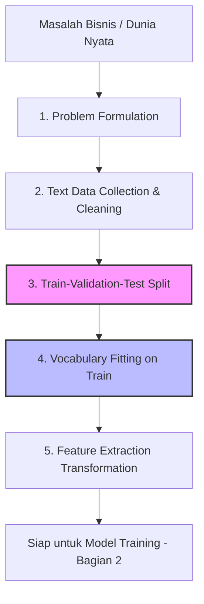

# NLP Pipeline — Bagian 1: From Problem Formulation to Feature Extraction

## 1. Gambaran Besar

### Peta Konsep


### Alur "Masalah -> Solusi"
* **Masalah:** Komputer hanya paham angka, sedangkan teks di dunia nyata berbentuk data tak terstruktur (*unstructured data*), acak, penuh *noise* (karakter aneh/HTML), dan tidak berukuran tetap.
* **Solusi:** Kita membangun **NLP Pipeline**, yaitu rantai pemrosesan bertahap yang mengubah teks mentah menjadi representasi numerik (*vector/matrix*) berstruktur, dengan batasan ketat agar data pengujian tidak bocor (*data leakage*) ke proses pelatihan.

---

## 2. Tujuan Belajar Terukur

Setelah menyelesaikan materi Bagian 1 ini, kamu akan mampu:
1. Merumuskan masalah bisnis berbasis teks menjadi tugas Machine Learning (*text classification*, *sequence labeling*, dsb.) yang tepat.
2. Melakukan pembersihan teks (*text cleaning*) dasar menggunakan modul standar Python (`re` dan `unicodedata`).
3. Menerapkan skema pemisahan data (*data split*) yang aman tanpa memicu *data leakage*.
4. Membedakan secara tegas mekanisme `fit` (membentuk *vocabulary*) dan `transform` (vektorisasi) pada data teks.
5. Menyusun *workflow* ekstraksi fitur yang mereplikasi *standard engineering practices* di industri.

---

## 3. Prasyarat Minimum & Cek Cepat

Sebelum masuk ke materi, pastikan kamu mengingat pemahaman dasar berikut:

### Cek Cepat (3 Soal)
1. Apa tipe data kembalian dari fungsi `string.split()` di Python?
2. Mengapa kita tidak boleh mengevaluasi performa model Machine Learning menggunakan data yang sama dengan data pelatihan (*training data*)?
3. Apa perbedaan mendasar antara *array* 1D dan matriks 2D di NumPy/Pandas?

<details>
<summary>Jawaban Cek Cepat</summary>

1. **`list`** berisi potongan-potongan *substring* (token).
2. Karena model bisa menghafal data tersebut (*overfitting*), sehingga metrik evaluasi menjadi terlalu optimis dan tidak mencerminkan performa nyata pada data baru.
3. *Array* 1D hanya memiliki satu dimensi (vektor panjang $N$), sedangkan matriks 2D memiliki dimensi baris dan kolom ($M \times N$).
</details>

---

## 4. Isi Sub-Materi

### Sub-Materi 1: Problem Formulation in NLP

#### 1. Masalah yang Diselesaikan
Kalimat dari pengguna atau dokumen bisnis bersifat ambigu dan tak terstruktur. Tanpa penentuan formulasi masalah yang jelas, kita tidak tahu struktur input ($X$), struktur target/output ($Y$), serta metrik evaluasi apa yang harus dioptimalkan.

#### 2. Intuisi
Merumuskan masalah NLP mirip seperti mengubah keluhan pelanggan berupa paragraf panjang menjadi tiket *support* dengan label yang rapi (misal: "Aplikasi Crash" atau "Masalah Tagihan"). 

* **Batas Analogi:** Komputer tidak benar-benar memahami makna emosional atau nuansa manusia dalam paragraf tersebut; komputer hanya mencocokkan pola statistik dari fitur yang kita ekstraksi.

#### 3. Contoh Konkret Kecil
* **Input ($X$):** `"Aplikasi ini selalu keluar sendiri saat saya membuka menu profil."`
* **Formulasi Task:** *Single-label Text Classification* (Binary).
* **Output Target ($Y$):** `1` (*Bug/Technical Issue*) vs `0` (*General Feedback*).

#### 4. Mekanisme
Pemetaan umum fungsi NLP adalah memetakan sekuens teks $X = (x_1, x_2, \dots, x_n)$ ke target $Y$:

| Tipe Formulasi | Output ($Y$) | Contoh Aplikasi |
| :--- | :--- | :--- |
| **Text Classification** | Kategori diskrit (*single* / *multi-label*) | Deteksi Spam, Analisis Sentimen |
| **Sequence Labeling** | Tag untuk setiap kata di teks | Named Entity Recognition (NER), POS Tagging |
| **Text Regression** | Nilai kontinu | Prediksi skor kepuasan (1.0 - 5.0) |
| **Seq2Seq / Generation** | Sekuens teks baru | Penerjemahan Bahasa, Summarization |

#### 5. Kode Minimal
```python
import pandas as pd

# Menyiapkan formulasi data klasifikasi teks sederhana
raw_data = [
    {"text": "Transfer uang gagal tapi saldo berkurang", "label": "FINANCE_ISSUE"},
    {"text": "Aplikasi tidak bisa dibuka di Android 13", "label": "TECH_BUG"},
    {"text": "Pelayanan customer service sangat ramah", "label": "FEEDBACK"}
]

df = pd.DataFrame(raw_data)
# X adalah Series berisi teks, y adalah Series berisi label kategori
X = df["text"]
y = df["label"]

print(f"Bentuk Input X: {X.shape}")
print(f"Daftar Target y:\n{y.value_counts()}")
```

#### 6. Jebakan & Failure Modes
* **Multi-label terselubung:** Memaksa masalah menjadi *single-label* padahal satu teks bisa punya beberapa label sekaligus (misal: keluhan yang mencakup "Bug" sekaligus "Billing").
* **Class Imbalance:** Memformulasi masalah tanpa memeriksa distribusi label. Jika label Spam 1% dan Non-Spam 99%, model malas akan menebak Non-Spam terus dan mendapat akurasi 99%.

#### 7. Mini-Eksperimen
Ubah struktur data pada `raw_data` di atas agar mendukung *Multi-label Classification* dengan mengganti `label` menjadi `list of labels` (contoh: `["TECH_BUG", "FINANCE_ISSUE"]`). Amati bagaimana struktur kolom target $Y$ berubah di Pandas.

#### 8. Cek Pemahaman
1. **Konseptual:** Mengapa tugas mencari letak nama kota dalam kalimat tidak bisa diformulasikan sebagai *Text Classification* tingkat dokumen?
2. **Debugging:** Kamu menerima dataset berupa rating bintang (1 sampai 5) dalam bentuk angka *float*. Kamu langsung memasukkannya ke fungsi klasifikasi binary `LogisticRegression`. Apa kesalahan formulasi yang terjadi?

<details>
<summary>Jawaban</summary>

1. Karena informasi lokasi nama kota berada pada tingkat token/kata (*word-level*), bukan karakteristik keseluruhan dokumen. Formulasi yang tepat adalah *Sequence Labeling* (NER).
2. Terjadi ketidakcocokan tipe formulasi (*mismatch*). Rating 1-5 bersifat ordinal/kontinu. Jika ingin diklasifikasikan sebagai binary, angka tersebut harus di-threshold dulu (misal: $<3$ menjadi `0`, $\ge 3$ menjadi `1`), atau diformulasikan sebagai masalah Regresi/Multi-class Classification.
</details>

---

### Sub-Materi 2: Text Data Collection & Cleaning

#### 1. Masalah yang Diselesaikan
Teks dari internet atau database mengandung *noise* berupa kode HTML, karakter Unicode yang tidak konsisten (misal karakter aksen atau emoji rusak), penulisan huruf besar/kecil yang acak, dan spasiasi liar. Jika dimasukkan langsung, *vocabulary* model akan membengkak oleh kata-kata duplikat yang secara makna sama.

#### 2. Intuisi
Proses pembersihan teks seperti menyaring bijih besi sebelum dilebur. Kita membuang lumpur dan batu (HTML, karakter tak terpakai) agar tersisa logam murni (kata-kata bermakna).

* **Batas Analogi:** Menghapus seluruh tanda baca atau meng-convert semua huruf menjadi *lowercase* kadang bisa membuang informasi penting (misal: "AS" sebagai nama negara vs "as" sebagai kata hubung).

#### 3. Contoh Konkret Kecil
* **Input Mentah:** `"<p>Barang BAGUSSS bgt!!! &amp; cepat sampai👍</p>"`
* **Setelah Cleaning:** `"barang bagus bgt cepat sampai"`

#### 4. Mekanisme
Proses pembersihan teks standar mengikuti urutan pipa (*pipeline*):
1. **Unicode Normalization:** Mengubah variasi encoding karakter Unicode ke bentuk standar (NFC/NFKC) menggunakan `unicodedata`.
2. **Noise Removal:** Menghapus tag HTML, URL, dan karakter kontrol menggunakan Regex (`re`).
3. **Case Folding:** Mengubah teks menjadi huruf kecil (*lowercasing*) — 💡 *Heuristik: Bagus untuk klasifikasi umum, hindari pada task NER.*
4. **Whitespace Normalization:** Merapikan spasi ganda, `\n`, dan `\t` menjadi satu spasi tunggal.

#### 5. Kode Minimal
```python
import re
import unicodedata

def clean_text_pipeline(raw_text: str) -> str:
    # 1. Normalisasi Unicode (NFKC menangani karakter aksen dan simbol)
    text = unicodedata.normalize("NFKC", raw_text)
    
    # 2. Hapus Tag HTML
    text = re.sub(r"<[^>]+>", " ", text)
    
    # 3. Hapus URL
    text = re.sub(r"http\S+|www\.\S+", " ", text)
    
    # 4. Lowercasing
    text = text.lower()
    
    # 5. Hapus karakter selain huruf dan angka (keep spasi)
    text = re.sub(r"[^a-z0-9\s]", " ", text)
    
    # 6. Normalisasi spasi ganda
    text = re.sub(r"\s+", " ", text).strip()
    
    return text

sample_input = "<p>Diskon 50% di [https://toko.com](https://toko.com)!! Beli SEKARANG&excl;</p>"
cleaned_output = clean_text_pipeline(sample_input)
print(f"Hasil: '{cleaned_output}'")
# Output deterministik: 'diskon 50 di beli sekarang'
```

#### 6. Jebakan & Failure Modes
* **Over-cleaning:** Menghapus semua angka padahal dataset berisi ulasan produk bertema spesifikasi (misal: "iPhone 13" menjadi "iPhone").
* **Regex Catastrophic Backtracking:** Menggunakan pola regex liar seperti `(a+)+` pada teks panjang yang menyebabkan eksekusi program berhenti/gantung (*hang*).

#### 7. Mini-Eksperimen
Jalankan fungsi `clean_text_pipeline` pada kalimat `"Tidak, ini tidak bagus!"` vs `"Tidak ini tidak bagus"`. Hapus aturan prapemrosesan tanda baca, lalu amati perbedaan struktur kata yang tersisa.

#### 8. Cek Pemahaman
1. **Konseptual:** Mengapa normalisasi Unicode (`unicodedata.normalize`) penting dilakukan sebelum kita membuat *dictionary* kata di NLP?
2. **Debugging:** Diberikan pola regex `re.sub(r"\d+", "", text)`. Teks inputnya adalah `"Beli HP Samsung A53 seharga 5juta"`. Apa efek samping yang tidak disengaja dari regex tersebut?

<details>
<summary>Jawaban</summary>

1. Karena karakter dengan bentuk visual sama bisa memiliki kode Unicode berbeda (misal huruf "é" yang ditulis sebagai satu kode vs gabungan "e" + aksen). Tanpa normalisasi, model menganggap keduanya sebagai dua kata yang berbeda.
2. Angka `53` pada `"A53"` dan `5` pada `"5juta"` akan hilang seluruhnya, menghasilkan `"Beli HP Samsung A seharga juta"`, yang merusak nama model produk.
</details>

---

### Sub-Materi 3: Train–Validation–Test Split for Text

#### 1. Masalah yang Diselesaikan
Membelah dataset teks secara acak (*random split*) tanpa memperhatikan distribusi label atau urutan waktu dapat menyebabkan evaluasi model bias. Lebih parah lagi jika pembelahan dilakukan *setelah* proses ektraksi fitur (menyebabkan *data leakage*).

#### 2. Intuisi
*Train-Validation-Test split* seperti membagi bahan ujian. *Train set* adalah buku latihan, *Validation set* adalah kuis mingguan, dan *Test set* adalah Ujian Akhir Semester (UAS). 

* **Batas Analogi:** Jika ada soal latihan yang persis sama dengan soal UAS (teks duplikat di dataset), siswa akan mendapat nilai tinggi bukan karena paham, melainkan karena menghafal.

#### 3. Contoh Konkret Kecil
* Dataset: 10 dokumen (8 Sentimen Positif, 2 Sentimen Negatif).
* **Random Split Biasa (80:20):** Test set bisa saja mendapatkan 2 Positif dan 0 Negatif (proporsi kelas hancur).
* **Stratified Split (80:20):** Train set mendapat 6 Positif & 1 Negatif; Test set mendapat 2 Positif & 1 Negatif (proporsi kelas terjaga seimbang).

#### 4. Mekanisme
1. **Stratified Split:** Mempertahankan proporsi label $P(Y)$ di setiap *fold* atau pembagian data.
   $$\frac{\text{Jumlah Kelas } k \text{ di Train}}{\text{Total Train}} \approx \frac{\text{Jumlah Kelas } k \text{ di Test}}{\text{Total Test}}$$
2. **Time-based Split:** Digunakan jika data teks memiliki dependensi waktu (misal: berita, *tweet* finansial). Data masa lalu untuk *Train*, data masa depan untuk *Test*.

#### 5. Kode Minimal
```python
import pandas as pd
from sklearn.model_selection import train_test_split

# Dataset imbalanced sintetis
texts = [f"Teks contoh ke-{i}" for i in range(100)]
labels = [0] * 90 + [1] * 10  # 90% Kelas 0, 10% Kelas 1

# Stratified Split 80:20
X_train, X_test, y_train, y_test = train_test_split(
    texts, 
    labels, 
    test_size=0.20, 
    stratify=labels, 
    random_state=42
)

print(f"Proporsi Kelas 1 di Train: {sum(y_train)/len(y_train):.2f}")
print(f"Proporsi Kelas 1 di Test : {sum(y_test)/len(y_test):.2f}")
# Jalankan sendiri, lalu bandingkan dengan prediksimu (keduanya harus 0.10)
```

#### 6. Jebakan & Failure Modes
* **Near-duplicate Data across Splits:** Artikel berita yang di-*copy-paste* berulang kali masuk ke *Train* dan *Test* sekaligus. Model lulus ujian dengan menghafal.
* **Temporal Leakage:** Menggunakan *Random Split* pada data tren harga saham berbasis analisis sentimen berita. Model tidak sengaja melihat "masa depan" saat dilatih.

#### 7. Mini-Eksperimen
Ubah argumen `stratify=labels` pada kode di atas menjadi `stratify=None`. Ulangi eksekusi dengan beberapa `random_state` berbeda (misal `random_state=1` atau `7`), lalu catat fluktuasi proporsi kelas di `y_test`.

#### 8. Cek Pemahaman
1. **Konseptual:** Kapan kita wajib menggunakan *Time-based Split* dibanding *Stratified Random Split*?
2. **Numerik:** Kamu memiliki dataset teks berisi 1.000 sampel. Kelas A berjumlah 800 dan Kelas B berjumlah 200. Jika kamu menggunakan *Stratified Split* dengan rasio Train:Test = 80:20, berapa jumlah persis sampel Kelas B di Test set?

<details>
<summary>Jawaban</summary>

1. Saat data memiliki faktor waktu yang kuat di mana pola bahasa atau topik berubah seiring waktu (misal: prediksi tren topik media sosial, klasifikasi transaksi penipuan).
2. Total Kelas B adalah 200. Karena rasio Test set adalah 20% ($0.20$), maka jumlah Kelas B di Test set adalah $200 \times 0.20 = 40$ sampel.
</details>

---

### Sub-Materi 4: Vocabulary Fitting vs Transformation

#### 1. Masalah yang Diselesaikan
Komputer membutuhkan indeks angka konstan untuk setiap kata. Proses membangun indeks kata (*Vocabulary Fitting*) dan proses mengubah teks menjadi vektor angka (*Transformation*) adalah dua tahapan terpisah. Mencampur keduanya memicu eror dimensi matriks dan kebocoran data.

#### 2. Intuisi
* **`fit()`** = Membaca buku teks latihan (Train Set) lalu menyusun **Kamus Indeks Kata**.
* **`transform()`** = Membuka lembar soal ujian (Test Set) dan menerjemahkan kata-katanya menggunakan **Kamus Indeks Kata** yang sudah dibuat tadi.

* **Batas Analogi:** Guru DILARANG menambahkan kata baru dari soal ujian ke dalam Kamus Indeks Kata saat murid sedang menempuh ujian. Kata asing di soal ujian harus diperlakukan sebagai kata tak dikenal (*Out-Of-Vocabulary / OOV*).

#### 3. Contoh Konkret Kecil
* **Train Data:** `["saya suka makan", "saya suka minum"]`
  * Hasil `fit()` -> *Vocabulary*: `{"makan": 0, "minum": 1, "saya": 2, "suka": 3}`
* **Test Data:** `["saya suka lari"]`
  * Hasil `transform()` pada Test Data (menggunakan *vocabulary* Train):
  * `"saya"` -> Indeks 2
  * `"suka"` -> Indeks 3
  * `"lari"` -> Tidak ada di kamus! (Diabaikan / OOV)
  * Vektor hasil: `[0, 0, 1, 1]` (sesuai panjang *vocabulary* Train = 4).

#### 4. Mekanisme

```
Train Data  ---> [ fit() ] -------> Vocabulary Indeks (Panjang V)
                   |                     |
                   v                     v
Train Data  ---> [ transform() ] --> Matriks X_train (Shape: N_train x V)
                                         |
Test Data   ---> [ transform() ] --> Matriks X_test  (Shape: N_test x V)
```

1. **`fit()`**: Menganalisis teks input, mencatat semua token unik, lalu menetapkan pemetaan $\text{kata} \to \text{indeks}$. Panjang *vocabulary* adalah $V$.
2. **`transform()`**: Mengubah daftar teks menjadi matriks frekuensi $N \times V$.
3. **`fit_transform()`**: Menjalankan `fit()` kemudian `transform()` secara berurutan. 💡 *Heuristik: HANYA BOLEH dipanggil pada Training Data!*

#### 5. Kode Minimal
```python
from sklearn.feature_extraction.text import CountVectorizer

train_corpus = ["saya suka makan", "saya suka minum"]
test_corpus = ["saya suka lari"]

vectorizer = CountVectorizer()

# 1. FIT & TRANSFORM pada Train
X_train = vectorizer.fit_transform(train_corpus)
print("Vocabulary Train:", vectorizer.vocabulary_)
print("Shape X_train   :", X_train.toarray().shape)

# 2. HANYA TRANSFORM pada Test (Gunakan kamus Train!)
X_test = vectorizer.transform(test_corpus)
print("Shape X_test    :", X_test.toarray().shape)
print("Vektor X_test   :", X_test.toarray())
```

#### 6. Jebakan & Failure Modes
* **Memanggil `fit_transform()` pada Test Data:** Ini menciptakan *vocabulary* baru dengan panjang $V_{test}$ yang berbeda. Model Machine Learning akan mengalami *crash* karena jumlah kolom $X_{test}$ tidak sama dengan $X_{train}$.
* **Re-fitting Vectorizer:** Memanggil `fit()` ulang sebelum `transform(X_test)` akan menghapus kamus yang dipelajari dari data *Train*.

#### 7. Mini-Eksperimen
Ubah baris `X_test = vectorizer.transform(test_corpus)` menjadi `X_test = vectorizer.fit_transform(test_corpus)`. Amati perubahan jumlah kolom pada `X_test.toarray().shape` dan perhatikan bahaya perbedaan dimensi tersebut saat dimasukkan ke model.

#### 8. Cek Pemahaman
1. **Konseptual:** Mengapa nilai indeks suatu kata dalam *Vocabulary* harus dijamin konsisten antara data *Train* dan data *Test*?
2. **Debugging:** Seorang *engineer* menulis kode berikut untuk tahap evaluasi:
   ```python
   vec = CountVectorizer()
   X_train_vec = vec.fit_transform(X_train)
   model.fit(X_train_vec, y_train)

   vec_test = CountVectorizer()
   X_test_vec = vec_test.fit_transform(X_test)
   preds = model.predict(X_test_vec)
   ```
   Sebutkan 2 kesalahan fatal pada potongan kode di atas!

<details>
<summary>Jawaban</summary>

1. Karena kolom matriks merepresentasikan fitur numerik untuk model. Jika indeks kata "suka" berubah dari kolom 3 di Train menjadi kolom 0 di Test, model akan salah mengartikan fitur tersebut sebagai kata lain.
2. Dua kesalahan fatal:
   a. Membuat objek `CountVectorizer` baru (`vec_test`) khusus untuk data Test.
   b. Memanggil `fit_transform()` pada data Test alih-alih `transform()` dari objek `vec` yang sudah di-`fit` pada data Train.
</details>

---

### Sub-Materi 5: Feature Extraction Workflow & Avoiding Data Leakage

#### 1. Masalah yang Diselesaikan
*Data leakage* terjadi ketika informasi dari *Validation/Test set* secara tidak sengaja bocor ke dalam proses pemodelan atau pembentukan fitur di *Train set*. Akibatnya, metrik performa model terlihat sangat tinggi saat pengujian internal, tetapi performanya hancur saat di-deploy ke lingkungan produksi.

#### 2. Intuisi
Seperti memberikan kuis latihan di mana lembar kunci jawaban Ujian Akhir terselip secara tidak sengaja di bawah meja murid. Murid akan mendapat nilai sempurna di kelas, tetapi gagal total saat diuji di luar sekolah tanpa kunci jawaban.

#### 3. Contoh Konkret Kecil
* **Alur SALAH (Leakage):**
  1. Ambil SELURUH dataset (1000 teks).
  2. Ekstraksi Fitur TF-IDF pada 1000 teks sekaligus (`fit_transform`).
  3. Bagi matriks fitur menjadi Train (800) dan Test (200).
  * *Hasil:* Nilai IDF kata-kata di hitung menggunakan seluruh 1000 dokumen. Informasi frekuensi dokumen di Test set sudah bocor ke Train set!

* **Alur BENAR (Leakage-Free):**
  1. Bagi dataset mentah menjadi Train (800) dan Test (200).
  2. Ekstraksi Fitur TF-IDF **hanya** pada Train set (`fit_transform`).
  3. Menerapkan `transform` pada Test set menggunakan statistik dari Train set.

#### 4. Mekanisme (Demo Perhitungan Matematika Leakage vs Benar)

Mari kita buktikan secara eksplisit menggunakan rumus baku **TF-IDF (Smooth IDF)** dari Scikit-Learn:
$$IDF(t) = \ln \left( \frac{1 + n}{1 + df(t)} \right) + 1$$

Di mana:
* $n$ = Total dokumen dalam corpus yang di-`fit`.
* $df(t)$ = Jumlah dokumen yang mengandung kata $t$.

**Skenario Dataset:**
* **Train Set (3 Dokumen):**
  * Doc 1: `"kucing makan ikan"`
  * Doc 2: `"anjing makan daging"`
  * Doc 3: `"kucing tidur"`
* **Test Set (1 Dokumen):**
  * Doc 4: `"kucing lari"`

Kita amati nilai $IDF$ untuk kata **`"kucing"`**:

1. **Kondisi A: SALAH (Data Leakage - Fit di Seluruh 4 Dokumen)**
   * Total dokumen $n = 4$.
   * Kata `"kucing"` muncul di Doc 1, Doc 3, dan Doc 4 $\implies df(\text{"kucing"}) = 3$.
   $$IDF(\text{"kucing"}) = \ln \left( \frac{1 + 4}{1 + 3} \right) + 1 = \ln(1.25) + 1 \approx 0.22314 + 1 = 1.22314$$

2. **Kondisi B: BENAR (Leakage-Free - Fit HANYA di 3 Dokumen Train)**
   * Total dokumen $n = 3$.
   * Kata `"kucing"` di Train set hanya muncul di Doc 1 dan Doc 3 $\implies df(\text{"kucing"}) = 2$.
   $$IDF(\text{"kucing"}) = \ln \left( \frac{1 + 3}{1 + 2} \right) + 1 = \ln(1.33333) + 1 \approx 0.28768 + 1 = 1.28768$$

> **Terbukti:** Nilai pembobot $IDF$ berbeda! Pembobotan pada Kondisi A terkontaminasi oleh keberadaan kata di data Test yang seharusnya belum diketahui oleh model.

#### 5. Kode Minimal (Demo Engineering Data Leakage)
```python
import pandas as pd
from sklearn.model_selection import train_test_split
from sklearn.feature_extraction.text import TfidfVectorizer

# Dataset Teks Mentah
raw_texts = [
    "kucing makan ikan",
    "anjing makan daging",
    "kucing tidur",
    "kucing lari" # Asumsikan ini data pengujian
]
labels = [1, 0, 1, 1]

# --- ALUR BENAR (LEAKAGE-FREE) ---
# Step 1: Split data MENTAH terlebih dahulu
X_train_raw, X_test_raw, y_train, y_test = train_test_split(
    raw_texts, labels, test_size=0.25, random_state=42, shuffle=False
)

# Step 2: Inisialisasi & FIT HANYA pada Train Data
tfidf_correct = TfidfVectorizer()
X_train_vec = tfidf_correct.fit_transform(X_train_raw)

# Step 3: TRANSFORM pada Test Data
X_test_vec = tfidf_correct.transform(X_test_raw)

# Verifikasi Nilai IDF kata 'kucing'
idx_kucing = tfidf_correct.vocabulary_["kucing"]
print(f"[BENAR] IDF 'kucing' (Train saja) : {tfidf_correct.idf_[idx_kucing]:.5f}")

# --- ALUR SALAH (DATA LEAKAGE) ---
tfidf_leakage = TfidfVectorizer()
# FIT pada SELURUH data sebelum split
X_all_vec = tfidf_leakage.fit_transform(raw_texts)

idx_kucing_leak = tfidf_leakage.vocabulary_["kucing"]
print(f"[SALAH] IDF 'kucing' (Leakage All) : {tfidf_leakage.idf_[idx_kucing_leak]:.5f}")
```

#### 6. Jebakan & Failure Modes
* **Global Preprocessing Scaling:** Melakukan pembersihan atau normalisasi frekuensi fitur global (misal: menghapus kata dengan frekuensi $< 5$ di seluruh dataset sebelum split).
* **Target Leakage:** Menggunakan informasi dari kolom target $Y$ untuk membuat fitur teks di data *Train* dan *Test* secara bersamaan tanpa skema *out-of-fold*.

#### 7. Mini-Eksperimen
Jalankan skrip pada poin 5. Amati output angka IDF yang dihasilkan. Tambahkan 5 dokumen baru ke dalam `raw_texts` yang kaya akan kata `"kucing"`, lalu perhatikan bagaimana selisih nilai IDF antara alur BENAR dan SALAH semakin membesar.

#### 8. Cek Pemahaman
1. **Konseptual:** Mengapa *data leakage* pada pembentukan TF-IDF menyebabkan estimasi metrik evaluasi pada *validation set* menjadi terlalu optimis?
2. **Numerik:** Diketahui $N=5$ dokumen total (4 Train, 1 Test). Kata $t$ muncul di 2 dokumen Train dan 1 dokumen Test. Hitung nilai $IDF(t)$ menggunakan rumus Scikit-Learn ($IDF = \ln((1+n)/(1+df)) + 1$) untuk:
   a. Kondisi Leakage (`fit` pada 5 dokumen).
   b. Kondisi Benar (`fit` pada 4 dokumen Train).

<details>
<summary>Jawaban</summary>

1. Karena model dilatih menggunakan fitur yang nilai pembobotannya ($IDF$) sudah memperhitungkan kemunculan kata di *validation set*. Model seolah-olah sudah "mengintip" distribusi data pengujian sebelum diuji.
2. **Perhitungan Step-by-Step:**
   * **a. Kondisi Leakage:**
     $n = 5$, $df(t) = 2 + 1 = 3$.
     $$IDF = \ln\left(\frac{1 + 5}{1 + 3}\right) + 1 = \ln\left(\frac{6}{4}\right) + 1 = \ln(1.5) + 1 \approx 0.405465 + 1 = 1.40547$$
   * **b. Kondisi Benar:**
     $n = 4$, $df(t) = 2$ (hanya menghitung Train).
     $$IDF = \ln\left(\frac{1 + 4}{1 + 2}\right) + 1 = \ln\left(\frac{5}{3}\right) + 1 = \ln(1.66667) + 1 \approx 0.510825 + 1 = 1.51083$$
</details>

---

## 5. Jembatan ke Bagian 2

Di Bagian 1 ini, kita telah berhasil merumuskan masalah NLP, membersihkan teks mentah, melakukan pemisahan data yang aman dari *data leakage*, serta merancang alur ekstraksi fitur yang benar (`fit` vs `transform`). 

Namun, matriks fitur $X_{train}$ dan $X_{test}$ yang telah kita bentuk belum dimasukkan ke dalam pemodelan Machine Learning. Kita belum menangani masalah kata-kata baru di luar kamus (*Handling Unseen Words / OOV*), melatih model klasifikasi, mengukur metrik evaluasi secara rinci, membangun *inference pipeline* untuk data produksi, serta menjaga *reproducibility* skrip pipeline kita.

Semua topik krusial tersebut akan dikupas tuntas pada **Bagian 2**.

---

## 6. Glosarium Istilah

* **Case Folding:** Proses menyetarakan kapitalisasi huruf dalam teks (biasanya mengubah seluruh huruf menjadi *lowercase*).
* **Data Leakage:** Kebocoran informasi dari data di luar set pelatihan (*validation/test set*) ke dalam proses pelatihan model.
* **Document Frequency (DF):** Jumlah dokumen dalam suatu himpunan data yang mengandung kata tertentu.
* **Inverse Document Frequency (IDF):** Ukuran seberapa langka atau pentingnya suatu kata di seluruh koleksi dokumen.
* **Out-Of-Vocabulary (OOV):** Kata-kata yang muncul saat proses *testing/inference* tetapi tidak ada di dalam kamus (*vocabulary*) pelatihan.
* **Sequence Labeling:** Tugas NLP yang memberikan label pada setiap token/kata secara berurutan dalam kalimat (contoh: NER).
* **Stratified Split:** Metode pemisahan data yang mempertahankan proporsi distribusi kelas target di setiap bagian (*train/test*).
* **Unicode Normalization (NFKC):** Standarisasi bentuk pengkodean karakter Unicode agar karakter yang secara visual identik memiliki representasi biner yang sama.

---

## 7. Log Verifikasi ⚠️

| Tag | Lokasi / Konteks | Alasan Tag & Tindakan Verifikasi |
| :--- | :--- | :--- |
| `Status Verifikasi: Belum Diaudit ⚠️` | Frontmatter | Materi ini disusun berdasarkan konvensi standar scikit-learn dan teori NLP kanonik, namun disarankan untuk terus diverifikasi secara berkala sesuai pembaruan versi library. |