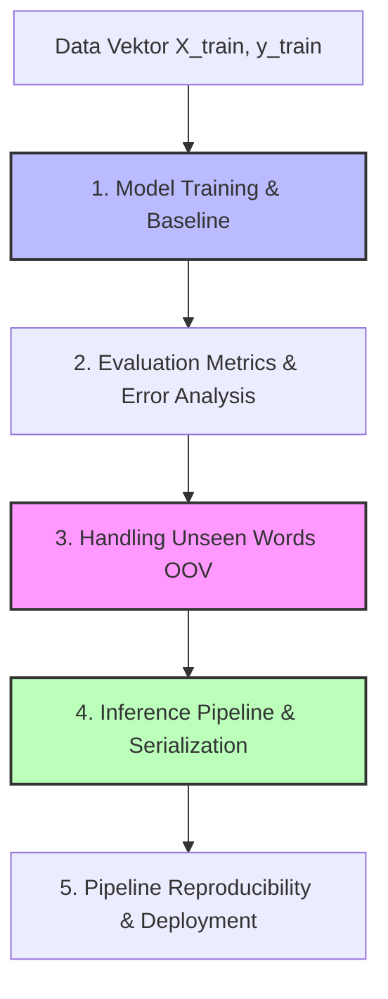

# NLP Pipeline — Bagian 2: Model Training, Evaluation, & Production Engineering

## 1. Gambaran Besar

### Peta Konsep


### Alur "Masalah -> Solusi"
* **Masalah:** Vektor fitur hasil ekstraksi teks belum memilik prediktor akhir, performa model sering kali menipu jika metrik evaluasinya salah, kata-kata baru (*unseen words*) di lingkungan produksi sering merusak prediksi, serta *pipeline* tidak bisa direplikasi jika tidak diserialisasi dengan benar.
* **Solusi:** Menyusun alur pemodelan terintegrasi dengan *Scikit-Learn Pipeline*, menetapkan baseline sederhana, menangani OOV secara eksplisit, menyimpan seluruh artefak model untuk *inference*, dan mengunci *random seed* serta lingkungan untuk menjamin *reproducibility*.

---

## 2. Tujuan Belajar Terukur

Setelah menyelesaikan Bagian 2 ini, kamu akan mampu:
1. Melatih model klasifikasi teks baseline (seperti *Multinomial Naive Bayes* dan *Logistic Regression*) menggunakan skema *Pipeline*.
2. Mengukur dan menginterpretasikan metrik evaluasi teks (*Accuracy*, *Precision*, *Recall*, *F1-Score*, dan *Confusion Matrix*).
3. Menganalisis dan memitigasi dampak kata-kata asing (*Out-Of-Vocabulary / OOV*) pada saat *inference*.
4. Mengemas (*serialize*) seluruh *pipeline* (preprocessing + vectorizer + model) ke dalam satu file siap pakai di lingkungan produksi.
5. Menjamin *reproducibility* eksekusi eksperimen NLP dengan penguncian *seed* dan dokumentasi dependen.

---

## 3. Prasyarat Minimum & Cek Cepat

### Cek Cepat (3 Soal)
1. Apa fungsi dari parameter `random_state` pada fungsi pembagi data atau model Machine Learning?
2. Mengapa metrik *Accuracy* bisa sangat menipu pada dataset dengan distribusi label yang sangat timpang (*imbalanced dataset*)?
3. Apa fungsi modul `joblib` atau `pickle` di Python dalam konteks Machine Learning?

<details>
<summary>Jawaban Cek Cepat</summary>

1. Untuk mengunci *seed* generator angka acak (*pseudo-random number generator*) agar hasil pembagian data atau inisialisasi bobot model selalu identik saat dijalankan ulang (*reproducible*).
2. Karena jika 99% data adalah kelas A dan 1% kelas B, model "malas" yang menebak kelas A terus-menerus akan mendapat akurasi 99%, padahal gagal total mendeteksi kelas B.
3. Untuk mendaur ulang dan menyimpan objek Python (termasuk objek model dan *vectorizer* yang sudah di-`fit`) ke dalam file biner agar bisa dimuat kembali tanpa dilatih ulang.
</details>

---

## 4. Isi Sub-Materi

### Sub-Materi 1: Model Training & Baseline Formulation

#### 1. Masalah yang Diselesaikan
Langsung mencoba model yang sangat kompleks (seperti arsitektur *Deep Learning*) di awal project NLP sering membuat kita kehilangan panduan performa minimum. Tanpa *baseline model* sederhana, kita tidak tahu apakah performa model kompleks tersebut worth it dibanding biaya komputasinya.

#### 2. Intuisi
*Baseline* seperti patok ukur tinggi badan. Sebelum membangun tangga mahal, kita perlu mengukur seberapa tinggi kita bisa melompat tanpa bantuan. Dalam NLP, model tradisional seperti *Multinomial Naive Bayes* atau *Logistic Regression* adalah lompatan tanpa bantuan tersebut.

* **Batas Analogi:** Model baseline sederhana mengasumsikan independensi antar kata (asumsi *Bag-of-Words*), sehingga tidak bisa menangkap urutan atau struktur tata bahasa yang kompleks.

#### 3. Contoh Konkret Kecil
* **Input Dataset:** 4 dokumen teks dengan kata-kata frekuensi TF-IDF.
* **Model Baseline:** *Multinomial Naive Bayes* (MNB) memanfaatkan Teorema Bayes dengan Laplace Smoothing:
  $$P(y\vert{}x) \propto P(y) \prod_{i=1}^n P(x_i\vert{}y)$$
* Jika kata `"promo"` muncul 3 kali di kelas Spam (total kata kelas Spam = 10, ukuran Vocabulary $\vert{}V\vert{}=5$):
  $$P(\text{"promo"} \mid \text{Spam}) = \frac{3 + 1}{10 + 5} = \frac{4}{15} \approx 0.2667$$

#### 4. Mekanisme
1. Data teks $X_{train}$ diubah menjadi matriks sparse $V_{train}$ oleh Vectorizer.
2. Model mempelajari estimasi probabilitas $P(y)$ dan $P(x_i\vert{}y)$ untuk Naive Bayes, atau bobot linear $w_i$ untuk Logistic Regression.
3. Fungsi loss dihitung dan dioptimalkan secara matematis hingga konvergen.

```
X_train (Teks) ---> [ Vectorizer.fit_transform ] ---> Matriks V_train
                                                         |
y_train (Label) -----------------------------------------> [ Model.fit ] ---> Model Terlatih
```

#### 5. Kode Minimal
```python
import pandas as pd
from sklearn.feature_extraction.text import TfidfVectorizer
from sklearn.linear_model import LogisticRegression

# Data sintetis
X_train_raw = [
    "layanan bagus dan cepat",
    "aplikasi sering error dan lambat",
    "sangat puas dengan respon customer service",
    "fitur tidak bisa digunakan sama sekali"
]
y_train = [1, 0, 1, 0]  # 1: Positif, 0: Negatif

# Ekstraksi Fitur
vectorizer = TfidfVectorizer()
X_train_vec = vectorizer.fit_transform(X_train_raw)

# Training Model Baseline (Logistic Regression)
model = LogisticRegression(random_state=42)
model.fit(X_train_vec, y_train)

print(f"Model berhasil dilatih dengan {X_train_vec.shape[1]} fitur vocabulary.")
# Output: Model berhasil dilatih dengan 14 fitur vocabulary.
```

#### 6. Jebakan & Failure Modes
* **Overfitting pada Train Set:** Model memiliki *training accuracy* 100% karena ukuran *vocabulary* terlalu besar (misal memasukkan semua kata tanpa batasan `min_df`), tetapi gagal pada data pengujian.
* **Mengabaikan Hyperparameter Sederhana:** Tidak mengatur `C` pada Logistic Regression atau `alpha` pada Naive Bayes.

#### 7. Mini-Eksperimen
Tambahkan argumen `min_df=2` pada `TfidfVectorizer` di kode atas. Amati jumlah fitur yang terbentuk. Mengapa jumlah fiturnya berkurang secara drastis?

#### 8. Cek Pemahaman
1. **Konseptual:** Mengapa *Multinomial Naive Bayes* sangat populer sebagai baseline klasik untuk klasifikasi teks?
2. **Debugging:** Kamu menjalankan `model.fit(X_train_vec, y_train)` dan mendapat error `ValueError: Found input variables with inconsistent numbers of samples: [100, 80]`. Apa arti error ini dan bagaimana cara memperbaikinya?

<details>
<summary>Jawaban</summary>

1. Karena sangat cepat dilatih, efisien secara komputasi, bekerja baik pada matriks *sparse* berdimensi tinggi, serta terbukti tangguh untuk dataset teks skala kecil hingga menengah.
2. Jumlah sampel baris pada matriks fitur $X$ (100) tidak sama dengan jumlah elemen pada label $y$ (80). Hal ini biasanya terjadi karena data $X$ dan $y$ di-filter atau di-split menggunakan indeks yang berbeda.
</details>

---

### Sub-Materi 2: Evaluation Metrics in NLP Classification

#### 1. Masalah yang Diselesaikan
Menguji model NLP hanya dengan metrik *Accuracy* sangat berbahaya, terutama pada kasus mendeteksi *Spam*, *Ancaman Cyber*, atau *Keluhan Pelanggan* yang jumlah sampelnya sedikit. Kita membutuhkan metrik spesifik untuk mengukur tipe kesalahan model (*False Positive* vs *False Negative*).

#### 2. Intuisi
* **Precision:** "Dari semua pesan yang dituduh model sebagai SPAM, berapa persen yang BENAR-BENAR spam?" (Fokus: Jangan sampai email penting pelanggan terbuang ke folder Spam).
* **Recall:** "Dari SELURUH email spam yang nyata di inbox, berapa persen yang BERHASIL ditangkap oleh model?" (Fokus: Jangan sampai ada ancaman keamanan yang lolos).

* **Batas Analogi:** Kita tidak selalu bisa memaksimalkan keduanya sekaligus. Ada *trade-off* konstan antara Precision dan Recall.

#### 3. Contoh Konkret Kecil
Misalkan kita memiliki 10 data evaluasi (6 Spam = 1, 4 Non-Spam = 0).
* Target Sebenarnya ($y$): `[1, 1, 1, 1, 1, 1, 0, 0, 0, 0]`
* Hasil Prediksi Model ($\hat{y}$): `[1, 1, 1, 1, 0, 0, 1, 0, 0, 0]`

Mari kita hitung komponen Confusion Matrix:
* **True Positive (TP)** = $y=1, \hat{y}=1 \implies$ 4
* **False Negative (FN)** = $y=1, \hat{y}=0 \implies$ 2
* **False Positive (FP)** = $y=0, \hat{y}=1 \implies$ 1
* **True Negative (TN)** = $y=0, \hat{y}=0 \implies$ 3

#### 4. Mekanisme & Formulas

1. **Accuracy:**
   $$\text{Accuracy} = \frac{TP + TN}{TP + TN + FP + FN} = \frac{4 + 3}{10} = 0.70 \quad (70\%)$$

2. **Precision:**
   $$\text{Precision} = \frac{TP}{TP + FP} = \frac{4}{4 + 1} = \frac{4}{5} = 0.80 \quad (80\%)$$

3. **Recall:**
   $$\text{Recall} = \frac{TP}{TP + FN} = \frac{4}{4 + 2} = \frac{4}{6} \approx 0.6667 \quad (66.67\%)$$

4. **F1-Score (Rataan Harmonis Precision & Recall):**
   $$\text{F1-Score} = 2 \times \frac{\text{Precision} \times \text{Recall}}{\text{Precision} + \text{Recall}} = 2 \times \frac{0.80 \times \frac{2}{3}}{0.80 + \frac{2}{3}} = \frac{3.2}{4.4} \approx 0.7273 \quad (72.73\%)$$

#### 5. Kode Minimal
```python
from sklearn.metrics import classification_report, confusion_matrix

y_true = [1, 1, 1, 1, 1, 1, 0, 0, 0, 0]
y_pred = [1, 1, 1, 1, 0, 0, 1, 0, 0, 0]

print("--- CONFUSION MATRIX ---")
print(confusion_matrix(y_true, y_pred))

print("\n--- CLASSIFICATION REPORT ---")
print(classification_report(y_true, y_pred, target_names=["Non-Spam", "Spam"]))
```

#### 6. Jebakan & Failure Modes
* **Macro Average vs Weighted Average:** Pada dataset imbalanced, *Macro Average* menghitung rata-rata metrik setiap kelas secara setara tanpa mempedulikan jumlah sampel, sedangkan *Weighted Average* memperhitungkan bobot sampel. Mengabaikan perbedaan ini membuat kesimpulan performa menjadi keliru.

#### 7. Mini-Eksperimen
Ubah array `y_pred` menjadi `[1, 1, 1, 1, 1, 1, 1, 1, 1, 1]` (model menebak Spam terus-menerus). Jalankan `classification_report` dan perhatikan apa yang terjadi pada nilai Precision dan Accuracy kelas Non-Spam!

#### 8. Cek Pemahaman
1. **Konseptual:** Dalam sistem deteksi penipuan transaksi perbankan (*fraud detection*), metrik mana yang lebih krusial diutamakan: Precision atau Recall? Jelaskan alasannya!
2. **Numerik:** Sebuah model memprediksi 20 teks. TP = 10, FP = 5, FN = 2, TN = 3. Hitunglah nilai Precision dan Recall model tersebut secara manual!

<details>
<summary>Jawaban</summary>

1. **Recall**, karena biaya finansial akibat tidak mendeteksi transaksi penipuan (*False Negative*) jauh lebih besar dibanding dampak salah menandai transaksi aman sebagai mencurigakan (*False Positive*).
2. **Perhitungan Step-by-Step:**
   * $\text{Precision} = \frac{TP}{TP + FP} = \frac{10}{10 + 5} = \frac{10}{15} \approx 0.6667 \text{ atau } 66.67\%$.
   * $\text{Recall} = \frac{TP}{TP + FN} = \frac{10}{10 + 2} = \frac{10}{12} \approx 0.8333 \text{ atau } 83.33\%$.
</details>

---

### Sub-Materi 3: Handling Unseen Words (OOV) & Vocabulary Boundaries

#### 1. Masalah yang Diselesaikan
Bahasa berkembang secara dinamis. Di lingkungan produksi, pengguna akan mengetik kata-kata baru, *typo*, atau istilah gaul yang tidak pernah muncul dalam data *Train* (*Out-Of-Vocabulary / OOV*). Model NLP berbasis *Bag-of-Words* tradisional akan mengabaikan kata OOV ini, yang dapat merusak kualitas prediksi jika kata tersebut krusial.

#### 2. Intuisi
OOV seperti menemui kata dalam bahasa asing saat membaca novel. Jika kita menggunakan kamus saku biasa (Vocabulary terbatas), kata tersebut tidak terdaftar dan terpaksa kita lewati.

* **Batas Analogi:** Jika terlalu banyak kata yang tidak terdaftar di kamus, isi cerita novel (makna dokumen) menjadi tidak bisa dipahami lagi.

#### 3. Contoh Konkret Kecil
* **Vocabulary Train (Ukuran $V=4$):** `{"beli": 0, "hp": 1, "murah": 2, "promo": 3}`
* **Kalimat Input Baru (Inference):** `"beli hp bekas canggih"`
* **Analisis Token:**
  * `"beli"` $\to$ Ada di Vocab (Indeks 0)
  * `"hp"` $\to$ Ada di Vocab (Indeks 1)
  * `"bekas"` $\to$ **OOV!** (Diabaikan oleh CountVectorizer)
  * `"canggih"` $\to$ **OOV!** (Diabaikan oleh CountVectorizer)
* **Hitung OOV Rate:**
  $$\text{OOV Rate} = \frac{\text{Jumlah Token OOV}}{\text{Total Token Input}} = \frac{2}{4} = 0.50 \quad (50\%)$$

#### 4. Mekanisme & Strategi Penanganan OOV
1. **Sub-linear / Subword Tokenization (N-gram Karakter):** Memecah kata menjadi potongan karakter (misal `n-gram=(2,3)`). Kata `"canggih"` dipecah menjadi `"can"`, `"ang"`, `"ngg"`, `"ghi"`, `"ih"`.
2. **Explicit Unknown Token (`<UNK>`):** Mengganti kata-kata dengan frekuensi sangat rendah di data *Train* menjadi simbol `<UNK>`.
3. **Handling via Minimum Frequency (`min_df`):** Membuang kata-kata *rare* di Train agar model tidak tergantung pada kata-kata spesifik yang rapuh.

```
Input Teks Mentah ---> [ Preprocessing ] ---> [ Subword / N-gram Tokenizer ] 
                                                      |
                                                      v
                                        Pecah kata OOV jadi sub-potongan
                                        sehingga fitur tetap terekstraksi!
```

#### 5. Kode Minimal
```python
from sklearn.feature_extraction.text import CountVectorizer

train_corpus = ["beli hp murah promo"]
test_sentence = ["beli hp bekas canggih"]

# Strategy A: Word-level (Default)
word_vec = CountVectorizer()
word_vec.fit(train_corpus)
X_test_word = word_vec.transform(test_sentence)

# Strategy B: Character N-grams (Tahan OOV)
char_vec = CountVectorizer(analyzer='char', ngram_range=(3, 3))
char_vec.fit(train_corpus)
X_test_char = char_vec.transform(test_sentence)

print("--- WORD-LEVEL ---")
print("Vocab Train Size:", len(word_vec.vocabulary_))
print("Vektor Test     :", X_test_word.toarray()[0])  # Kata OOV hilang total

print("\n--- CHAR N-GRAM (3-gram) ---")
print("Vocab Train Size:", len(char_vec.vocabulary_))
print("Vektor Test     :", X_test_char.toarray()[0])  # Sub-karakter 'bel', 'eli', 'hp ' tetap cocok!
```

#### 6. Jebakan & Failure Modes
* **High-dimensional Explosion pada Char N-grams:** Menggunakan `ngram_range=(1, 5)` pada corpus besar menghasilkan matriks fitur berdimensi jutaan kolom yang membuat memori RAM penuh (*out-of-memory crash*).

#### 7. Mini-Eksperimen
Jalankan kode di atas, lalu ubah input `test_sentence` menjadi typo parah seperti `"bli hpe mrah"`. Bandingkan matriks output antara `word_vec` dan `char_vec`. Strategi mana yang masih mampu mengekstraksi fitur?

#### 8. Cek Pemahaman
1. **Konseptual:** Mengapa pendekatan *Character-level N-gram* sangat efektif menangani teks dari media sosial Indonesia?
2. **Numerik:** Sebuah dokumen pengujian berisi 10 kata unik. Setelah ditransformasi menggunakan *Vectorizer* data *Train*, vektor yang dihasilkan memiliki nilai total kemunculan (*sum of frequencies*) sebesar 6. Berapa OOV Rate untuk dokumen tersebut?

<details>
<summary>Jawaban</summary>

1. Karena bahasa di media sosial Indonesia kaya akan kata-kata *typo*, singkatan (misal: "bgt", "slm"), dan variasi kata berimbuhan non-baku yang struktur karakternya masih mirip dengan kata aslinya.
2. Total kata unik = 10. Kata yang teridentifikasi di Vocabulary = 6. Maka kata OOV = $10 - 6 = 4$.
   $$\text{OOV Rate} = \frac{4}{10} = 0.40 \text{ atau } 40\%$$
</details>

---

### Sub-Materi 4: Inference Pipeline & Model Serialization

#### 1. Masalah yang Diselesaikan
Dalam praktik nyata, kita sering melihat kesalahan di mana pengembang menyimpan model ML (`model.pkl`) secara terpisah dari objek pemroses teks (`vectorizer.pkl`). Saat aplikasi Flask/FastAPI dijalankan, urutan pemrosesan teks mentah sering tidak konsisten dengan saat pelatihan, menyebabkan kegagalan inferensi (*inference failure*).

#### 2. Intuisi
*Inference Pipeline* yang diserialisasi seperti paket makanan siap saji yang sudah dikemas rapat. Kita tidak perlu meracik bumbu dan memasaknya dari awal di restoran pelanggan; cukup buka kemasannya dan panaskan.

* **Batas Analogi:** Jika bahan-bahan bumbu makanan (versi library) di dapur penerima tidak cocok dengan versi tempat makanan dikemas, rasanya akan rusak (terjadi *unpickling error*).

#### 3. Contoh Konkret Kecil
* **Tanpa Pipeline (Berdarah-darah):**
  1. Terima teks mentah `s`.
  2. Panggil fungsi manual `clean_text(s)`.
  3. Panggil `vec.transform([s_clean])`.
  4. Panggil `model.predict(X_vec)`.
  *(Rawan salah urutan atau lupa fungsi cleaning!)*

* **Dengan Scikit-Learn Pipeline (Rapi & Standar Industri):**
  1. Panggil `pipeline.predict([s])`.
  *(Semua langkah pembersihan, vektorisasi, dan prediksi otomatis dieksekusi teratur dalam satu baris!)*

#### 4. Mekanisme

```
[ Input Teks Mentah ] 
          |
          v
+----------------------------------------------------+
|               Scikit-Learn Pipeline                |
|                                                    |
|  1. Text Preprocessor (Fungsi Custom / Transformer)|
|  2. TfidfVectorizer (Feature Extractor)             |
|  3. LogisticRegression (Classifier)                 |
+----------------------------------------------------+
          |
          v
   [ Output Label ]
```

Objek `Pipeline` menggabungkan seluruh tahapan menjadi satu objek tunggal yang dapat disimpan ke piringan hitam (disk) menggunakan `joblib.dump()`.

#### 5. Kode Minimal
```python
import joblib
from sklearn.pipeline import Pipeline
from sklearn.feature_extraction.text import TfidfVectorizer
from sklearn.linear_model import LogisticRegression

# Data Training
X_train = ["transaksi berhasil", "saldo terpotong sistem error", "pembayaran sukses"]
y_train = [1, 0, 1]

# 1. Mambangun End-to-End Pipeline
nlp_pipeline = Pipeline([
    ('tfidf', TfidfVectorizer()),
    ('clf', LogisticRegression(random_state=42))
])

# 2. Fit Pipeline pada data mentah
nlp_pipeline.fit(X_train, y_train)

# 3. Serialisasi (Simpan ke file biner)
joblib.dump(nlp_pipeline, 'nlp_pipeline_model.joblib')
print("Pipeline berhasil disimpan ke file 'nlp_pipeline_model.joblib'.")

# --- INFERENCE ENVIRONMENT (MISAL DI SERVER FASTAPI) ---
# 4. Muat kembali pipeline
loaded_pipeline = joblib.load('nlp_pipeline_model.joblib')

# 5. Prediksi langsung dari Teks Mentah!
new_data = ["sistem pembayaran error"]
prediction = loaded_pipeline.predict(new_data)
print(f"Hasil Prediksi: {prediction[0]}") # Output: 0
```

#### 6. Jebakan & Failure Modes
* **Serialisasi Custom Lambda Function:** Menggunakan fungsi `lambda` anonim di dalam pipeline membuat `joblib` atau `pickle` gagal menyimpannya (`AttributeError: Can't pickle local object`). Solusinya: gunakan fungsi bernama (*named top-level function*) atau kelas kustom dari `BaseEstimator`.
* **Incompatibilitas Versi Library:** Menyimpan model menggunakan Scikit-Learn versi `1.3.0` lalu memuatnya di server dengan Scikit-Learn versi `1.0.2` sering memicu `Warning` atau `AttributeError`.

#### 7. Mini-Eksperimen
Cobalah memuat file `nlp_pipeline_model.joblib` di skrip terpisah tanpa mengimpor ulang kelas `LogisticRegression` atau `TfidfVectorizer`. Amati betapa bersih dan praktisnya proses inferensi tersebut.

#### 8. Cek Pemahaman
1. **Konseptual:** Mengapa sangat direkomendasikan untuk membungkus `TfidfVectorizer` dan `Classifier` ke dalam satu objek `sklearn